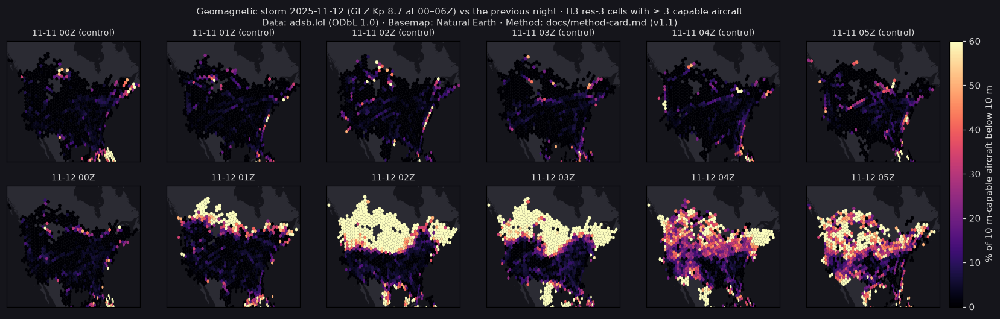
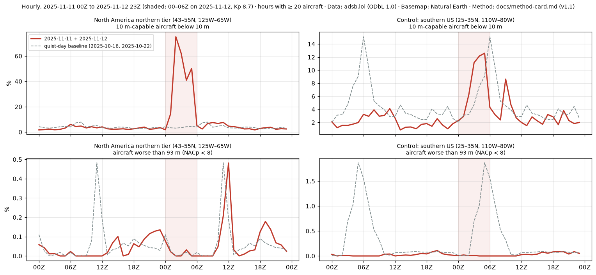
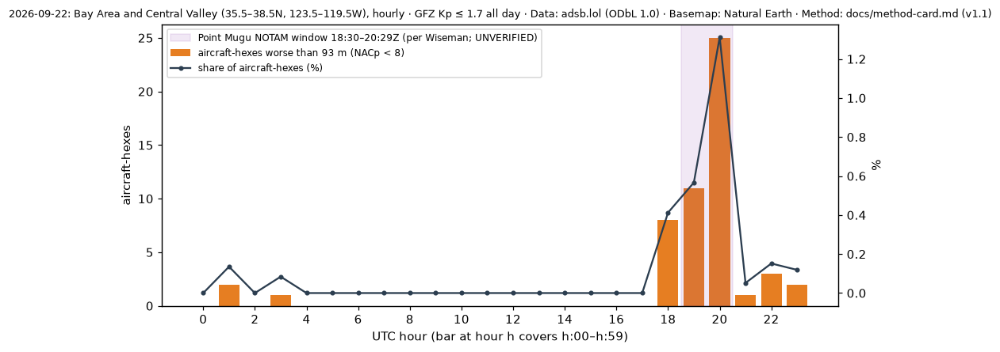

# Event case studies: generated results

Generated by `tools/validate_cases.py`. Narrative and verdicts: `phase1.md` (Phase 1.1 section).

## A. Geomagnetic storm, 11–12 Nov 2025 (GFZ Kp 8.7 at 00–06Z on 12 Nov)

Storm window 00–06Z on 12 Nov, against the same hours on the quiet-day baseline (16 and 22 Oct 2025).

| Region | Capable below 10 m, storm % | Baseline % | Worse than 93 m, storm % | Baseline % |
|---|---|---|---|---|
| North America northern tier (43–55N, 125W–65W) | 38.5 | 3.7 | 0.03 | 0.04 |
| Control: southern US (25–35N, 110W–80W) | 6.1 | 3.6 | 0.01 | 0.23 |

## B. Bay Area GPS loss, 22 Sep 2026 (GFZ Kp ≤ 1.7 all day)

| UTC hour | Aircraft-hexes | Worse than 93 m | Share % | Capable below 10 m % |
|---|---|---|---|---|
| 14 | 1007 | 0 | 0.0 | 3.4 |
| 15 | 1378 | 0 | 0.0 | 3.1 |
| 16 | 1484 | 0 | 0.0 | 2.0 |
| 17 | 1667 | 0 | 0.0 | 4.5 |
| 18 | 1940 | 8 | 0.4 | 4.8 |
| 19 | 1942 | 11 | 0.6 | 3.6 |
| 20 | 1906 | 25 | 1.3 | 7.8 |
| 21 | 1935 | 1 | 0.1 | 3.4 |
| 22 | 1979 | 3 | 0.2 | 2.3 |
| 23 | 1684 | 2 | 0.1 | 1.5 |

