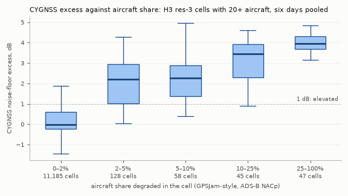
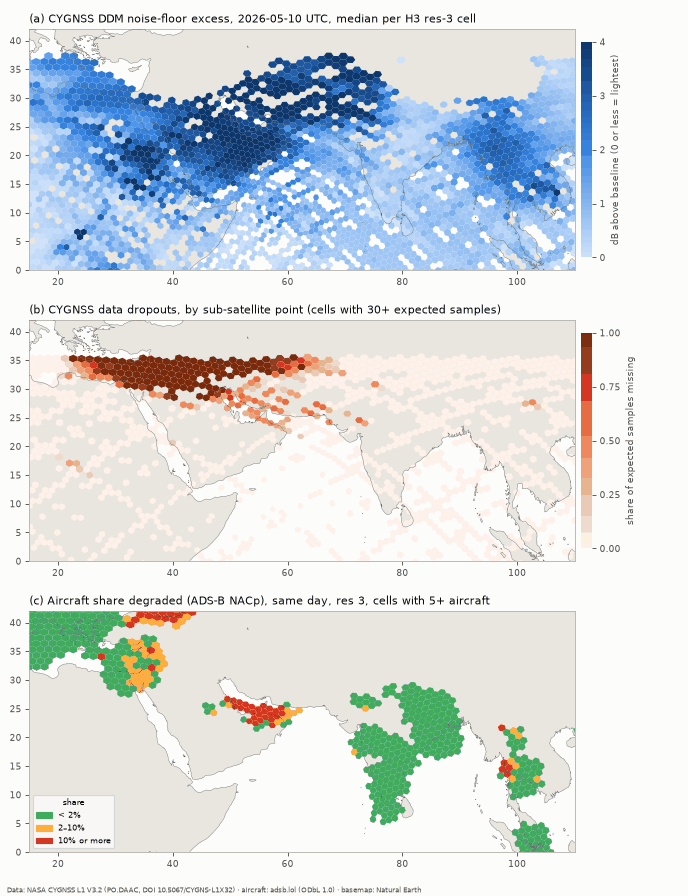
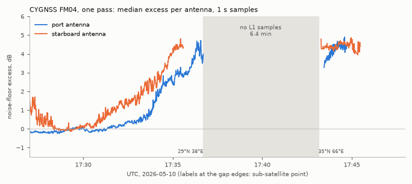

# CYGNSS noise-floor lane: first validation (23 Oct 2026)

**Lane:** spaceborne (planned, Phase 7). **Tool:** `tools/cygnss_rfi.py`, tests in `tests/test_cygnss_rfi.py`.
**Data:** NASA CYGNSS Level 1 Science Data Record V3.2 (PO.DAAC), six UTC days: 2 Jan, 24 Feb, 9, 10 and 16 May, and 19 Oct 2026.
**Reference:** the project's aircraft map, H3 res-4 daily tables in `data/pnt/year/<day>.parquet`, aggregated to res 3.
**Held-out test (24 Oct 2026):** 21 more days chosen by a date rule, with the rules pre-registered in section 8 before any was fetched; results in section 9. Same-hour and FAA-test checks are in sections 9.5 and 9.6.

## Bottom line

- **A full year (section 10): 383 days, AUC 0.974 over 746,753 paired cell-days, 97.7% of jammed cells caught at 1 dB.**
  The March 2026 Gulf surge shows in both sensors; afterwards CYGNSS fades more slowly than the aircraft share.
- **Held-out test (section 9): the method holds on 21 unseen days.**
  - Pooled AUC 0.974 (224 jammed, 39,713 clean cells), 98.7% hit and 15.8% false alarms at 1 dB, 0.7% of control cell-days raised.
  - With each region left out in turn the AUC stays at 0.959 or above.
  - The events lane's rule S3 stays well above chance: 58% of 93 m observations against 21% of random land points.
  - **Same hour:** the 2 Jan Punjab misses are explained: aircraft there were degraded only at night (17–23 UTC), and CYGNSS passed in daytime. Same-hour pairing explains almost none of the false alarms and doesn't beat daily pairing elsewhere.
  - **Announced US tests:** not shown in aggregate (AUC 0.57, below the pre-set 0.70). When CYGNSS does see a test (White Sands, Fort Polk, China Lake), the on/off timing matches the published windows. Most windows show nothing.
  - The Persian Gulf onset in spring matches the aircraft, but CYGNSS stays raised from late June to October while the aircraft read clean. The "tracks change" bullet below is weaker than it reads.
- **CYGNSS sees GNSS interference from orbit, and the aircraft map agrees where both can look.**
  - Indicator: the DDM noise floor (power in the delay rows ahead of any surface reflection), normalised by instrument gain and compared with a same-day baseline for the same spacecraft, antenna and land/sea mix.
  - Over 11,463 cell-days with 20+ aircraft, the indicator separates aircraft-jammed cells (share ≥ 10%, n = 92) from aircraft-clean cells (share < 2%, n = 11,185) with **AUC 0.98**.
  - At a 1 dB threshold, chosen before the comparison, it catches **98% of the jammed cells**.
  - The median excess rises with aircraft share: −0.03 dB (< 2%), 2.2 dB (2–5%), 2.3 dB (5–10%), 3.5 dB (10–25%), 4.0 dB (≥ 25%).
- **It tracks change as well as place.**
  - In the Persian Gulf, aircraft share went from 0.5% (Jan, Feb) to 39–53% (May) and back to 2.4% (Oct).
  - CYGNSS went 1.9–2.0 dB → 3.6–4.2 dB → 3.5 dB over the same days: the same order on all six days.
- **Quiet controls stay quiet.**
  - 0.8% of 11,751 control cell-days read ≥ 1 dB (central Pacific, South Atlantic, interior Brazil, Australia, southern Africa).
  - Box medians run from −0.26 to +0.46 dB.
- **"False alarms" against aircraft are mostly not random.**
  - 16% of aircraft-clean cells read ≥ 1 dB, but most lie inside or near regions with published interference reports, where antenna smear and spoofing (which need not degrade NACp) are expected.
  - More than 2,000 km from those regions, the rate is **3.2%** (1.6% below 33° latitude), and most of the rest is over Japan, Korea and eastern China. Maritime advisories describe GNSS interference there; this is unverified for our days.
- **CYGNSS loses data inside the strongest interference.**
  - Every spacecraft has multi-minute gaps in the L1 series over Iraq, Iran and the Levant: up to 13 minutes per pass on 10 May, typically 1–4 minutes (at most 7) in January and February.
  - Counted as their own indicator, the dropouts are specific (1.7% false alarms at half the samples missing) but cover few cells.
  - The cause isn't confirmed. The spacecraft losing its own GPS fix is the likely candidate.
- **What CYGNSS adds:**
  - It covers the open sea and closed airspace: the Red Sea, Arabian Sea, Gulf of Oman, Iraq, Iran, Myanmar and Sudan.
  - About 80% of the cells it flags have no aircraft coverage, and a third of those are over water.
- **Limits:**
  - Location is coarse. The noise enters through an antenna beam a few hundred km wide, plus sidelobes, so one emitter lights up a region.
  - The validation positives come from four regions. Three-quarters of the 92 aircraft-jammed cells are in the Gulf, Gulf of Oman and UAE.
  - The sample is six days.
- **Next:**
  - Same-hour comparison against the hourly aircraft tables.
  - A test against a known emitter: an announced US test, or the Shiraz case already used in the NISAR lane.
  - A daily run.

## 1. Data and access

| Item | Value |
|---|---|
| Product | CYGNSS Level 1 Science Data Record **V3.2**, `CYGNSS_L1_V3.2`, CMR collection C2832195379-POCLOUD, DOI 10.5067/CYGNS-L1X32. Latest L1 science version in CMR on 23 Oct 2026. No RFI-specific or noise-floor product exists. |
| Licence | NASA open data. ESDIS treats data from NASA-led missions as CC0. Citation expected (registry id `cygnss-l1`). |
| Granules | One file per spacecraft per UTC day, about 1.1 GB each. Seven spacecraft files per day (cyg01–05, 07, 08) for the January–May days; six on 19 Oct (no cyg02). The days 20–21 Oct had 5 and 4 files on 23 Oct, still arriving. |
| Access | NASA cloud OPeNDAP (Hyrax, DAP4). The tool asks for 10 variables and every 2nd sample (1 Hz): about 5–6 MB per spacecraft-day, **205 MB for all six days** (data/cygnss/l1/, gitignored). Earthdata Login bearer token from the `EARTHDATA_TOKEN` environment variable, sent only in the request header. |
| Variables | `ddm_noise_floor`, `inst_gain`, `sp_lat`, `sp_lon`, `ddm_ant`, `quality_flags`, `quality_flags_2` (per DDM); `ddm_timestamp_utc`, `sc_lat`, `sc_lon` (per sample). |
| Land mask | Natural Earth 50 m land v5.1.2 (public domain), already cached by the project. |

## 2. Method

**Physics.**

- Each CYGNSS receiver correlates the signal from its nadir antenna with four GPS C/A codes every 0.5 s and writes four delay-Doppler maps.
- Surface reflections can only arrive at or after the specular delay. So the rows ahead of it carry no surface signal, only what the antenna hears that doesn't correlate with the code: scene brightness, receiver noise, background GPS energy and any interference.
- The L1 field `ddm_noise_floor` is the mean raw count over the first 45 of the 128 delay rows (netCDF comment).
- A jammer's power, spread by the correlation, raises that mean: across the whole map for wideband signals, along a Doppler stripe for narrowband ones.
- Chew, Roberts & Lowe (2023) mapped RFI hotspots worldwide from this quantity. Shin & Son (2026) built an epoch detector from the four channel values and validated it at White Sands against NOTAMs and ADS-B.

**Indicator, step by step.**

1. **Gain.** x = 10 log10(`ddm_noise_floor` / `inst_gain`). `inst_gain` (count/W, from the on-board black-body calibration) removes gain drift with LNA temperature. Gain settings were fixed at 33 dB on the spacecraft-day checked (FM04, 10 May); other spacecraft and days weren't checked.
2. **Baseline.** That day's median of x for the same spacecraft, same antenna (port or starboard) and same decile of footprint land fraction.
   - The land fraction is the Natural Earth mask at 0.25°, smoothed with a 1.5° Gaussian, roughly the main beam on the ground.
   - **Land footprints read 0.9–1.4 dB below open ocean.** The probable cause, background GPS energy scattered by the sea (Gleason et al. 2020 describe a variable background component), is unverified. Without this term, every continent looks quiet and every ocean noisy.
   - Large interference areas are kept out of their own reference: res-2 cells with a median excess of 1 dB or more (7–9% of DDMs each day) are dropped and the baseline recomputed, three passes.
3. **Excess** = x − baseline (dB). Per H3 res-3 cell (about 12,000 km²) the tool keeps:
   - the median excess, its 90th percentile, and the shares of DDMs ≥ 1 dB and ≥ 2 dB;
   - the shares carrying the product's own `rfi_detected` (kurtosis) and `poor_quality_bin_ratio` flags;
   - the number of separate overpasses.
   - Cells need 20+ DDMs to be judged; the median cell has about 70 from 5 passes.
4. **Excluded DDMs:**
   - black-body, idle, test-pattern, reconfigured or bad-attitude samples, and samples with the direct signal in the map;
   - `noise_floor_cal_error` (signal in the top rows, which is common over high terrain such as Tibet);
   - **wrong-antenna and sidelobe specular points.** The noise belongs to the antenna beam, not to the point (section 4).
5. **Dropouts.**
   - Multi-sample gaps in the 1 Hz series of each spacecraft are filled with interpolated sub-satellite positions, for gaps up to 15 minutes.
   - dropout = missing / (present + missing) per cell, by sub-satellite point, for cells with 30+ expected samples.
6. **Calls.** A cell is *elevated* at a median excess ≥ 1 dB (26% more noise power; fixed in advance). It *drops out* when half its expected samples are missing. It is *affected* if either holds.

**Comparison with aircraft.**

- Per res-3 cell, the aircraft share is the GPSJam-style sum over its res-4 children: Σ max(bad − 1, 0) / Σ aircraft, using `bad_nacp_live`.
- Cells with 20+ aircraft are paired. *Jammed*: share ≥ 10%. *Clean*: share < 2%.
- Metrics:
  - AUC: the chance a jammed cell scores above a clean one;
  - hit and false-alarm rates at fixed thresholds;
  - Spearman rank correlation, worldwide and over 0–42°N, 20–110°E;
  - fixed region boxes: nine with published interference reports, five quiet controls (coordinates in the tool).
- The boxes were set before the comparison and were not changed afterwards.

## 3. Results

### 3.1 Against the aircraft map, cell by cell (H3 res 3)

| Day (UTC) | Spacecraft | DDMs used | Paired cells | Jammed cells | AUC | Hit @ 1 dB | False alarm @ 1 dB | Spearman ρ (world / ME–Asia) | Samples missing |
|---|---|---|---|---|---|---|---|---|---|
| 2 Jan | 7 | 2,076,751 | 2,001 | 5 | 0.84 | 60% | 17.7% | 0.30 / 0.18 | 0.42% |
| 24 Feb | 7 | 1,967,236 | 2,014 | 1 | 0.96 | 100% | 15.6% | 0.17 / 0.14 | 0.37% |
| 9 May | 7 | 1,730,960 | 1,772 | 20 | 0.99 | 100% | 13.7% | 0.30 / 0.46 | 2.00% |
| 10 May | 7 | 1,734,512 | 1,767 | 24 | 0.99 | 100% | 13.9% | 0.32 / 0.50 | 2.20% |
| 16 May | 7 | 1,952,084 | 1,855 | 33 | 0.99 | 100% | 16.1% | 0.32 / 0.52 | 1.69% |
| 19 Oct | 6 | 1,678,564 | 2,054 | 9 | 0.98 | 100% | 17.5% | 0.31 / 0.38 | 0.88% |
| **Pooled** | | | **11,463** | **92** | **0.984** | **97.8%** | **15.9%** | **0.28 / 0.36** | |

Every ρ has p < 0.005. Pooled thresholds: 0.5 dB catches 100% with 28% false alarms; 1.5 dB, 96% and 8.3%; 2 dB, 91% and 5.1%. At res 2 (sensitivity check) the pooled AUC is 0.983, hit and false alarm at 1 dB are 97% and 15%, and ρ is 0.37 / 0.47.



**Where the positives come from.**

- The 92 jammed cell-days:
  - 69 in the Gulf, Gulf of Oman and UAE;
  - 12 on the Myanmar–Thailand border;
  - 7 on the India–Pakistan border (all on 2 Jan and 19 Oct);
  - 4 in the Levant.
- So the AUC rests on four regions, mostly one, and repeated days aren't independent.
- **The misses.** The two misses at 1 dB and the two weakest hits are all on 2 Jan in Pakistan: Punjab near Lahore and the border, and near Islamabad (aircraft share 11–37%). CYGNSS read only 0.8–1.2 dB there. A time-of-day mismatch is possible: the aircraft share covers the whole day, CYGNSS a few passes.

### 3.2 Regions with published interference reports, and quiet controls

Median excess of the cells in each box (dB), per day: 2 Jan, 24 Feb, 9 May, 10 May, 16 May, 19 Oct.

| Box | CYGNSS median excess | Cells ≥ 1 dB | Dropout ≥ 50% (share of cells) | Aircraft share (GPSJam-style) |
|---|---|---|---|---|
| Levant | 3.5, 3.6, 2.8, –, 3.4, 3.5 | 100% every day | 0.12, 0, 0.94, 1.00, 0.85, 0.54 | 1.3, 0.0, 13.7, 6.0, 11.1, 3.0% |
| Egypt / Sinai / Suez | 3.2, 3.2, 2.5, 2.5, 3.1, 3.1 | 100% | 0–0.40 | 0.0–3.8% |
| Iraq | 3.8, 3.7, 3.5, 3.5, 3.9, 3.6 | 100% | 0.20, 0.11, 0.97, 1.00, 0.94, 0.58 | almost no aircraft |
| Persian Gulf | 1.9, 2.0, 3.6, 3.8, 4.2, 3.5 | 88–100% | 0, 0, 0.36, 0.35, 0.09, 0 | 0.5, 0.5, 39.4, 47.2, 53.2, 2.4% |
| Iran (interior) | 3.2, 3.2, 2.7, 3.9, 3.8, 3.2 | 100% | 0.17–0.91 | no aircraft |
| Red Sea | 1.7, 1.1, 2.8, 2.7, 2.5, 2.2 | 54–100% | ~0 | almost no aircraft |
| India–Pakistan border | 0.8, 0.4, 3.7, 3.3, 3.0, 2.5 | 3–100% | ~0 | 5.4, 2.4, 0.0, 0.1, 0.1, 2.0% |
| Myanmar | 2.7, 2.7, 2.6, 2.5, 2.8, 2.8 | 100% | 0 | 0.0–2.3% (few aircraft) |
| South China Sea | 0.9, 0.8, 0.7, 0.7, 0.6, 0.7 | 17–41% | 0 | 0.0–0.2% |
| *Central Pacific* (control) | −0.04 to 0.10 | 0–2% | 0 | – |
| *South Atlantic* (control) | −0.10 to 0.00 | 0% | 0 | – |
| *Brazil interior* (control) | −0.26 to −0.23 | 0% | 0–0.07 | 0.0% |
| *Australia interior* (control) | −0.01 to 0.46 | 0–10% | 0 | 0.0% |
| *Southern Africa interior* (control) | −0.12 to −0.06 | 0–1% | 0 | 0.0% |

- **Box-days elevated:** 46 of 54 (8 of the 9 boxes on every day). The exceptions are the South China Sea (median 0.6–0.9 dB, never ≥ 1) and the India–Pakistan border on 2 Jan and 24 Feb.
- **The Levant on 10 May** has no cells with 20+ DDMs: the whole box dropped out.
- **Persian Gulf:** the six-day ordering matches the aircraft ordering exactly (n = 6, so this is illustrative, not a test).
- **India–Pakistan border: the two maps disagree in time.**
  - The aircraft see more in Jan/Feb; CYGNSS sees much more in May (3.0–3.7 dB) and Oct.
  - The number of aircraft in the box fell from 4,126 (2 Jan) to 1,173–1,346 on the May days. We haven't checked for airspace restrictions.



The 2 Jan map for comparison: [img/cygnss_2026-01-02_r3.png](img/cygnss_2026-01-02_r3.png). Whole band: [10 May](img/cygnss_world_2026-05-10_r3.png), [2 Jan](img/cygnss_world_2026-01-02_r3.png).

### 3.3 Dropouts: no data where interference is strongest

- **Scale and pattern.**
  - Each spacecraft's 1 Hz series has multi-minute holes on the passes over Iraq, Iran and the Levant, near the northern turning latitude.
  - On 10 May the seven spacecraft lost 2.2% of their day.
  - The holes began over the eastern Mediterranean or Egypt (20–38°E) and ended over Iran, Pakistan or India (45–77°E).
  - Elsewhere, gaps are rare and short.
- **On a single pass (figure below).** FM04, 10 May, 17:28–17:46 UTC (12:28–12:46 CDT):
  - the noise floor climbs on both antennas to +4 to +4.5 dB;
  - then the series stops for 6.4 minutes, from 29°N 38°E to 35°N 66°E;
  - it resumes still at +4.5 dB.
  - The line ends at 17:45 because the DDMs over Tibet fail `noise_floor_cal_error`.
- **What it means for the noise metric.** The hole is the core of the interference, so the noise floor is censored from above there. The core cells' 3.5–4 dB probably understates the true level.
- **Cause, unconfirmed.** It looks like the satellite losing its own GPS fix: the L1 processing needs a navigation solution. Data withheld on purpose would look the same. Radio-occultation receivers show a similar data void over the region (GPS World, March 2024; secondary, not read in full).
- **As an indicator:**
  - AUC 0.78; at ≥ 50% missing, 44% hit and 1.7% false alarms (39 jammed and 4,646 clean cell-days with enough samples);
  - the dropout cells grow from 17–19 per day (Jan/Feb) to 126–155 (May), the same direction as the aircraft maps.



### 3.4 Where CYGNSS reads high and aircraft read clean

Aircraft-clean cells with ≥ 1 dB, by distance from the nearest box with published reports (pooled, res 3):

| Distance | Clean cells | ≥ 1 dB | ≥ 2 dB |
|---|---|---|---|
| inside a box | 316 | 65.5% | 47.8% |
| < 500 km | 1,008 | 52.0% | 24.4% |
| 500–1,000 km | 923 | 26.1% | 4.6% |
| 1,000–2,000 km | 1,139 | 48.1% | 6.9% |
| > 2,000 km | 7,799 | 3.2% | 0.6% |

- **Eastern Mediterranean, Levant, Jordan, Egypt.**
  - Every aircraft-clean cell reads high, mostly above 2 dB. Examples from 2 Jan:
    - the Jordan–Syria border: 117 aircraft, share 0.0%, +3.9 dB;
    - Turkey's south coast, Antalya to Adana: 214–789 aircraft per cell, share 0–1%, +2.6 to +3.4 dB.
  - Two candidate reasons:
    - The beam and sidelobes reach the Syrian, Iraqi and Israeli emitters.
    - Spoofing is widely reported here (EASA SIB 2022-02R3), and a spoofed receiver can report good NACp, so the aircraft share can stay low while the RF environment is far from clean.
- **Gulf of Oman, Strait of Hormuz, Arabian Sea, Bay of Bengal.**
  - These read 1–2 dB with clean aircraft cells.
  - Maritime advisories name the Arabian Sea, Gulf of Oman and Hormuz (Marshall Islands Maritime Administrator, YSA 05-25, Oct 2025; MARAD 2019-012).
  - Smear from inland sources is the other candidate.
- **Japan, Korea, eastern China, the Taiwan Strait.**
  - These read 1–1.5 dB (rarely 2) on most days, with aircraft clean.
  - The same advisory reports interference in the East and South China Seas, the Yellow Sea, the Taiwan Strait and near the Korean Peninsula.
  - Not verified for our days.
- **Northern Mexico, 9–10 May (a lead, unverified).**
  - 20–22 of 25 cells in Sinaloa, Durango and Chihuahua read ≥ 1 dB (median +2 dB), on many passes from 03 to 12 UTC and on both antennas. That rules out the single-antenna artifact found in section 4.
  - The box read 0.2–0.5 dB on 2 Jan and 24 Feb, and about 0 on 16 May and 19 Oct.
  - Only about 300 aircraft cross it, all clean.
- **Quiet-ocean structure.**
  - Open oceans away from all boxes show a residual ±0.3–0.5 dB pattern: −0.5 dB toward ±36–40° in the eastern Pacific and Atlantic, +0.3 dB in the western Pacific.
  - The rise in the northern Indian Ocean toward the Arabian Sea and Bay of Bengal (+1 dB at 12–24°N) is larger and points at the sources around it.
  - The 1 dB threshold is two to three times the quiet structure.

### 3.5 What CYGNSS sees that aircraft can't

- **Scale.** Each day, 1,546–2,043 CYGNSS-affected cells have fewer than 5 aircraft, out of 1,940–2,465 affected cells in all. That is about 80%; 558–704 of them are mostly water.
- **The largest groups:**
  - the Red Sea (75–133 cells a day);
  - Iran and Iraq (closed or empty airspace);
  - Myanmar;
  - Sudan, South Sudan, Eritrea, Ethiopia and the Horn of Africa;
  - Yemen and Somalia, the Arabian Sea and Gulf of Oman;
  - Afghanistan and western Pakistan;
  - the seas around Taiwan and Okinawa.
- **Caveat.** "Seen over the sea" is not "emitter at sea": a coastal or inland source lights up the water within reach of the beam.
- **Inland water.** Chew et al. (2023) caution that calm inland water can mimic hotspots.
  - One spot check on 10 May (FM04, Sudan and South Sudan, 0–10°N 20–40°E, +1.1 dB) showed excess *anti*-correlated with reflected signal strength (`ddm_snr`, Pearson r = −0.25).
  - That points to external noise, not reflection, but it is a single check.
  - Ethiopia's highlands read 0.4–1.4 dB on the four days checked. Chew et al. reported a Tigray hotspot from 2020–2022.

### 3.6 Other indicators on the same cells (pooled AUC, jammed vs clean)

| Indicator | AUC | Note |
|---|---|---|
| Noise-floor excess (this lane) | **0.984** | 1 dB: 98% hit, 16% false alarm |
| Share of DDMs with the product's `poor_quality_bin_ratio` flag | 0.949 | ADC bit-count ratio; nearly as good, and needs no baseline |
| Change against the cell's own median on the other days | 0.815 | 1 dB: 54% hit, **1.5%** false alarm. Finds new interference and misses persistent interference. |
| Dropout share | 0.782 | Few cells, very specific |
| Share with the product's `rfi_detected` (kurtosis) flag | 0.711 | Weakest, as Chew et al. 2023 and Shin & Son 2026 found |

## 4. Mistake found and fixed during the work

The first run kept DDMs flagged `incorrect_ddmi_antenna_selection`, because the flag is far more frequent in the Gulf (36%) and Levant (88%) than worldwide (16%), and dropping it looked like dropping signal. That was wrong. The flag is frequent there because those regions sit near the ±35° turning latitude, not because of interference. On 9 May the starboard antenna, looking south from about 35°N, logged specular points at 36–40°N over Nevada, Colorado and Kansas (97–99% flagged) at +2 dB while the port antenna on the same passes read −0.2 dB. Aircraft over those states were clean. The noise belongs to the beam, so a point outside it puts the noise in the wrong place. The tool now drops wrong-antenna and sidelobe points (`sp_in_sidelobe`), about 24% of DDMs. The western-US "hotspots" vanished, and the false-alarm rate against aircraft fell from 18.5% to 15.9% with the hit rate unchanged.

## 5. Limits

- **Coarse location.**
  - The antenna beam spans a few hundred km on the ground. A strong source is also heard in the sidelobes out to the radio horizon (about 2,500 km from 520 km altitude).
  - Gridding by specular point (main-lobe points only) spreads one emitter over a region.
  - The maps say where receivers in orbit were exposed, not where a transmitter is.
- **Censoring in the core.** Dropouts remove the strongest-interference samples, so core cells are biased low, and some (the Levant on 10 May) have no noise value at all.
- **Few independent positives.** 92 jammed cell-days from four regions, three-quarters in one. The AUC would not survive a region-held-out test on this sample. Controls and far-field rates are the stronger evidence of specificity.
- **Different clocks.**
  - Aircraft share is a whole-day aggregate weighted by traffic; CYGNSS is a handful of passes at fixed times on each day.
  - Intermittent jammers will disagree for that reason alone.
  - The hourly aircraft tables exist but weren't used yet.
- **The aircraft reference is imperfect.** NACp responds to jamming more reliably than to spoofing, and coverage is thin exactly where interference is heaviest.
- **Baseline residue.**
  - About ±0.4 dB of latitude and ocean-basin structure remains in quiet areas.
  - The land/ocean offset is empirical and its cause unverified.
  - Wet soil and inland water could raise weak land signals. Not tested.
- **Coverage gaps.**
  - Nothing poleward of about ±38°: no Baltic, Black Sea, Caucasus or Kaliningrad.
  - High terrain such as Tibet is masked by `noise_floor_cal_error`.
  - Latency: the newest days arrive over several days (5 of 7 files for 20 Oct on 23 Oct).
- **Six days.** One day each in January, February and October, three in May. (Section 9 adds 21 held-out days spread over the year and 12 FAA-test days.)

## 6. Next steps

1. **Same-hour comparison.** Done (section 9.5): it explains the Punjab misses, not the false alarms.
2. **Known emitters.**
   - FAA-announced GPS tests: done (section 9.6), not shown in aggregate. A better test would model emitter reach (Yuma hears White Sands at 750 km) and use only windows with reported effects.
   - Score it against the Shiraz case from the NISAR lane, using days when the jammer was reported on and off.
3. **Localisation.** Fit an emitter position from the antenna gain pattern and pass geometry (beam-weighted back-projection) instead of gridding by point, as Chew et al. did with boresight positions.
4. **Dropouts.** Find the cause (CYGNSS team, data notes), and check whether the zenith navigation signal (`zenith_sig_i2q2`) collapses before each gap.
5. **Region-held-out test.** Done (section 9.3): lowest leave-one-out AUC 0.959.
6. **Daily run.** CMR search and subset fetch are cheap (about 36 MB a day). Output would go to the site only after Tom's review, with the CYGNSS citation and the location caveat on the map.
7. **Registry.** `registry/sources.csv` row `cygnss-l1` still says "later". Update it when the lane is adopted.

## 7. Reproduce

```
python tools/cygnss_rfi.py fetch 2026-01-02 2026-02-24 2026-05-09 2026-05-10 2026-05-16 2026-10-19   # needs EARTHDATA_TOKEN
python tools/cygnss_rfi.py grid 2026-01-02 2026-02-24 2026-05-09 2026-05-10 2026-05-16 2026-10-19
python tools/cygnss_rfi.py validate 2026-01-02 2026-02-24 2026-05-09 2026-05-10 2026-05-16 2026-10-19 --figures --map-days 2026-05-10 2026-01-02
python tools/cygnss_rfi.py grid --res 2 <same days> && python tools/cygnss_rfi.py validate --res 2 <same days>
python tools/cygnss_rfi.py pass 2026-05-10 --sc 4 --hours 17.45 17.80
python tests/test_cygnss_rfi.py
```

Held-out run (sections 8–9), with HELDOUT = the 21 days of section 8.1, ALL27 = those plus the six, ALL39 = those plus the 12 FAA days:

```
python tools/cygnss_rfi.py fetch $ALL39 && python tools/cygnss_rfi.py grid $ALL39     # grid also writes <day>.r3.passes.parquet
python tools/cygnss_checks.py heldout $HELDOUT --tag heldout                           # checks 1-5 -> data/cygnss/heldout_heldout_r3.json
python tools/events.py build --all
python tools/cygnss_checks.py s3 $HELDOUT --tag heldout                                # check 6 -> data/cygnss/s3_heldout.json
python tools/cygnss_checks.py samehour $ALL27                                          # -> data/cygnss/samehour_r3.json
python tools/cygnss_checks.py faa $ALL39                                               # -> data/cygnss/faa_r3.json
```

Outputs: `data/cygnss/grid/<day>.r3.parquet` (per cell: n, passes, med_db, p90_db, frac1, frac2, rfi_flag, bin_flag, land, sub_present, sub_missing, dropout) and `data/cygnss/validation_r3.json`. Since 24 Oct, `grid` also writes `<day>.r3.passes.parquet` (per cell and pass: h3, sc, bucket, t_mid, n, med_db). All under the gitignored `data/`. Runtime needs numpy, scipy, h5py, requests and h3 (all in `nisar/requirements.txt`), plus pyarrow and matplotlib (`requirements.txt`). The tests need numpy, scipy and h3; the land-mask test also needs matplotlib and skips without it.

## 8. Held-out test: pre-registration (written 24 Oct 2026, 06:50 UTC, before any new day was fetched)

Everything in this section was fixed before any CYGNSS data for the new days was downloaded. Results go in section 9 and do not change this section.

### 8.1 Days, by a date rule

- **Rule:** every 19th day from 1 Oct 2025 (k = 0 … 20), up to 20 Oct 2026. Nineteen is prime to seven, so the weekday rotates.
- **The 21 days:** 2025-10-01, 10-20, 11-08, 11-27, 12-16; 2026-01-04, 01-23, 02-11, 03-02, 03-21, 04-09, 04-28, 05-17, 06-05, 06-24, 07-13, 08-01, 08-20, 09-08, 09-27, 10-16.
- None is one of the six in-sample days, and every one has an aircraft table (checked against `data/pnt/year/`).
- A day with fewer than four spacecraft files in CMR is skipped and reported, not replaced.

### 8.2 Frozen method

- `tools/cygnss_rfi.py` as committed in 91dcebc: stride 2 (1 Hz), the same quality-flag exclusions, the spacecraft × antenna × land-decile baseline with three passes leaving out res-2 cells at ≥ 1 dB, H3 res 3, 20+ DDMs per judged cell.
- Calls and pairing unchanged: elevated at a median excess ≥ **1 dB**; aircraft pairing at 20+ aircraft per res-3 cell; jammed ≥ 10%, clean < 2% (GPSJam-style, `bad_nacp_live`).
- Code added for sections 8.4 and 8.5 (a per-pass table) must not change any cell value. The six in-sample grids will be rebuilt and compared to confirm that.
- If a bug turns up, the frozen-method result is reported first and any fixed result beside it.

### 8.3 Checks on the 21 days, with pass marks

| # | Check | In-sample (six days) | Holds if | Fails if |
|---|---|---|---|---|
| 1 | Pooled AUC, jammed vs clean cells | 0.984 | ≥ 0.90 | < 0.80 |
| 2 | Hit rate at 1 dB | 97.8% | ≥ 85% | < 70% |
| 3 | False-alarm rate at 1 dB | 15.9% | ≤ 20% | > 30% |
| 4 | Control boxes: share of cell-days (20+ DDMs) at ≥ 1 dB | 0.8% | ≤ 2% | > 5% |
| 5 | Region-held-out AUC (every region left out in turn) | not possible on six days | every value ≥ 0.85 | any value < 0.75 |
| 6 | Events rule S3: 93 m observations vs random land points (below) | 64% vs 22% | 93 m share ≥ 2 × random share, and the Wilson 95% intervals don't overlap | 93 m share < 1.5 × random share |

Between the two marks the result is "weakened". Each control box's median is also reported per day; any box-day above +0.5 dB is flagged.

**Regions for check 5.**

- A region is a single-linkage cluster of the jammed cell-days (21 days pooled), linking cell centres within 1,000 km.
- Leaving a region out removes every paired cell (jammed or clean) within 1,000 km of any of its jammed cells, then recomputes the pooled AUC.
- A leave-one-out value is judged only when 10 or more jammed cells remain.
- Also reported, without a pass mark: each region's own AUC (its jammed cells against all clean cells), and the same test on all 27 days (six plus 21).

**Rule S3 for check 6** (events lane, `tools/events.py`, not changed).

- Rebuild the register with the new grids (`tools/events.py build --all`).
- **93 m observations:** ADS-B observations on the 93 m measure (93 m anomalies, bursts, level regions) at |lat| ≤ 38° on the 21 days. The statistic is the share whose judged CYGNSS cells within 300 km have a median excess ≥ 1 dB (the register's `cyg_local_med`, as the rule uses it). This definition reproduces the in-sample 386 observations and 64.0% exactly.
- **Random land points:** 400 per day, uniform by area within ±38°, kept if the 0.25° Natural Earth land mask (unsmoothed) says land. The seed is the date as an integer (20251001 …). Each point is scored as a one-region observation at its res-2 cell, with the events lane's own `local_cygnss`.
- The same sampler is run on the six in-sample days, as a calibration against the published 22%.
- Also reported, without a pass mark: "any raised cell within 300 km" for both groups, and 10 m observations (expected near the random-land rate).

### 8.4 Same-hour comparison (next step 1)

- **Pass-cell values:** per res-3 cell and pass (spacecraft and 10-minute bucket, as the tool already counts passes), the median excess of that pass's DDMs in the cell, with 5+ DDMs. The pass hour is the UTC hour of the DDMs' mean time.
- **Same-hour aircraft share:** the same res-3 cell and UTC hour from `data/pnt/year/<day>.hourly.parquet`, GPSJam-style over the res-4 children with `bad_nacp_live`, exactly as the daily share. Cell-hours need 10+ aircraft. Jammed ≥ 10%, clean < 2%.
- **Days:** all 27 (the six in-sample days are needed for question a).
- **Questions and what counts as an answer:**
  - (a) **2 Jan Punjab and Islamabad.** For the two misses and two weakest hits, compare the aircraft share in the CYGNSS pass hours with the day's share. The misses are explained if the pass-hour share is below 10% while the day's share is 10% or more.
  - (b) **False alarms.** Among aircraft-clean cell-days (daily share < 2%) that read ≥ 1 dB, count the share with at least one pass hour at ≥ 2% aircraft share. Compare with clean cell-days that read < 1 dB. "Part explained" if the first rate is at least twice the second.
  - (c) **Pass-level scoring.** AUC of the pass-cell excess against same-hour labels, and against daily labels on the same pass-cells. Same-hour pairing counts as better if the AUC rises by 0.02 or more, or the false-alarm rate at 1 dB falls by 2 points or more.

### 8.5 Known emitters: FAA-announced GPS tests (next step 2)

- **Tests:** `data/declared/faa_gps_tests.json` (updated 22 Oct 2026), centres at |lat| ≤ 38°, windows as published (UTC).
- **Sites:** test centres within 100 km of each other form one site (single linkage). The site centre is the mean, and its windows are the union of its tests' windows.
- **Days:** the 27 above, plus 12 chosen from the FAA file alone. These are the days in the period with the most announced window time summed over band tests, excluding the 27, ties to the earlier day: 2026-05-14, 09-15, 09-19, 09-21, 10-14, 10-15, 2025-10-07, 2026-04-22, 05-12, 05-13, 04-23, 09-16. If downloads approach the 2 GB budget, days are dropped from the end of this list.
- **Unit:** one spacecraft pass near one site, meaning that spacecraft's DDMs with specular points within 300 km of the site centre, split where the gap exceeds 10 minutes. A pass needs 10+ DDMs. Its score is the median excess under the frozen baseline.
- **In-window:** the pass's mean time is inside one of the site's windows.
- **Out-of-window:** the pass's mean time is more than 60 minutes from every window of every site within 600 km. Passes near a window edge, or inside a nearby site's window, are left out.
- **Comparison:** in-window against out-of-window passes, using only the processed days. Reported: AUC, the share ≥ 1 dB, medians, a one-sided Mann–Whitney p and a one-sided Fisher p at 1 dB, overall and per site. A pass near two sites counts for each; unique passes are also reported.
- **Call:** "detected" if there are 10+ in-window passes, AUC ≥ 0.70 and Mann–Whitney p < 0.01. Otherwise "not shown".
- **Why a null would be weak:** announced windows are maximum windows, so jammers may be on for only part of them. Test emitters are low-power and may be directional. Shin & Son (2026) detected White Sands with a probability of detection of 0.595 using their own detector.

## 9. Held-out results (24 Oct 2026)

**Data.**

- Fetched from 06:52 UTC on 24 Oct, after section 8 was written: all 21 date-rule days and all 12 FAA days.
- Spacecraft files: seven on most days; six on 2 Mar, 14 Oct and 15 Oct 2026; five on 21 Mar 2026. All are above the minimum of four, so no day was skipped.
- Download: 1.1 GB for the 33 days, about 36 MB a day.
- Frozen-method check: the six in-sample grids, rebuilt with the new per-pass output, are identical to the committed run (Arrow table equality, every cell).
- The home network dropped DNS on and off during the night. The fetch was retried day by day, with a process-local DNS fallback for the download only. No data or code path changed.

**Bottom line.**

- All six pre-registered checks hold.
- The lane separates aircraft-jammed from aircraft-clean cells on unseen days as well as it did in-sample.
- It does so in every region on its own, not only in the Gulf.
- The same-hour comparison explains the 2 Jan Punjab misses: aircraft there were degraded only in the local night, and CYGNSS passed in daytime. It explains almost none of the false alarms.
- **Announced US tests:** the pre-registered call is "not shown", although CYGNSS clearly sees some tests, with the timing of the published windows.

### 9.1 Pass marks

| # | Check | In-sample (six days) | Held-out (21 days) | Mark | Result |
|---|---|---|---|---|---|
| 1 | Pooled AUC, jammed vs clean | 0.984 | **0.974** (224 jammed, 39,713 clean) | ≥ 0.90 | holds |
| 2 | Hit rate at 1 dB | 97.8% | **98.7%** (221 of 224) | ≥ 85% | holds |
| 3 | False-alarm rate at 1 dB | 15.9% | **15.8%** | ≤ 20% | holds |
| 4 | Control-box cell-days at ≥ 1 dB | 0.8% | **0.7%** (308 of 41,650) | ≤ 2% | holds |
| 5 | Region-held-out AUC, lowest value | – | **0.959** (Middle East region left out, 64 jammed cells left) | ≥ 0.85 | holds |
| 6 | Rule S3: 93 m observations vs random land points | 64.0% vs 22.3% | **58.4% vs 20.6%**, ratio 2.83. Wilson 95%: 55.6–61.1% vs 19.7–21.5% | ≥ 2×, no overlap | holds |

- One control box-day passed the +0.5 dB flag: the Australia interior on 11 Feb 2026, at +0.51 dB.
- The random-land sampler gives 22.3% on the six in-sample days, against the published 22%. The 93 m statistic reproduces 247 of 386 (64.0%) exactly.

### 9.2 Day by day (H3 res 3)

| Day (UTC) | Spacecraft | Paired cells | Jammed cells | AUC | Hit @ 1 dB | False alarm @ 1 dB | Spearman ρ (world / ME–Asia) | Samples missing |
|---|---|---|---|---|---|---|---|---|
| 1 Oct 2025 | 7 | 1,950 | 3 | 0.95 | 100% | 16.9% | 0.32 / 0.27 | 0.13% |
| 20 Oct 2025 | 7 | 1,932 | 9 | 0.97 | 100% | 16.9% | 0.29 / 0.23 | 0.58% |
| 8 Nov 2025 | 7 | 2,015 | 6 | 0.92 | 83% | 15.5% | 0.24 / 0.09 | 0.71% |
| 27 Nov 2025 | 7 | 1,934 | 5 | 0.98 | 100% | 14.4% | 0.34 / 0.25 | 0.49% |
| 16 Dec 2025 | 7 | 2,002 | 4 | 0.93 | 100% | 17.4% | 0.34 / 0.29 | 1.24% |
| 4 Jan 2026 | 7 | 1,992 | 6 | 0.88 | 83% | 17.5% | 0.31 / 0.22 | 0.37% |
| 23 Jan 2026 | 7 | 1,761 | 3 | 0.94 | 100% | 16.8% | 0.28 / 0.23 | 1.40% |
| 11 Feb 2026 | 7 | 1,977 | 6 | 0.96 | 100% | 14.4% | 0.30 / 0.33 | 1.94% |
| 2 Mar 2026 | 6 | 1,829 | 18 | 0.99 | 100% | 14.9% | 0.33 / 0.45 | 1.72% |
| 21 Mar 2026 | 5 | 1,633 | 40 | 0.99 | 100% | 16.4% | 0.36 / 0.59 | 1.93% |
| 9 Apr 2026 | 7 | 1,934 | 15 | 0.99 | 100% | 12.5% | 0.36 / 0.55 | 0.84% |
| 28 Apr 2026 | 7 | 1,932 | 12 | 0.97 | 100% | 17.7% | 0.34 / 0.45 | 1.60% |
| 17 May 2026 | 7 | 1,849 | 23 | 0.99 | 100% | 17.0% | 0.29 / 0.49 | 1.62% |
| 5 Jun 2026 | 7 | 1,890 | 37 | 1.00 | 100% | 14.8% | 0.36 / 0.61 | 1.42% |
| 24 Jun 2026 | 7 | 1,814 | 6 | 0.97 | 100% | 10.3% | 0.33 / 0.41 | 1.74% |
| 13 Jul 2026 | 7 | 2,038 | 4 | 0.98 | 100% | 13.0% | 0.40 / 0.50 | 0.69% |
| 1 Aug 2026 | 7 | 1,867 | 8 | 0.96 | 100% | 19.0% | 0.28 / 0.38 | 1.83% |
| 20 Aug 2026 | 7 | 2,083 | 3 | 0.69 | 67% | 19.0% | 0.28 / 0.25 | 1.27% |
| 8 Sep 2026 | 7 | 2,162 | 4 | 0.97 | 100% | 14.5% | 0.36 / 0.42 | 1.16% |
| 27 Sep 2026 | 7 | 2,026 | 4 | 0.98 | 100% | 19.2% | 0.30 / 0.45 | 1.57% |
| 16 Oct 2026 | 7 | 2,112 | 8 | 0.97 | 100% | 13.8% | 0.32 / 0.46 | 1.91% |
| **Pooled** | | **40,732** | **224** | **0.974** | **98.7%** | **15.8%** | **0.32 / 0.37** | |

- **Significance:** every world ρ has p < 10⁻²⁷. Every ME–Asia ρ has p < 10⁻⁵ except 8 Nov 2025 (ρ 0.09, p = 0.08).
- **Other thresholds, pooled** (in-sample in brackets):

  | Threshold | Hit | False alarm |
  |---|---|---|
  | 0.5 dB | 99.6% (100%) | 28.6% (28%) |
  | 1.5 dB | 95.5% (96%) | 8.7% (8.3%) |
  | 2 dB | 89.3% (91%) | 5.8% (5.1%) |

- **Median excess by aircraft share:** −0.02 dB (< 2%), 2.3 dB (2–5%), 2.7 dB (5–10%), 3.0 dB (10–25%), 3.9 dB (≥ 25%).
- **Other indicators, pooled AUC:** `poor_quality_bin_ratio` share 0.955; dropout 0.754; the cell's own-history anomaly 0.738 (1 dB: 46% hit, 1.3% false alarm); `rfi_detected` (kurtosis) 0.647. The same order as in-sample.
- **Months:** jammed cells cluster in March–June 2026 (151 of 224: 58 in March, 27 in April, 23 in May, 43 in June). 20 Aug 2026 has only three, and one of them is the Atlantic miss below.

### 9.3 Where the positives come from, and the region test

**Where.** The 224 jammed cell-days:

- 119 in the Gulf, UAE, Oman and the Gulf of Oman (a few on the Red Sea and in Egypt);
- 47 on the Myanmar–Thailand border;
- 32 in the Levant, northern Egypt, Cyprus and southern Turkey;
- 14 on the India–Pakistan border;
- 6 in Iraq, Kuwait and western Iran, and 3 in interior Iran;
- 2 in eastern India;
- 1 in the Atlantic off Senegal.

**Regions** (single linkage at 1,000 km, as pre-registered):

| Region | Jammed cell-days (days) | Region's own AUC | Pooled AUC with the region left out (jammed cells left) |
|---|---|---|---|
| Middle East: Gulf, Levant, Egypt, Iraq, Iran | 160 (16) | 0.992 | **0.959** (64) |
| Myanmar–Thailand border | 48 (19) | 0.945 | 0.983 (176) |
| India–Pakistan border | 15 (5) | 0.937 | 0.977 (209) |
| Atlantic, 15.4°N 19.6°W | 1 (1) | 0.17 | 0.978 (223) |

- **Linkage.** At 1,000 km the Gulf and the Levant chain into one region.
  - At 500 km (a sensitivity check, not pre-registered) they split: Gulf 113, Levant and Egypt 41. The lowest leave-one-out AUC is still 0.959.
  - On all 27 days (six plus 21; descriptive) there are 316 jammed cells, a pooled AUC of 0.977 and a lowest leave-one-out value of 0.958.
- **Section 5 was too pessimistic.** It said the AUC "would not survive a region-held-out test on this sample". On the held-out days, each region discriminates on its own (own AUC 0.94–0.99).
- **The three misses at 1 dB:**
  - 20 Aug 2026, Atlantic off Senegal (15.4°N 19.6°W): 3 degraded of 21 aircraft; CYGNSS −0.3 dB. Likely a small-sample aircraft artefact. Not checked.
  - 4 Jan 2026, Punjab (30.9°N 73.0°E): 0.62 dB at an aircraft share of 10.6%. This is the same cell as a 2 Jan miss (section 9.5).
  - 8 Nov 2025, Myanmar–Thailand border (13.3°N 97.1°E): 0.96 dB.

### 9.4 Regions with published reports, and the controls

Over the 21 held-out days:

| Box | CYGNSS median excess, range (dB) | Box-days ≥ 1 dB | Aircraft share, range |
|---|---|---|---|
| Levant | 3.19 to 4.04 | 21 of 21 | 0.1–24.7% |
| Egypt / Sinai / Suez | 2.74 to 3.73 | 21 of 21 | 0.0–7.4% |
| Iraq | 3.46 to 4.16 | 21 of 21 | almost no aircraft |
| Persian Gulf | 1.78 to 4.26 | 21 of 21 | 0.4–77.2% |
| Iran (interior) | 3.11 to 4.12 | 21 of 21 | almost no aircraft |
| Red Sea | 1.14 to 3.26 | 21 of 21 | few aircraft |
| India–Pakistan border | 0.35 to 3.77 | 13 of 21 | 0.0–6.3% |
| Myanmar | 2.42 to 2.83 | 21 of 21 | 0.0–7.1% (few aircraft) |
| South China Sea | 0.49 to 0.96 | 0 of 21 | 0.0–0.4% |
| *Central Pacific* (control) | −0.07 to 0.11 | 0 | – |
| *South Atlantic* (control) | −0.19 to 0.11 | 0 | – |
| *Brazil interior* (control) | −0.37 to −0.18 | 0 | – |
| *Australia interior* (control) | 0.02 to 0.51 | 0 | – |
| *Southern Africa interior* (control) | −0.23 to 0.02 | 0 | – |

**Persian Gulf over the year.**

- **Aircraft share by date:**
  - October to February: 0.4–2.0%.
  - 2 Mar 25.9%, 21 Mar 60.6%, 9 Apr 16.5%, 28 Apr 1.0%, 17 May 77.2%, 5 Jun 27.3%.
  - 24 Jun to 16 Oct: 1.2–4.9%.
- **CYGNSS by season:** 1.8–2.8 dB from October to February, 3.2–4.3 dB from March to early June, and 2.8–3.8 dB from late June to October.
- The rank correlation over the 21 days is ρ = 0.82 (p = 5 × 10⁻⁶).
- CYGNSS caught the spring rise on the same days as the aircraft. After June, though, it stays about 1 dB above its winter level while the aircraft share falls back to 1–5%.
- So section 3.2's "same order on all six days" partly reflects which days were picked.
- Candidate reasons, none tested:
  - interference that doesn't degrade NACp (spoofing);
  - emitters at sea or inland that the aircraft don't cross;
  - time of day.

**India–Pakistan aircraft coverage.**

- The hourly aircraft tables over the Punjab core (29.5–33.5°N, 72.5–76°E) hold 2,200–3,700 aircraft-hours a day on most days (aircraft summed per res-4 cell and hour).
- They hold 0–41 on 20 Oct 2025, 8 Nov 2025, 23 Jan 2026, and on every held-out or in-sample day from 9 May to 27 Sep 2026 except 20 Aug (986).
- We haven't checked whether that is receiver coverage or closed airspace.
- On those days the aircraft can neither confirm nor contradict the 1–4 dB CYGNSS reads there.

### 9.5 Same-hour comparison (section 8.4)

**(a) The 2 Jan Punjab misses: explained.**

| Cell (2 Jan 2026) | Day share (aircraft) | CYGNSS median | CYGNSS pass hours (UTC) | Aircraft share in those hours | Hours with aircraft share ≥ 10% |
|---|---|---|---|---|---|
| 32.5°N 74.3°E | 10.8% (158) | 1.54 dB | 08–13 | 0.0% where judged (08, 10 UTC) | 20, 21, 23 |
| 30.3°N 74.0°E | 37.1% (89) | **0.80 dB** | 08–15 | < 10 aircraft in every pass hour | 17, 18, 21 (and 00, with 2 aircraft) |
| 30.9°N 73.0°E | 13.3% (143) | **0.91 dB** | 08–15 | 0.0% where judged (08, 09 UTC) | 21 |
| 31.4°N 74.2°E | 10.6% (416) | 1.19 dB | 08–14 | 0.0–2.9% (7 judged hours) | 17, 21, 22, 23 |
| 33.2°N 73.1°E | 14.3% (28) | 1.07 dB | 08–13 | < 10 aircraft in every pass hour | 22 |

- **The timing.** Aircraft degradation on 2 Jan sat at 17–23 UTC, which is 22:00–04:00 Pakistan time.
- **The passes.** Every CYGNSS pass over those cells was at 08–15 UTC, when the aircraft share was 0–3%.
- **4 Jan repeats it.** The same cells were degraded mostly at 17–22 UTC (one cell also at 13 and 15 UTC). CYGNSS again passed at 06–14 UTC, and the same cells were the weakest hits and one miss.

**A natural experiment (descriptive, not pre-registered).** The CYGNSS overpass times drift from day to day. Over the Punjab core box, median pass excess (dB, number of pass-cells in brackets):

| Day (UTC) | Evening passes, 16–23 UTC | Daytime passes, 02–15 UTC | Aircraft share, evening / daytime hours |
|---|---|---|---|
| 1 Oct 2025 | – | 0.33 (62) | 0.7% / 0.0% |
| 20 Oct 2025 | 2.99 (45) | 0.44 (10) | no aircraft |
| 8 Nov 2025 | 1.54 (46) | 0.80 (61) | no aircraft |
| 27 Nov 2025 | – | 0.54 (59) | 1.6% / 0.0% |
| 16 Dec 2025 | 1.97 (78) | 0.43 (3) | 2.3% / 0.0% |
| 2 Jan 2026 | – | 1.08 (99) | 10.8% / 0.8% |
| 4 Jan 2026 | – | 1.07 (102) | 8.2% / 0.8% |
| 23 Jan 2026 | 1.72 (34) | 1.08 (29) | no aircraft |
| 11 Feb 2026 | 2.17 (21) | 2.07 (49) | 4.6% / 0.4% |
| 24 Feb 2026 | – | 0.58 (74) | 3.0% / 0.1% |

- **Winter pattern.** From October to February, two independent sensors agree that the Punjab interference is mostly a night-time phenomenon.
  - Evening passes read 1.5–3.0 dB; daytime passes mostly 0.3–1.1 dB (2.1 dB on 11 Feb). On all five days with both, the evening is higher (on 11 Feb by only 0.1 dB).
  - The aircraft see 0.7–11% in the evening hours and ≤ 0.8% in daytime hours.
- **From March.** Daytime passes also read high: 1.4–4.2 dB on 12 of the 13 days with 10+ daytime pass-cells (0.8 dB on 8 Sep).
- **Cause unverified.** Public reporting (the Lok Sabha reply cited below) gives counts, not times of day.

**(b) The false alarms: barely explained.**

- 77 of the 5,129 aircraft-clean cell-days at ≥ 1 dB that had a judged pass hour (1.5%) had a pass hour at ≥ 2% aircraft share. For clean cell-days below 1 dB, it was 40 of 23,761 (0.17%).
- That is 9 times as often, so the pre-stated test reads "part explained". But the part is about 1.5% of the false alarms.
- The other 98.5% were aircraft-clean at the hours CYGNSS passed too.

**(c) Pass-level scoring: same-hour pairing is not better.**

- On 133,098 pass-cells (10+ aircraft in the cell-hour, 20+ in the day), same-hour labels give AUC 0.946, a hit rate of 90.2% and a false-alarm rate of 19.8% at 1 dB (224 jammed).
- Daily labels on the same pass-cells give 0.958, 93.3% and 18.7% (357 jammed).
- Probable reasons:
  - Hour-level shares rest on 10–30 aircraft, and the per-hex "minus one" rule weighs more on small counts.
  - Where interference persists all day (Gulf, Levant), the day label is already right.
- Same-hour matching earns its keep for diurnal sources like Punjab, not as the default pairing.

### 9.6 Known emitters: FAA-announced tests (section 8.5)

**Pre-registered call: not shown.**

| | In-window passes | Out-of-window passes |
|---|---|---|
| Passes (unique) | 922 (917) at 20 sites | 22,733 (10,339) |
| Median excess | −0.13 dB | −0.17 dB |
| Share ≥ 1 dB | 13.7% | 3.0% |

- AUC 0.57, below the 0.70 mark. The shift is real (Mann–Whitney p = 2 × 10⁻¹³; Fisher p at 1 dB = 10⁻⁴¹), but too small and too uneven to pass.
- 36 sites (from 178 announced tests inside ±38°), 39 days.

Sites with 10+ in-window passes:

| Site | In / out passes | AUC | Median in / out (dB) | ≥ 1 dB in / out | Mann–Whitney p |
|---|---|---|---|---|---|
| Fort Polk, LA | 183 / 731 | 0.66 | −0.08 / −0.15 | 21% / 0.3% | 1 × 10⁻¹¹ |
| White Sands Missile Range, NM | 130 / 648 | **0.705** | +0.22 / −0.09 | **41% / 5.4%** | 8 × 10⁻¹⁴ |
| Yuma, AZ | 100 / 563 | 0.59 | +0.09 / −0.03 | 15% / 5.9% | 0.002 |
| Camp Shelby, MS | 72 / 689 | 0.41 | −0.27 / −0.21 | 0% / 0.0% | 0.99 |
| Fort Bragg, NC | 64 / 587 | 0.47 | −0.27 / −0.24 | 0% / 0.0% | 0.77 |
| Schofield Barracks, HI | 64 / 513 | 0.38 | −0.31 / −0.15 | 0% / 0.0% | 1.0 |
| Fort Irwin, CA | 59 / 492 | 0.41 | −0.22 / −0.14 | 2% / 5.7% | 0.99 |
| Naval Surface Warfare Center, SC | 41 / 702 | 0.43 | −0.19 / −0.17 | 0% / 0.1% | 0.95 |
| San Clemente Island, CA | 33 / 606 | 0.54 | −0.06 / −0.10 | 21% / 10.6% | 0.23 |
| China Lake, CA | 30 / 475 | 0.64 | +0.04 / −0.17 | 40% / 5.3% | 0.006 |
| Pohakuloa Training Area, HI | 28 / 484 | 0.41 | −0.30 / −0.14 | 0% / 0.0% | 0.95 |
| Huntsville, AL | 23 / 648 | 0.50 | −0.15 / −0.15 | 0% / 1.7% | 0.49 |
| Pinon Canyon, CO | 18 / 370 | 0.56 | −0.23 / −0.24 | 0% / 0.0% | 0.22 |
| Electronic Proving Ground, AZ | 17 / 646 | 0.49 | −0.01 / +0.00 | 0% / 5.3% | 0.57 |
| Naval Submarine Base Kings Bay, GA | 16 / 804 | 0.37 | −0.32 / −0.25 | 0% / 0.1% | 0.97 |
| Schofield Barracks, HI (second site) | 16 / 490 | 0.64 | −0.03 / −0.15 | 0% / 0.0% | 0.03 |
| Fort Stewart, GA | 14 / 768 | 0.39 | −0.29 / −0.22 | 0% / 0.1% | 0.93 |

**What CYGNSS sees when it sees a test** (descriptive, looked at after the call).

- **12–14 May 2026.** White Sands, Fort Polk and Yuma read +2 to +9 dB.
- **The windows** (UTC, from the FAA file):
  - White Sands: 13 and 14 May, 03:00–06:29 (22:00–01:29 CDT the evening before).
  - Fort Polk: 00:01–12:59 each day.
  - Yuma: 06:00–11:59 and 16:00–22:59.
- **White Sands.** CYGNSS read +4.5 to +9.0 dB on all 13 in-window passes on 13 May, and on 14 of 16 on 14 May.
  - On 16 May, with a 03:00–14:59 window, it read nothing on 10 passes. On 17 May it read ≥ 1 dB on 2 of 12.
- **Fort Polk on 13 May.**
  - −0.4 to +0.1 dB from 00:52 to 02:43 UTC, then +2.5 to +4.4 dB from 03:25 to 05:59, then −0.2 dB at 07:02.
  - All of that is inside one announced 13-hour window: the emitter was on for about three hours of it.
- **Yuma on 13 and 14 May.** Raised at 03:15–06:20 and quiet after 06:30. That follows White Sands' window, 754 km away, not Yuma's own.
  - A strong test is heard far beyond the 300 km pass radius.
  - Those passes counted as "out of window", because the 600 km nearby-site rule didn't reach White Sands.

**Why the aggregate fails.**

- **Most windows show nothing.** Fort Bragg, Camp Shelby, both Schofield Barracks sites, Pohakuloa, Fort Stewart, Kings Bay and the Naval Surface Warfare Center: 0 of 315 in-window passes at ≥ 1 dB.
- **Windows are maxima.** Emitters run for part of them.
- **Strong tests leak.** They raise the out-of-window passes at neighbouring sites.
- **South-western background.** Out of window, 5–6% of passes read ≥ 1 dB at the south-western sites (China Lake, White Sands, Yuma, the Electronic Proving Ground, Fort Irwin), against about 0% in the Southeast and Hawaii. Unannounced activity or distant tests could explain this; not resolved.

**Comparison with Shin & Son.** The White Sands result agrees in kind with theirs (probability of detection 0.595 at White Sands with their detector). Here, 41% of in-window passes there read ≥ 1 dB, against 5% outside.

### 9.7 Events register after the rebuild

**The rebuild.**

- `tools/events.py build --all`, 24 Oct 2026: 385 days, 39 of them with CYGNSS (six in-sample, 21 held-out, 12 FAA days).
- 61,080 events (52,260 before); most of the increase is CYGNSS-only single-source events.
- **"Multiple sources": 587** (98 before):
  - 98 on the in-sample days (unchanged);
  - **311 on the 21 held-out days**;
  - 178 on the 12 FAA days.

| Month (UTC) | 2025-10 | 2025-11 | 2025-12 | 2026-01 | 2026-02 | 2026-03 | 2026-04 | 2026-05 | 2026-06 | 2026-07 | 2026-08 | 2026-09 | 2026-10 |
|---|---|---|---|---|---|---|---|---|---|---|---|---|---|
| CYGNSS days | 3 | 2 | 1 | 3 | 2 | 2 | 4 | 7 | 2 | 1 | 2 | 6 | 4 |
| "Multiple sources" | 37 | 22 | 18 | 36 | 24 | 35 | 51 | 117 | 35 | 16 | 35 | 93 | 68 |

**Per CYGNSS day and where.**

- Per CYGNSS day: 6 (1 Oct 2025) to 21 (21 Mar 2026), median 15.
- Where (event centroids):
  - Gulf, Arabian Peninsula, Red Sea and Egypt 148;
  - East Asia 106;
  - eastern Mediterranean, Levant and southern Turkey 92;
  - Myanmar, Thailand, Andaman Sea and Yunnan 89;
  - eastern India and the Bay of Bengal 55;
  - central Mediterranean (Libya, Malta, Ionian) 41;
  - Pakistan, north-western India and the Arabian Sea 29;
  - Iraq and western Iran 17;
  - North America 7, all on announced-test days (New Mexico, Chihuahua, the Texas panhandle, the Mojave);
  - interior Iran 3.

**Checks.**

- None sits in a control box.
- 583 are `open`. 4 are `planned`: New Mexico on 12–14 May and the Mojave on 21 Sep, matched to announced tests.
- 439 rest on 93 m-only events and 148 on events with both measures.
- The events doc (`docs/assessment/events.md`) still describes the six-day build. It is outside this lane's files and wasn't updated.

**Found in the rebuild (events lane, not changed here).**

- 15 CYGNSS-only events are now graded `planned` by rule P1. The rule matches a CYGNSS cell, whose time is the whole day, to any announced test on that day within the test's widest aircraft radius, often more than 500 km.
- Some matches are loose, such as single cells far offshore.
- Others look right. On 22 Apr, 18 cells over Chihuahua were matched to a White Sands test (the "northern Mexico" lead of section 3.4 again).
- The per-pass table (`<day>.r3.passes.parquet`) now gives pass times, so P1 could require a pass inside a window.

### 9.8 What changes

- **The method holds on unseen days.** Detection, specificity and the controls hold, and the result does not rest on one region. The in-sample numbers weren't an artefact of the days picked.
- **"Tracks change" is weaker than section 3.2 says.** The Gulf onset in spring matches the aircraft, but from late June to October CYGNSS stays raised while the aircraft read clean.
- **Same-hour pairing** settles the Punjab misses: night-time jamming, daytime passes. Elsewhere it isn't better than daily pairing, and it doesn't explain the false alarms.
- **Known emitters.**
  - Aggregate: not shown.
  - Per pass: when CYGNSS sees an announced test, the on/off timing matches the published windows within the pass sampling.
  - Most announced windows show nothing.
  - Localisation is the weak point (Yuma hearing White Sands).

## 10. A full year (383 days, 1 Oct 2025 – 20 Oct 2026; descriptive, 24 Oct 2026)

Every day with aircraft tables was fetched (344 more days, about 13 GB of subsets, no failures; 304 days with all seven
spacecraft, none with fewer than four) and gridded with the frozen method. This is a description, not a new test: the
held-out test in section 9 is the test.

**Against the aircraft map, pooled over the year (res 3):** AUC 0.974 over 746,753 paired cell-days (4,705 aircraft-jammed,
727,996 aircraft-clean); at 1 dB, 97.7% of jammed cells caught and 16.1% of clean cells flagged; at 2 dB, 87.5% and 5.8%.
Spearman ρ 0.33 worldwide, 0.38 over the Middle East–Asia window. The product's ADC bit-ratio flag scores AUC 0.951,
the dropout share 0.71, the kurtosis flag 0.65.

**By region and month** (monthly median of daily values: CYGNSS median excess in the box | aircraft degraded share,
GPSJam-style; boxes in `cygnss_year_regions.py`, the scratch script behind this table):

| Month | Persian Gulf | Gulf of Oman / Hormuz | Levant | Iraq | Punjab border | Myanmar | Red Sea | Central Pacific (control) |
|---|---|---|---|---|---|---|---|---|
| 2025-10 | 1.9 dB, 0.9% | 0.7 dB, 0.4% | 3.6 dB, 1.0% | 4.0 dB, – | 0.8 dB, 0.2% | 2.7 dB, 2.1% | 2.8 dB, 4.8% | −0.1 dB |
| 2025-12 | 1.5 dB, 0.7% | 0.5 dB, 0.3% | 3.5 dB, 2.0% | 4.0 dB, – | 1.9 dB, 3.4% | 2.7 dB, 2.5% | 2.3 dB, 2.0% | −0.1 dB |
| 2026-02 | 1.5 dB, 0.5% | 0.6 dB, 0.3% | 3.5 dB, 0.2% | 4.0 dB, – | 1.3 dB, 6.8% | 2.8 dB, 1.4% | 2.2 dB, – | 0.0 dB |
| 2026-03 | **3.9 dB, 63.1%** | **3.8 dB, 25.4%** | 3.4 dB, 26.8% | 4.0 dB, – | 3.4 dB, 7.5% | 2.7 dB, 1.5% | 2.9 dB, – | −0.1 dB |
| 2026-04 | 3.7 dB, 6.3% | 2.4 dB, 2.1% | 3.5 dB, 12.6% | 4.0 dB, – | 1.7 dB, 3.6% | 2.7 dB, 0.7% | 2.4 dB, – | −0.1 dB |
| 2026-05 | 4.0 dB, 56.1% | 3.9 dB, 31.9% | 3.4 dB, 8.3% | 4.0 dB, – | 3.2 dB, – | 2.7 dB, 0.6% | 2.8 dB, – | −0.1 dB |
| 2026-06 | 3.9 dB, 21.0% | 3.8 dB, 25.4% | 3.4 dB, 3.4% | 3.8 dB, – | 2.7 dB, – | 2.6 dB, 0.5% | 2.2 dB, – | −0.1 dB |
| 2026-07 | 3.5 dB, 8.5% | 2.4 dB, 3.0% | 3.4 dB, 4.3% | 3.8 dB, 1.4% | 1.7 dB, – | 2.6 dB, 0.3% | 1.8 dB, – | −0.1 dB |
| 2026-08 | 3.1 dB, 2.3% | 1.7 dB, 3.3% | 3.3 dB, 4.5% | 3.8 dB, 0.5% | 2.0 dB, 0.9% | 2.7 dB, 0.3% | 2.0 dB, – | −0.1 dB |
| 2026-09 | 2.7 dB, 1.4% | 1.3 dB, 1.1% | 3.3 dB, 4.8% | 3.7 dB, 0.4% | 2.6 dB, 0.7% | 2.6 dB, 0.1% | 2.2 dB, – | −0.1 dB |
| 2026-10 | 2.5 dB, 1.4% | 1.3 dB, 0.8% | 3.4 dB, 5.5% | 3.8 dB, 0.5% | 3.1 dB, 3.8% | 2.7 dB, 0.3% | 2.0 dB, – | −0.1 dB |

"–" means fewer than 50 aircraft in the box (or, for monthly values, no such day). Australia's interior control stayed
at 0.0–0.5 dB with no aircraft degraded.

- **The Gulf surge of March 2026 is in both sensors.** Both step up together in March (aircraft 63%, CYGNSS 3.9 dB from
  1.5–1.9 dB). Public reporting describes a GNSS interference surge across the Gulf that month, with around 1,000 ships
  affected in the Persian Gulf and Gulf of Oman according to the UT Austin Radionavigation Laboratory, and ships shown at
  inland points and airports (sources below). Causes and attribution are outside this lane.
- **"The Gulf stays raised after June" is a slow fade, not a plateau.** CYGNSS decays from 3.9 dB (June) to 2.5 dB
  (October) while the aircraft share falls from 21% to 1.4%, and stays above the October 2025–February 2026 level.
  Candidates, none tested: spoofing, which raises the noise floor without lowering aircraft NACp (the aircraft spoofing
  detector found an inland UAE point on 20 Jun 2026; reports describe ship spoofing in the area); emitters CYGNSS hears
  over water that aircraft routes avoid; and lower-power interference below what aircraft receivers flag.
- **The Levant, Iraq and Myanmar sit at a steady 2.6–4.0 dB all year** while the aircraft share moves from 0.1% to 27%. In
  those places CYGNSS reads persistent exposure (and in the Levant may be near saturation, with dropouts censoring the
  core, section 3.3); it doesn't follow the aircraft's episodes.
- **The Punjab border varies** between 0.6 and 3.4 dB, with highs in March, May and October 2026; aircraft coverage there
  is thin on many days (section 9).

Reproduce: `python tools/cygnss_rfi.py fetch|grid <days>`, then `python tools/cygnss_rfi.py validate <all days> --out
data/cygnss/validation_year_r3.json`.

Sources for section 10 (retrieved 24 Oct 2026): UT Austin Radionavigation Laboratory, "Hundreds of Ships in Middle East
Struggle Against GNSS Interference" (https://radionavlab.ae.utexas.edu/?p=5268); Focal Point Positioning, "GPS jamming
and spoofing: What the Gulf reveals about the scale of the problem"
(https://focalpointpositioning.com/resources/insights/blogs/gps-spoofing-and-jamming-what-the-gulf-reveals-about-the-scale-of-the-problem/);
New Space Economy, 20 Mar 2026, a GPSJam-based summary (secondary). Ship counts differ between sources and are estimates.

## Sources

Retrieved 23 Oct 2026 unless noted. "Via Shin & Son" means cited from that paper's reference list, not read directly.

- NASA CYGNSS L1 V3.2: CMR collection C2832195379-POCLOUD and granule records (queried 23 Oct 2026); product page https://podaac.jpl.nasa.gov/dataset/CYGNSS_L1_V3.2 ; DOI 10.5067/CYGNS-L1X32. Variable definitions and flag meanings come from the netCDF attributes, read through OPeNDAP (DMR of `cyg04.ddmi.s20260510-000000-e20260510-235959.l1.power-brcs.a32.d33`).
- NASA Earthdata data use policy: https://www.earthdata.nasa.gov/learn/use-data/data-use-policy (recorded in `registry/sources.csv`).
- C. Chew, T. M. Roberts, S. Lowe, "RFI mapped by spaceborne GNSS-R data," *NAVIGATION* 70(4), navi.618, 2023, doi:10.33012/navi.618. https://navi.ion.org/content/70/4/navi.618 (page read: method uses the forbidden-zone mean noise of the first 45 delay rows; hotspots include Syria, Libya, Yemen, Kashmir, Ethiopia, Myanmar).
- J.-H. Shin, P.-W. Son, "Wide-Area GNSS Interference Monitoring with CYGNSS GNSS-R Delay-Doppler Noise Floor Observations," arXiv:2603.04813 (v4, 28 Jul 2026). https://arxiv.org/abs/2603.04813 (full text read: four-channel maximum, 41 dB threshold, White Sands PD 0.595 at zero observed false alarms; L1 V3.2, May 2025).
- A. Boumeftah, P. Klimas, G. Karabulut Kurt, "Space-Based GNSS Radio Frequency Interference Detection Evaluation Through Multi-Satellite Data Integration," arXiv:2606.14056 (12 Jun 2026). https://arxiv.org/abs/2606.14056 (abstract read).
- S. Gleason, J. Johnson, C. Ruf, C. Bussy-Virat, "Characterizing background signals and noise in spaceborne GNSS reflection ocean observations," *IEEE GRSL* 17(4):587–591, 2020, doi:10.1109/LGRS.2019.2926695 (via Shin & Son).
- M. M. Al-Khaldi, J. T. Johnson, S. Gleason, "Global detection, geolocation, and analysis of terrestrial GPS RFI using spaceborne GNSS-R receivers," *IEEE TGRS* 63, 2025; and Al-Khaldi, Johnson, McKague, Gleason, "Detection and analysis of GPS L1-band radio frequency interference using spaceborne GNSS-R receivers," *IEEE TGRS* 63, 2025 (both via Shin & Son).
- M. J. Murrian et al., "First results from three years of GNSS interference monitoring from low Earth orbit," *NAVIGATION* 68(4):673–685, 2021, doi:10.1002/navi.449 (via Shin & Son).
- EASA, Safety Information Bulletin 2022-02R3, "Global Navigation Satellite System Outage and Alterations Leading to Communication / Navigation / Surveillance Degradation," 5 Jul 2024. https://www.easa.europa.eu/en/domains/air-operations/global-navigation-satellite-system-outages-and-alterations (summary only; not read in full).
- Republic of the Marshall Islands Maritime Administrator, Yacht Safety Advisory No. 05-25, "Global Navigation Satellite System (GNSS) interference," 14 Oct 2025. https://www.register-iri.com/wp-content/uploads/YSA-2025-05.pdf (read: lists the Eastern Mediterranean; Asia, meaning the East and South China Seas, Yellow Sea and Taiwan Strait, with Korean Peninsula jamming; and the Middle East, meaning the Arabian Sea, Red Sea, Persian Gulf, Gulf of Oman and Hormuz).
- US MARAD, Advisory 2019-012, Persian Gulf, Strait of Hormuz, Gulf of Oman, Arabian Sea, Red Sea. https://www.maritime.dot.gov/msci/2019-012-persian-gulf-strait-hormuz-gulf-oman-arabian-sea-red-sea-threats-commercial-vessels (summary only).
- Government of India, written reply in the Lok Sabha, 20 Mar 2025: about 465 GPS interference/spoofing reports in the border region, mostly Amritsar/Jammu, Nov 2023 – Feb 2025, as reported by ETV Bharat. https://www.etvbharat.com/en/!bharat/several-airlines-operating-aircraft-in-around-amritsar-report-gps-interference-govt-enn25032004486 (secondary).
- GPS World, March 2024 issue, "A Black Hole in Earth Science" (radio-occultation data void over Europe and the Middle East). https://editions.mydigitalpublication.com/article/A+Black+Hole+in+Earth+Science/4737387/816882/article.html (search summary only; not read).
- S. Gorman, "Converging on the jammer," GPS World, 18 May 2026 (the Shiraz case; see `docs/validation/nisar.md`). That CYGNSS contributed to the fix comes from a secondary summary: **unverified**.
- Natural Earth 50 m land, v5.1.2 (public domain). Aircraft tables: the project's own, from adsb.lol (ODbL 1.0).
