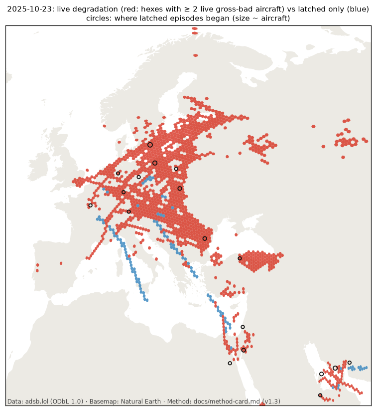

# Latching tag (processor v1.3): generated results

Generated by `tools/validate_latching.py`. Narrative: `phase1.md` (latching section).

## 1. Latched aircraft and latched share of gross-bad aircraft-hexes

| Day | Latched aircraft | Unjudged candidate cells | Central Europe (45–55N, 5–25E) | Western Europe (43–55N, 10W–5E) | Baltic (53.5–61N, 17–30E) | Black Sea (40.5–47.5N, 27–42E) | North America (25–55N, 125–65W) |
|---|---|---|---|---|---|---|---|
| 2025-10-09 | 39 | 131 | 5% (118/2320) | 10% (28/280) | 1% (11/1091) | 1% (11/1609) | 4% (20/473) |
| 2025-10-10 | 50 | 129 | 2% (50/2243) | 10% (38/395) | 0% (0/907) | 1% (19/1360) | 9% (50/582) |
| 2025-10-11 | 46 | 108 | 6% (140/2302) | 4% (19/456) | 2% (18/1129) | 1% (15/1536) | 13% (73/579) |
| 2025-10-12 | 38 | 83 | 8% (155/2032) | 8% (34/411) | 1% (12/1011) | 1% (8/1362) | 0% (0/314) |
| 2025-10-13 | 43 | 110 | 5% (110/2397) | 0% (0/222) | 2% (26/1250) | 0% (5/1460) | 16% (51/324) |
| 2025-10-14 | 39 | 130 | 4% (79/2151) | 7% (12/177) | 0% (3/1137) | 0% (6/1467) | 7% (24/333) |
| 2025-10-15 | 26 | 116 | 4% (58/1622) | 1% (3/264) | 1% (12/839) | 0% (1/1067) | 11% (59/529) |
| 2025-10-16 | 30 | 129 | 6% (141/2253) | 6% (18/313) | 1% (14/1156) | 1% (8/1403) | 1% (9/892) |
| 2025-10-17 | 46 | 187 | 10% (196/2050) | 6% (20/354) | 2% (24/1291) | 1% (10/1561) | 1% (11/989) |
| 2025-10-18 | 50 | 101 | 3% (66/2405) | 3% (13/395) | 1% (21/1639) | 1% (8/1564) | 3% (14/464) |
| 2025-10-19 | 47 | 93 | 4% (83/2250) | 5% (12/262) | 1% (11/1273) | 1% (10/1467) | 6% (27/478) |
| 2025-10-20 | 37 | 105 | 6% (130/2279) | 2% (5/211) | 1% (11/1441) | 0% (0/1555) | 0% (0/383) |
| 2025-10-21 | 31 | 103 | 6% (163/2640) | 8% (25/326) | 0% (2/1402) | 0% (5/1548) | 1% (13/873) |
| 2025-10-22 | 53 | 189 | 6% (165/2638) | 1% (2/280) | 1% (14/1526) | 1% (9/1770) | 7% (60/841) |
| 2025-10-23 | 46 | 120 | 5% (146/2914) | 1% (3/274) | 1% (19/1717) | 0% (4/1606) | 0% (0/852) |
| 2025-10-24 | 42 | 192 | 2% (56/2333) | 9% (27/302) | 1% (17/1184) | 0% (1/1436) | 1% (5/723) |
| 2025-10-25 | 51 | 178 | 8% (216/2555) | 9% (23/250) | 2% (19/1184) | 0% (7/1636) | 3% (17/539) |

## 2. Where latched episodes began (H3 res-2 regions, all days pooled)

| Rank | Region centre | Country | Latched aircraft |
|---|---|---|---|
| 1 | 43.96, 27.0 | Bulgaria | 39 |
| 2 | 42.8, 37.69 | sea / unknown | 37 |
| 3 | 4.03, 101.95 | Malaysia | 33 |
| 4 | 21.01, 87.24 | sea / unknown | 32 |
| 5 | 56.28, 15.48 | Sweden | 27 |
| 6 | 15.28, 96.57 | sea / unknown | 24 |
| 7 | 55.59, 20.13 | sea / unknown | 19 |
| 8 | 53.89, 16.49 | Poland | 17 |
| 9 | 23.54, 89.0 | Bangladesh | 14 |
| 10 | 26.15, 51.6 | sea / unknown | 14 |
| 11 | 29.27, 35.18 | Saudi Arabia | 13 |
| 12 | 23.14, 59.15 | sea / unknown | 13 |
| 13 | 26.92, 54.49 | Iran | 13 |
| 14 | 50.06, 9.89 | Germany | 12 |
| 15 | 52.04, 13.08 | Germany | 12 |
| 16 | 39.89, 37.8 | Turkey | 12 |
| 17 | 20.93, 90.47 | sea / unknown | 11 |
| 18 | 50.47, 5.7 | Belgium | 11 |
| 19 | 23.35, 51.33 | Saudi Arabia | 10 |
| 20 | 25.04, 56.87 | sea / unknown | 10 |

Onsets inside the Phase 1 hotspot sub-regions: 66 of 687 (10%).

## 3. Burst events over central Europe starting 01–06Z: v1.2 (raw) vs v1.3 (live)

| Day | v1.2 events | v1.3 events | v1.2 largest peak | v1.3 largest peak |
|---|---|---|---|---|
| 2025-10-09 | 2 | 1 | 18 | 18 |
| 2025-10-10 | 1 | 1 | 27 | 27 |
| 2025-10-11 | 2 | 2 | 21 | 21 |
| 2025-10-12 | 1 | 1 | 19 | 19 |
| 2025-10-13 | 1 | 1 | 21 | 21 |
| 2025-10-14 | 0 | 0 | – | – |
| 2025-10-15 | 0 | 0 | – | – |
| 2025-10-16 | 1 | 1 | 22 | 22 |
| 2025-10-17 | 2 | 2 | 11 | 11 |
| 2025-10-18 | 5 | 5 | 13 | 13 |
| 2025-10-19 | 1 | 1 | 12 | 12 |
| 2025-10-20 | 2 | 1 | 10 | 10 |
| 2025-10-21 | 2 | 2 | 21 | 21 |
| 2025-10-22 | 4 | 3 | 21 | 21 |
| 2025-10-23 | 5 | 5 | 25 | 25 |
| 2025-10-24 | 3 | 2 | 19 | 9 |
| 2025-10-25 | 1 | 2 | 16 | 19 |
| **Total** | **33** | **30** | | |

## 4. Hotspot shares, raw vs live (share of aircraft-hexes worse than 93 m)

| Sub-region | 2025-10-23 raw → live | 2025-10-24 raw → live | 2025-10-25 raw → live |
|---|---|---|---|
| Kaliningrad and approaches | 50.3 → 50.3 | 25.2 → 25.2 | 12.7 → 12.7 |
| Gulf of Finland / Estonia–Russia border | 39.9 → 39.9 | 29.7 → 29.5 | 34.6 → 34.3 |
| Southern Black Sea offshore Turkey | 42.8 → 42.8 | 37.0 → 37.0 | 43.8 → 43.8 |
| Western Black Sea coast | 6.6 → 6.6 | 8.3 → 8.3 | 7.0 → 7.0 |
| Caucasus | 24.4 → 24.3 | 13.8 → 13.8 | 20.5 → 20.1 |
| Cyprus–Levant | 0.4 → 0.4 | 0.5 → 0.5 | 0.6 → 0.6 |
| High latitude excl. Baltic/Russia | 0.2 → 0.2 | 0.0 → 0.0 | 1.7 → 1.7 |

## 5. Map, 2025-10-23

