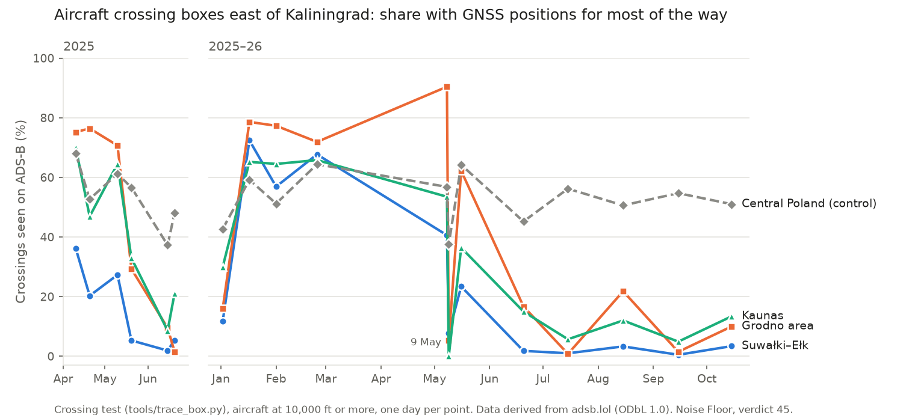

# Phase 1 validation report: PNT processor v1

**Date:** 14 Oct 2026 · **Method:** `docs/method-card.md` (v1) · **Code:** `pipeline/pnt_daily.py` · **Generated tables and maps:** `phase1_results.md`

## Bottom line

The processor finds the known Baltic, Black Sea and Caucasus hotspots on all three test days. The controls stay quiet, and the maps agree by eye with GPSJam's for the same dates. A G2 geomagnetic storm produced no measurable rise at high latitudes at the 93 m threshold. Phase 1.1 found the storm effect at the 10 m threshold (verdict 9).

One rule needs work before backfill. The avionics-suspect filter works as intended over western Europe, but on the quiet day it also dropped about one in six suspects that flew mostly inside the hotspots. Some of those may be genuinely jammed flights.

A worldwide day processes in about a minute on this PC, not the 10 CPU-minutes estimated, so a full backfill is hours, not days.

## Test days

| Day | Why | Space weather (GFZ Kp) |
|---|---|---|
| Thu 16 Oct 2025 | Quiet weekday; also the 6 Oct spike day | Max Kp 1.3 |
| Sat 18 Oct 2025 | G2 storm; weekend traffic | Max Kp 6.3 |
| Wed 22 Oct 2025 | Quiet weekday a week later (stability) | Max Kp 1.3 |

Kp source: GFZ Potsdam Kp index (`kp.gfz.de`, CC BY 4.0), retrieved 14 Oct 2026.

## Verdicts

| # | Check | Result | Verdict |
|---|---|---|---|
| 1 | Known hotspots reproduce | Share of aircraft degraded, across the three days:<br>• Southern Black Sea offshore Turkey **46–59%**, with every busy hex (10+ aircraft) red<br>• Gulf of Finland / Estonia–Russia border **32–41%**<br>• Kaliningrad **20–35%**<br>• Caucasus **15–39%**<br>• Western Black Sea coast 6–8% | **Pass** |
| 2 | Controls stay quiet | • US Midwest 0.0%<br>• Central Europe 0.7–1.0%<br>• High latitude away from Russia 0.1–1.4%<br>• No red hexes, except one on 22 Oct | **Pass** |
| 3 | Agreement with GPSJam (by eye only; GPSJam is never an input) | 16 and 18 Oct match on the Baltic states, Kaliningrad, Gulf of Finland, western Black Sea coast, Turkish Black Sea coast and Caucasus. On 18 Oct both show Scandinavia, Iceland and the UK green, and a larger Baltic footprint toward Lithuania and Poland. On 16 Oct both show the Levant mostly green. | **Pass, with differences below** |
| 4 | Storm-day effect (G2) | High-latitude control lowest on the storm day (0.1%, against 0.3% and 1.4%). No storm signature on either map. | **Pass at 93 m only.** Corrected by Phase 1.1 verdict 9: the storm shows at 10 m. |
| 5 | Avionics-suspect rule | Suspects: 93 (Thu), 252 (Sat), 82 (Wed). Over central Europe alone: 27, 170, 19. The Saturday excess is weekend light aviation (most common types: Ikarus C42, Breezer, ultralight, FK9, DR40, glider), correctly removed. Several sorties in a day stretch past the 3-hour span. On 16 Oct, 16 of 93 suspects flew mostly over western Russia, the Baltic states or the Black Sea, including airliners. | **Open:** may remove real signal |
| 6 | Throughput | 53–70 s per worldwide day (3.1–3.5 GB archive, read sequentially from the USB drive) | **Pass**; the earlier estimate was about 10× too high |

### Differences from GPSJam

- **Coverage.** GPSJam (fed by ADS-B Exchange and airplanes.live) sees far more of Russia's interior than adsb.lol does. Our map has gaps there, and they show as no data, not as quiet.
- **Levant.** GPSJam shows isolated red hexes near Adana, the Syrian coast and southern Israel and Jordan on 16 Oct. Our Cyprus–Levant box reads 0.5–0.7% with no red hexes among those with 10+ aircraft. This is probably the aircraft threshold: those hexes carry little traffic. Check once hourly resolution exists.

## What the data shows (beyond pass/fail)

- **The southern Black Sea is the most consistent hotspot.** Every busy hex on the airways off Turkey's Black Sea coast (41.3–42.5°N, 34–41°E) was red on all three days, at 46–59% degraded. Per the method card, this marks where receivers degraded, not where a transmitter is.
- **The Estonia–Russia border and the eastern Gulf of Finland** hold the highest single-hex scores: 90%+ on all three days, with NIC degraded alongside NACp.
- **Kaliningrad** rose from 20% (Thu) to about 35% (Sat and Wed). This is a variation worth tracking day by day once backfill exists.

## Open items for Phase 1.1 (before backfill)

1. **Avionics-suspect rule.** Flag an aircraft only where it is bad and most other aircraft in the same hex and hour are good. That keeps faulty avionics out without dropping flights that spent hours inside a jammed area. Re-run all three days and compare the hotspot shares.
2. **Hourly resolution.** It is needed to time storm effects and separate events within a day.
3. **Coverage layer.** Publish aircraft per hex with the score, and decide a minimum aircraft count for colouring public maps.
4. **Validation set.** None of the planning guide's validation events fall in October 2025. Once those rows are verified, add test days that match them (for example the October 2024 Kaliningrad case, if adsb.lol's 2024 archive covers it).

## Reproduce

```bash
python pipeline/pnt_daily.py 2025-10-16 --raw <folder with the adsb.lol tar or split parts>
python pipeline/pnt_daily.py 2025-10-18 --raw <...>
python pipeline/pnt_daily.py 2025-10-22 --raw <...>
python tools/validate_phase1.py 2025-10-16 2025-10-18 2025-10-22
```

Each run's `data/pnt/daily/<day>.summary.json` records the input files, their SHA-256 and every method parameter.

---

# Phase 1.1: processor v1.1 (14 Oct 2026)

**Generated tables and figures:** `phase1_1_results.md` (v1 vs v1.1, October storm test, coverage) and `cases_results.md` (November storm, Bay Area).

## Bottom line

- **The peer-based avionics rule leaves the hotspot figures unchanged** (within half a point of v1) while removing more faulty avionics elsewhere.
- **The 10 m accuracy metric, counted over aircraft that showed 10 m capability that day, detects two geomagnetic storms and a documented EGNOS outage.** The 93 m (gross) metric stays flat through all three. The two thresholds therefore separate natural and infrastructure degradation from jamming-scale loss.
- **A deliberate event, the Bay Area GPS loss of 22 Sep 2026, shows in the gross metric on a geomagnetically quiet day.** Its timing matches the published account.

## Verdicts

| # | Check | Result | Verdict |
|---|---|---|---|
| 7 | Peer-based avionics rule | Hotspot shares within ±0.5 points of v1 on all three days. Suspects 164 / 421 / 133 (v1: 93 / 252 / 82), with 0–2 per day centred in a hotspot. | **Pass** |
| 8 | Raw NACp < 10 share | 61–100% in northern Europe on every day. Many aircraft without SBAS report NACp 9 all the time, so it measures equipage. | **Fail:** replaced by the capable-aircraft share |
| 9 | Capable share, G2 storm (18 Oct 2025, Kp 6.3 at 18–21Z) | North America northern tier: 12.4% against 2.1–3.2% on quiet days, peaking at 29–39% at 20–22Z. Southern US control 2.2% against 3.0–3.5%. Gross flat. | **Pass.** This corrects Phase 1 verdict 4: the storm had an effect, below the gross threshold. |
| 10 | Capable share, G4 storm (12 Nov 2025, Kp 8.7 at 00–06Z) | North America northern tier **38.5%** against a 3.7% baseline. Gross 0.03% against 0.04%. Maps show onset over southern Canada at 01Z, a coast-to-coast band at 02–03Z and southward spread at 04–05Z. | **Pass.** Independently reproduces the sequence John Wiseman showed from his own data |
| 11 | EGNOS outage (unplanned finding) | On 16 Oct 2025, 80–100% of capable aircraft were below 10 m across Europe (Scandinavia to Iberia) all day, against 10–25% on 18 and 22 Oct. North America normal (3–5%). EGNOS had a total loss of signal from 13 Oct 11:14 to 17 Oct 10:10. | **Detected.** Needs an SBAS-outage exclusion. 16 Oct is not a valid quiet baseline for Europe on this metric. |
| 12 | Deliberate interference (22 Sep 2026, Kp ≤ 1.7) | Bay Area and Central Valley, aircraft-hexes worse than 93 m: 0 every hour 04–17Z; **8 at 18Z, 11 at 19Z, 25 at 20Z**; 1 at 21Z. Capable share 7.8% at 20Z against 2–4% otherwise. | **Pass.** Matches the reported early burst around 18:00Z and the larger burst near 20:00Z inside the Point Mugu NOTAM window (18:30–20:29Z). The NOTAM text was not independently retrieved (UNVERIFIED). |
| 13 | Coverage and public maps | Hexes with 3–4 aircraft score red 2.0% of the time, against 1.3–1.4% for 5–49. | **Decided:** colour public maps at 5+ aircraft (method card) |

## Open items (Phase 1.2, before backfill)

1. **SBAS-outage exclusion.** Ingest EGNOS service notices and historical status, and FAA WAAS NOTAMs. Flag the capable metric as unusable for a region while its SBAS is down.
2. **Burst detection.** The hourly majority rule dampens short events. At 20Z the Bay Area case shows 25 aircraft-hexes, while the source thread counts about 80 aircraft affected in its peak minute. Add a per-minute count of aircraft with any degraded report, for event timing.
3. **Baselines.** Add a rolling same-hour median per region over the previous 14 days. The storm and EGNOS cases show that a fixed threshold isn't enough on the fine metric.
4. **Leads seen in passing (not yet explained):**
   - A gross spike over northern Europe at 02Z on all three October days (low traffic). **Explained (22 Oct 2026):** it happens on almost every day of the year and is the Baltic hotspot at night (verdict 31).
   - A gross spike over the southern US at 03–08Z on 16 and 22 Oct, both weekdays. **Explained (22 Oct 2026):** a scheduled GPS interference test at White Sands Missile Range; see lead 2 below.
5. ~~Retrieve the 22 Sep 2026 NOTAM~~ **Closed 22 Oct 2026** by FAA flight advisory PMSRCA GPS 26-03 (Revision 2): see row 17.

## Sources for this section

- Kp: GFZ Potsdam (`kp.gfz.de`, CC BY 4.0), retrieved 14 Oct 2026.
- EGNOS outage:
  - [EGNOS Monthly Performance Report, October 2025](https://egnos.gsc-europa.eu/sites/default/files/documents/174%20-%20Monthly%20Performance%20Report%20-%20October%202025.pdf?v=1762523670) ("total loss of SiS occurring on October 13")
  - [LPPR NOTAM, EGNOS outage](https://notamify.com/notams/LPPR/c0b92b77-ed7b-4b00-974c-7544f05f6a5b) (13 Oct 11:14 to 17 Oct 10:10; time zone not stated)
- Storm and Bay Area accounts: John Wiseman on Bluesky, 7 Oct 2026, [storm figure](https://bsky.app/profile/lemonodor.bsky.social/post/3mxcife7bw22t) and [Bay Area GPS loss](https://bsky.app/profile/lemonodor.bsky.social/post/3mxccciuhlk2z). His data is independent of ours, and we used his posts only as accounts of the events, never as data.

---

# Phase 1.2: SBAS flag, minute bursts, baselines (14 Oct 2026)

**Generated tables and figures:** `phase1_2_results.md`. **Data:** 20 days (9–25 Oct 2025, 11–12 Nov 2025, 22 Sep 2026), processor v1.2, about 70 s per day.

## Bottom line

- **The SBAS flag reconstructs the October 2025 EGNOS outage from aircraft data alone.** It flags 13 Oct from 10Z, all of 14–16 Oct, and 17 Oct until 11Z. The documented window is 13 Oct 11:14 to 17 Oct 10:10.
- **Storm hours are labelled "storm."** That covers Canada on both storm days, and Japan and Korea on 12 Nov.
- **Minute bursts recover both Bay Area bursts of 22 Sep 2026,** at 18:00–18:08Z and 19:52–20:12Z.
- **Baselines turn up leads on quiet days.** On 23 Oct the top major event is an expansion of interference over the southern and central Baltic. On 23 and 24 Oct there is 10 m degradation over New Mexico at 03–08Z.

## Verdicts

| # | Check | Result | Verdict |
|---|---|---|---|
| 14 | SBAS flag: EGNOS outage | Flagged 13 Oct 10–23Z (14 h), 14–16 Oct all day, 17 Oct 00–11Z (12 h). EGNOS service area only; no other day in 9–25 Oct flagged for EGNOS except one hour on 12 Oct. | **Pass** (within an hour at both ends) |
| 15 | SBAS flag: false positives | With absolute thresholds, India (GAGAN) and Australia/NZ (SouthPAN) were flagged 7–14 h every day. Most airliners can't use those SBASs, so capable aircraft routinely lose 10 m there. Against each area's own same-hour baseline, and with the excess required to beat 4 × MAD, that falls to 1–6 stray hours a day. | **Partial pass.** Residual flags in those two areas are labelled as such. |
| 16 | Storm labelling | 12 Nov: Canada 01–05Z, Japan 01–14Z, Korea 02–12Z, all labelled storm. 18 Oct: Canada 20–22Z labelled storm, once the label checks Kp within ±3 h (storm effects lag the 3-hourly index). | **Pass** |
| 17 | Minute bursts, Bay Area 22 Sep 2026 | Burst events at **18:00–18:08Z (peak 13 aircraft)** and **19:52–20:12Z (peak 36)**, centred on the southern Central Valley. The early burst only shows when each region is summed with its neighbours, because it straddles res-2 cell edges. | **Pass.** Counts are lower than the source thread's (about 40 and 80 aircraft above 8,000 ft), reflecting adsb.lol coverage and our filters. **Declared test confirmed (22 Oct 2026):** FAA flight advisory PMSRCA GPS 26-03 (Revision 2), published 10 Sep 2026, scheduled a Point Mugu Sea Range GPS test on 22 Sep 18:30–20:29Z, centred 34.36°N 121.69°W, with GPS (incl. WAAS and ADS-B) possibly unavailable out to 567 NM at 10,000 ft and 623 NM at FL250. The Bay Area is about 160 NM from the centre. The 19:52–20:12Z burst falls inside the window; the 18:00–18:08Z burst starts 22 minutes before it opens and stays unexplained ([PDF](https://www.faasafety.gov/files/notices/2026/Sep/PMSRCA_26-03_GPS_Flight_Advisory_(Revision_2).pdf)). |
| 18 | Burst thresholds from earlier days | Within-day thresholds produced 53–66 burst events a day, mostly the same regions at the same hours (Hungary and Slovakia at 01:30–05:30Z, Southern California in the afternoons). Same-slot thresholds from earlier days cut this to 11–57. | **Pass** |
| 19 | Same-hour baseline anomalies | Raw anomalous region-hours were 200–500 a day, mostly small-sample. A binomial z ≥ 4 test and grouping into events give 137–174 events a day: **9–22 major** (25+ points above baseline), 65–90 notable, the rest minor. | **Pass**, read majors first |

## Leads from the quiet days

1. **Southern and central Baltic, 23 Oct 2025 (not corroborated).**
   - The 93 m share peaked at 51% over open sea around 55.6°N 17.9°E (between Bornholm, Gotland and the Polish coast), against a 14-day median near 15%.
   - It spanned 04–19Z over 62 region-hours, with matching 10 m events beside it.
   - This reads as a day-long expansion of the Baltic interference footprint.
   - **Checked 22 Oct 2026:** no public report ties an event to that date. Swedish, Polish and Lithuanian reporting describes the 2025 Baltic interference as near-continuous and growing (the Swedish Transport Agency counted 733 incidents in 2025 up to late August, against 495 in all of 2024), but nothing names 23 Oct. It stays a lead. The backfill to 1 Oct 2025 makes it testable against the whole year: is 23 Oct unusual for the southern Baltic, or an ordinary bad day?
   - **Tested against the year (22 Oct 2026): an ordinary bad day** (87th percentile of 383). See "Full-year lead tests", verdict 28.
2. **New Mexico, 03–08Z on 23 and 24 Oct 2025: verified, a scheduled GPS test.**
   - On the 10 m measure, 54–55% of capable aircraft were below 10 m in the worst region-hours, against a near-zero baseline, near White Sands at night local time.
   - **Match:** FAA flight advisory **WSMRNM GPS 25-16 (Revision 1)**, released 2 Oct 2025, scheduled GPS interference testing centred at 33°38′20″N 106°34′11″W, daily 0300–1100Z on **7–10, 14–17 and 21–24 Oct 2025**. GPS (including WAAS and ADS-B) "may not be available" out to 363 NM at FL400 and 242 NM at 10,000 ft. NOTAMs were published separately; they weren't retrieved.
   - **Test against the schedule** (aircraft within 450 km of the centre, about the advisory's 10,000 ft radius; 10 m share of capable aircraft, 03–10Z against 13–23Z):

     | Days in the processed set | 10 m share, 03–10Z | 10 m share, 13–23Z | 93 m share, 03–10Z |
     |---|---|---|---|
     | Scheduled, effect seen: 15–17, 21–24 Oct | 10.2–27.2% | 1.8–2.4% | 3.7–8.7% |
     | Scheduled, no effect: 9, 10, 14 Oct | 3.1–3.5% | 2.6–3.6% | 0.0% |
     | Not scheduled: 11–13, 18–20, 25 Oct | 1.6–3.1% | 1.4–4.2% | 0.0% |

   - **Timing:** on every day with an effect the 10 m share jumps at 03Z (1–3% at 00–02Z, then 16–25%) and falls back between 06Z and 11Z, inside the scheduled window. A scheduled window is a request, so a quiet scheduled day (9, 10, 14 Oct) most likely means no test ran.
   - **Result: pass.** 7 of 10 scheduled days show the effect, 0 of 7 unscheduled days do, and the onset hour matches. Planned tests like this need an exclusion layer (FAA SPANS flight advisories are public: registry `faa-spans-gps-advisories`) so they aren't read as hostile interference.
3. **Nightly bursts over central Europe, 01–06Z.**
   - Hungary, Slovakia, Czechia, Germany, Romania, Serbia and Austria have burst events on most nights, even against same-slot thresholds.
   - Hypothesis: overnight inbound flights cross jammed airspace (Iraq, the Caucasus, the Black Sea) and arrive with avionics still latched at degraded NACp (method card, "Latching").
   - Testing it needs per-aircraft continuity: was the aircraft already bad before it entered the region?

Sources for the leads (retrieved 22 Oct 2026):
- FAA, Flight Advisory GPS Interference Testing, WSMRNM GPS 25-16 (Revision 1), released 2 Oct 2025: [PDF](https://www.faasafety.gov/files/notices/2025/Oct/WSMRNM_25-16_GPS_Flight_Advisory_(Revision_1).pdf); [SPANS notice NOTC4680](https://www.faasafety.gov/SPANS/noticeView.aspx?nid=14680).
- Swedish Transport Agency figures on GNSS interference in 2025, as reported by [The Local, 4 Sep 2025](https://www.thelocal.se/20250904/sweden-accuses-russia-of-jamming-aircraft-gps-over-baltic) (secondary report; the agency's own release wasn't retrieved).

## Open items (next phase)

1. **Per-aircraft latching tag.** Mark aircraft that degraded in a known hotspot and stayed degraded, so downstream "events" made of latched aircraft are labelled rather than counted as new interference. This tests lead 3.
2. **Leads 1 and 2.** New Mexico is verified against the FAA test schedule (22 Oct 2026). The Baltic lead found no date-specific reporting. **Tested against the year (22 Oct 2026): not unusual** (verdict 28).
3. **FAA NOTAM API access** (Tom's request, decision 4). Planned-test exclusion now runs from the FAA's public flight advisories (`pipeline/faa_gps_tests.py`), which also closed the Bay Area case; the NOTAM API would add short-notice and non-advisory NOTAMs.
4. **Backfill to the present.** About 365 days at roughly 3.5 GB of raw data a day (about 1.3 TB) is too much to keep locally. Run it in GitHub Actions on the public repo, downloading, processing and discarding each day, and keep only the outputs (about 2 MB a day).

---

# Latching tag: processor v1.3 (14 Oct 2026)

**Generated tables and map:** `latching_results.md`. **Data:** the same 20 days, reprocessed with v1.3.

## Bottom line

- **The v1.3 tag works for the case it targets,** aircraft that stay degraded without a break after leaving a jammed area. It confirms 26–53 such aircraft a day, mostly flagged over central and western Europe and North America. **Hotspot shares are unchanged** (within 0.4 points), as they should be: inside a hotspot, neighbouring aircraft are bad too, so nothing is relabelled.
- **But it doesn't explain the nightly central-Europe bursts.** Those fell only from 33 to 30 events. Tracing the aircraft inside them on three nights (21, 23 and 25 Oct) shows a different, more specific pattern:
  - The bursts are made up mostly of **Airbus A350s**: **45–74% of the degraded aircraft, against 4–16% of all aircraft** in the same hex-hours. That is 10–15 times their share of traffic. A few 777s and A380s make up most of the rest.
  - Their neighbours were 91–99% healthy, so this **isn't live interference over central Europe**.
  - Most of these aircraft **first degraded hours earlier over the eastern Black Sea and Georgian coast, or north-east Turkey**, the strongest hotspot in Phase 1. Others first degraded near St Petersburg, Kaliningrad or in western Russia.
  - After that first degradation they're bad about **50–60% of the time**, flipping between bad and good. That's why a rule built on an unbroken bad run until landing misses them.

**Reading (hypothesis, not verified):** this is **intermittent post-exposure degradation**, carried mainly by one aircraft type on the overnight westbound long-haul wave from Asia and the Gulf. One possible mechanism is avionics rejecting GPS for the rest of a flight after spoofing exposure, then reporting an accuracy estimate that hovers around the 93 m threshold. Airbus and EASA guidance on this behaviour hasn't been checked yet. Either way, it is evidence of earlier exposure, not new interference where it is seen.

## Verdicts

| # | Check | Result | Verdict |
|---|---|---|---|
| 20 | Latch tag does no harm inside hotspots | Hotspot shares raw vs live: unchanged to within 0.4 points on 23–25 Oct | **Pass** |
| 21 | Where latched episodes begin | 687 onsets over 17 days. The top regions are the western Black Sea coast (Bulgaria), the eastern Black Sea, the Malay Peninsula, the Bay of Bengal, the south Baltic and Polish coast, the Andaman Sea, the Persian Gulf, the Gulf of Aqaba, the Gulf of Oman and southern Iran. These are mostly known interference regions; the Malay Peninsula is a lead to check. | **Consistent** |
| 22 | Do latched aircraft explain the nightly central-Europe bursts? | 33 events with raw counts vs 30 with live counts; peak sizes almost unchanged | **No** with the v1.3 rule; the cause is the A350 pattern above |
| 23 | Type concentration in those bursts | A350s are 45–74% of degraded aircraft vs 4–16% of all aircraft, over 7 events on 3 nights | **Found** |

## Next (v1.4)

**A post-exposure tag** replaces the unbroken-run rule:

- An aircraft's **exposure point** is its first gross-bad report of the day in a hex-hour where its peers were also bad, that is, genuine interference.
- Any **later** gross-bad report **300 km or more** from that point, in a hex-hour where peers are mostly good, is tagged as post-exposure. There is no continuity requirement.
- A second, genuinely jammed area later in the flight still has bad peers, so it stays live.

Then:

1. Re-run the 20 days and check that the nightly bursts collapse on live counts.
2. Report post-exposure degradation by aircraft type as its own product. Which types carry interference effects downstream, and for how long, is useful to operators.

---

# Post-exposure tag: processor v1.4 (21 Oct 2026)

**Generated tables and map:** `latching_results.md` (now v1.4). **Data:** the same 20 days, all at v1.4. The last two (12 Nov 2025 and 22 Sep 2026) were reprocessed on 21 Oct.

## Bottom line

- **The post-exposure tag finds far more downstream degradation than the latch did:**
  - It tags **164–324 aircraft a day**, against 26–53 under v1.3.
  - Over central Europe it covers **41–55% of gross-bad aircraft-hexes**, and over western Europe 50–75%.
  - Inside real hotspots the share stays low: Baltic 5–12%, Black Sea 6–11%. That is the expected split: away from jammers, much of what looks bad was carried in from elsewhere.
- **Hotspots are untouched.** Shares fall by at most 1.8 points (raw vs live, 23–25 Oct).
- **The nightly central-Europe bursts shrink but don't disappear:**
  - Events went from 33 (v1.2) to 30 (v1.3) to **26** (v1.4).
  - The largest burst on most nights got smaller: 27 to 17 aircraft on 10 Oct, 25 to 10 on 23 Oct. No burst above 17 aircraft remains.
  - Six nights now have no burst, against two before.
  - On six nights the count rose, probably because removing tagged aircraft split one large event into smaller ones that still clear the threshold.
- **The tag catches only 38–47% of the aircraft in the bursts that remain:**
  - 21 Oct, 05:03–05:09Z, near Berlin: 6 of 16 aircraft tagged.
  - 23 Oct, 04:16–04:26Z, over north-west Germany: 7 of 15 tagged.
  - In both, peers were 98–99% healthy and A350-900s made up 38–47% of the degraded aircraft, against 2–4% of traffic.
  - First degradations were over the eastern Black Sea and Georgian coast (21 Oct) and near St Petersburg and Lake Ladoga (23 Oct). On 21 Oct, 3 aircraft first degraded over Pomerania, roughly 220–290 km from the burst. That is inside the tag's 300 km radius, so they count as local.
- **The type pattern holds across all 17 October days,** not just the three traced nights. Of 4,025 post-exposure aircraft-days:

| Type | Share of post-exposure | Share of all traffic | Over-representation |
|---|---|---|---|
| A350-900 (A359) | 24.9% | 1.28% | 19.4× |
| A380 (A388) | 5.0% | 0.26% | 19.2× |
| 777-300ER (B77W) | 8.0% | 1.69% | 4.7× |
| 777-200LR/F (B77L) | 3.0% | 0.79% | 3.8× |
| A330-300 (A333) | 4.5% | 1.25% | 3.6× |
| A321 | 9.3% | 3.09% | 3.0× |
| 737-800, A320, A320neo, 737 MAX 8 | — | — | 0.6–1.3× |

**Reading (hypothesis, not verified):**
- Comparing against all traffic mixes route with avionics. Long-haul widebodies fly the Gulf/Asia–Europe corridors over Turkey and the Black Sea, while most narrowbodies don't.
- 777-300ERs fly the same corridors as A350s, yet they're over-represented 4.7×, not 19×. So aircraft type looks like it matters beyond route.
- **Guidance check (22 Oct 2026): partial.** Public sources support the mechanism, not the type pattern.
  - The OPSGROUP-led GPS Spoofing Workgroup report (Sep 2024) warns of "a significant possibility of the GPS Receiver appearing normal to flight crew after spoofing, but in reality being contaminated with false data", and that some systems don't work correctly after spoofing even when GPS coverage returns ([AIN summary](https://ainonline.com/aviation-news/air-transport/2024-09-09/opsgroup-releases-gps-spoofing-workgroup-report)). The full report wasn't retrieved.
  - Airbus's Safety First article on GNSS interference points to an Airbus World ISI (34.36.00049) for type detail; that and the FCOM aren't public. EASA SIB 2022-02 (R3, 5 Jul 2024; R4 exists) couldn't be read: the EASA AD site was down for maintenance at the time.
  - **EASA SIB 2022-02R4 (issued 3 Jul 2026, corrected 22 Jul 2026), read 23 Oct 2026.** EASA's site was still in maintenance, so the text was read from a third-party copy of the PDF (the official link is [ad.easa.europa.eu](https://ad.easa.europa.eu/blob/EASA_SIB_2022_02R4.pdf/SIB_2022-02R4_1)). It lists "temporary or non-recoverable" GNSS degradation, misleading position "later in the flight after having exited the affected area", and corrupted ADS-B among the effects. It names no aircraft type.
  - Still open: ask an A350 operator or pilot contact whether the GPS stays deselected or degraded for the rest of a flight after a spoofing alert.
- **Visibility and reporting (tested 23 Oct 2026, verdict 43):** A350s stay visible with degraded positions where other types go dark, and their degraded episodes last 4–8 times longer. A documented A350/A380 behaviour fits: the AESS sets NACp to zero when the ADIRU marks one satellite as degraded (ICAO CNS SG/29 IP/05, June 2025). The type pattern is therefore most likely a reporting artefact. See "A350s in the raw traces" below.
- The A321's 3.0× is the narrowbody exception. It isn't explained yet; it may reflect which carriers fly it on medium-haul routes near the hotspots.
- EASA's bulletin supports post-exit effects in general but has no type detail. Airbus's type documentation isn't public.

## Verdicts

| # | Check | Result | Verdict |
|---|---|---|---|
| 24 | Post-exposure tag does no harm inside hotspots | Raw vs live shares fall at most 1.8 points on 23–25 Oct | **Pass** |
| 25 | Where exposure episodes begin | 3,835 onsets; 34% inside the Phase 1 hotspot sub-regions (v1.3: 10%). The top H3 res-2 regions are the eastern Black Sea / Turkish–Georgian coast (681), east-central Turkey (493), offshore Kaliningrad (293), western Russia near Tver (283), the central Black Sea (266) and Lake Ladoga, north-east of St Petersburg (174) | **Consistent** with known interference regions |
| 26 | Do post-exposure aircraft explain the nightly central-Europe bursts? | 33 → 26 events, smaller peaks, 6 quiet nights vs 2; 38–47% of aircraft in the remaining bursts tagged | **Partly** |
| 27 | Type concentration, all days | A359 19.4×, A388 19.2×, B77W 4.7×. Narrowbodies are about 1×, except the A321 at 3.0× | **Found** |

## Next

1. **Why the rest of the burst aircraft go untagged.** Two possible causes, not yet checked:
   - The exposure point fails the peer test where overnight traffic is sparse. A fix would confirm it against the hex's daily baseline instead of same-hour peers.
   - The aircraft first degraded within 300 km of the burst, over the southern Baltic.
2. **A like-for-like type comparison:** only aircraft that crossed a hotspot, so route exposure is held constant.
3. **Fix the type table's denominator.** It counts only the top 80 types per day, so A350-1000 (A35K) shows zero traffic and an infinite ratio. **Fixed 22 Oct 2026** in `pnt_daily.py`: the summary now keeps every type. Days processed earlier, including the 1 Oct 2025 – 6 Oct 2026 backfill, keep the top-80 counts; the type chart skips types without a denominator.
4. Check Airbus and EASA guidance (still open).


---

# Full-year lead tests (22 Oct 2026)

**Data:** the published history from 1 Oct 2025 to 21 Oct 2026: 383 days with tables. Three days have none: adsb.lol published no archive for 31 Dec 2025 or 6 May 2026, and its 5 May 2026 archive holds no trace files (an empty table). 7 May 2026 covers only 6 hours (adsb.lol's archive for it is about a third of a normal day). **Measure:** the share of aircraft-hexes worse than 93 m per named box, on live counts (post-exposure aircraft removed). **Tool:** `tools/leads_year.py` (boxes and windows are in the script; `baltic`, `coverage`, `malay`, `north02`, `night`, `kurils`, `jammertest`). Figures are from a run on 22 Oct 2026; later runs include more days.

## Bottom line

- **Lead 1 is closed: 23 Oct 2025 was an ordinary bad day for the southern Baltic.** It ranks 50th of 383 days (87th percentile). The box is at or above its 90th percentile (14.1%) on 40 of the 383 days.
- **The worst Baltic days are days when aircraft go missing.**
  - On 9–11 May 2026 the box reached 39–50%, but held only 416–498 aircraft-hexes a day, against a median of 2,287.
  - From 30 Dec to 11 Jan it looks the same: 21–34% on 699–1,085 aircraft-hexes a day.
  - Global coverage and the neighbouring areas were normal on those days.
  - Across the year the share and the aircraft count move against each other (rank correlation −0.49). Of the 40 days at or above the 90th percentile, 17 had less than half the usual count and only 5 had at least 80% of it.
  - **The raw traces settle 9 May: aircraft flew through and lost their positions.** 293 aircraft crossed the box, against 326 a week later, but three crossings in four had no position for most of the way, against one in twenty. A350s stayed visible, with degraded positions, while other types went dark in the same hours, so it wasn't a receiver outage (verdict 34).
- **The 02Z spike is the Baltic at night.** Over northern Europe the worst hour is 02Z or 03Z on 369 of 383 days. On the Baltic side of that box, 41–47% of aircraft-hexes are degraded at 02–03Z, against 3–4% in daytime.
- **Malay Peninsula: closed, no local interference.** The share never passed 0.9% on any day.
- **The Kurils and Jammertest can't validate the ADS-B lane.** adsb.lol barely covers the Kurils (median 2 aircraft-hexes a day). Over Andøya no aircraft was degraded at any hour of Jammertest week.
- **The A350 pattern most likely reflects how A350s report accuracy, not what happened to them.** Inside jamming they stay visible while degraded where other types go dark, and their degraded episodes last 4–8 times longer. That fits a documented avionics behaviour (verdict 43).

## Verdicts

| # | Check | Result | Verdict |
|---|---|---|---|
| 28 | Lead 1: was 23 Oct 2025 unusual for the southern Baltic (54.8–57°N, 15–19°E)? | 12.9% on 1,846 aircraft-hexes; rank 50 of 383, 87th percentile. Year: median 5.5%, 90th percentile 14.1%, max 49.5% | **Closed: not unusual** |
| 29 | Southern Baltic surges | Runs of 3+ days at or above the 90th percentile: 28 Dec–11 Jan (14 days with data; 31 Dec has no table), 31 Jan–4 Feb, 21–25 Feb, 9–12 May. Monthly median share: 3.9–4.5% Oct–Dec 2025, 6.2% Jan, **14.1% Feb**, 4.3–5.0% Mar–Apr, 6.4–10.5% May–Aug, 4.9–5.2% Sep–Oct 2026 | **New lead**, with a coverage caveat (below) |
| 30 | Malay Peninsula (1–7°N, 99–104.5°E), the onset cluster in verdict 21 | Median 0.3%, 90th percentile 0.5%, max 0.9% | **Closed: no local interference.** v1.4's onset list (verdict 25) no longer ranks it |
| 31 | 02Z spike over northern Europe (50–60°N, 5°W–25°E), Phase 1.1 open item 4 | Worst hour 03Z on 298 days, 02Z on 71. Share 7.8% at 03Z against 0.4–0.7% by day. On every 4th day: east of 14°E and north of 53°N, 47% at 02Z and 41% at 03Z against 3.0% at 08Z and 3.7% at 14Z; the rest of the box 3.5% at 03Z against 0.2–0.3% by day. The top five 2° cells at 02–03Z are over the Baltic: off western Latvia (77%), the Gulf of Finland and the central Baltic; northern Poland comes next | **Explained: the Baltic hotspot at night.** Why nights are more than ten times worse is open |
| 32 | Kurils / Fukuoka FIR, 22 Jul–3 Aug 2026 (43–50°N, 145–156°E) | Aircraft seen on 151 of 386 days, median 2 aircraft-hexes. In the window, 4 days had 1–2 aircraft-hexes and 9 had none; 0% throughout | **Can't test:** adsb.lol has almost no coverage there |
| 33 | Jammertest 2026, Andøya (68.6–69.9°N, 14.0–17.8°E), as a positive control | 13–19 Sep: 130–265 aircraft-hexes a day, none degraded at any hour. The 50 W windows (plan times read as CEST): 14 Sep 12–13Z, 0% of 39; 15 Sep 07Z, 0% of 17; 15 Sep 12–14Z, 0% of 58; 18 Sep 07Z, 0% of 17 | **No effect seen; not usable as a positive control.** No hour of the week was degraded, so the time-zone reading doesn't matter |
| 34 | 9 May 2026 in the raw traces: position loss, or traffic routed around the box? | Aircraft crossing the box: 293 (16 May: 326). Crossings seen on ADS-B 14% (80%), dark 75% (5%), MLAT only 11% (16%). A350-900s seen on 25 of 27 crossings, 92% of their points degraded | **Position loss.** Traffic was near normal; aircraft lost their ADS-B positions across the box |
| 35 | The holiday and February surges in the raw traces (2 Jan, 1 Feb, 24 Feb 2026; control 17 Jan) | Aircraft crossing the box: 306, 286, 211 (control 257). Dark crossings 50%, 44%, 44% (5%); seen 29%, 53%, 52% (92%). A350-900s seen on 78–94% of crossings, 69–89% of their points degraded (control: 97% seen, 25% degraded) | **Same mechanism as 9 May, weaker.** Position loss with traffic still crossing |
| 36 | Why the Baltic is worse at night (53–60°N, 14–26°E; 16 May, 8 May, 17 Jan) | Not altitude: at FL300+ the night share is 31–43% against 3–7% by day, and the altitude mix changes little (FL300+ carries 71–83% of traffic at night, 70–76% by day). Partly carried in: at night 36–41% of FL300+ aircraft-minutes come from aircraft already degraded at their first ADS-B point in the region, against 11–16% by day. But aircraft that arrived healthy are also degraded 10–15% of the time at night against 1–4% by day | **Mostly local.** The interference over the Baltic is stronger or wider at night; night routing isn't ruled out |
| 37 | SBAS flags over the year (344 days with analysis files on 22 Oct 2026) | Days with any flagged hour: EGNOS 6 (all in the 13–17 Oct 2025 outage), WAAS CONUS 3 (storm days in Jan 2026), WAAS Canada 13, KASS 20, MSAS 72, **GAGAN 162, SouthPAN 229** | **GAGAN and SouthPAN flags are routine:** most aircraft there don't use those services, so the 10 m measure is unreliable in those areas. The flag already drops it there (the 93 m measure is unaffected). The map now lists those two apart as routine instead of as probable service problems |
| 38 | Spire's maritime jammer case, 14 Oct 2024 (map centred near 55.2°N 17.2°E; area tested 54.9–55.6°N, 16.5–18.0°E) | Share 10.8% on 342 aircraft-hexes, against 13.9% and 13.4% on 13 and 15 Oct. Dark crossings 11% (18 of 168), against 7% and 5% | **Not detected.** Spire counted 3 of 53 aircraft affected in its main hex, which is below what the daily share or the crossing test can resolve |
| 39 | False look-alike: Kiruna weather-radar fault and exercise chaff, 5–6 Mar 2024 (66.5–69.5°N, 17–25°E) | 0.0% and 1.0% degraded, against 0.0% on 27 Feb (88–104 aircraft-hexes a day) | **Pass.** A weather-radar artefact leaves no GNSS signal (coverage there is thin) |
| 40 | Radio-horizon localizer, first version (southern Baltic; 9 May, 2 Jan, 1 Feb, 24 Feb 2026) | Stacked best crossing at 55.10°N 19.52°E, offshore about 55 km NW of Baltiysk, with NACp events at 80% of the radio horizon. Day by day, every top peak lies within about 20–80 km of the western Sambia peninsula | **Points at the Sambia coast, not yet a fix.** The reach scale was tuned on the same days and moves the peak by up to about 50 km |
| 41 | Localizer against the 2025 TDOA fixes (Gattis, Cydejko & Akos 2026), scored with settings fixed in advance | Top peak 20 km from the Baltiysk-harbour fix on 3 Apr; 37, 48 and 45 km from the coastal-site fix on 15 Apr, 17 Apr and 21 Jun (1 hit of 4 at 25 km; 0 of 2 in the interference windows). The target cell always ranked in the top 2% of 3,496 cells. Mean miss 38 km, against 38 km for naming Kaliningrad city and 52 km for the centroid of onsets | **Fail.** It finds the area but not the site: the two TDOA sites are 21 km apart, finer than the localizer resolves |
| 46 | When did the loss east of Kaliningrad start? The same crossing test on every other raw day on disk: 9 days of 2024, 8 more of Feb–Jun 2025, 5 of Oct–Dec 2025 | Suwałki–Ełk box seen: 89–100% on all 9 days of 2024 (Feb–Oct, including 20 Jun 2024); 47% on 20 Feb 2025; 2–26% from late Apr to Jun 2025; 63–74% Oct–Dec 2025; 0.5–3% Jun–Oct 2026. Central Poland 37–70% throughout | **A change that began between late Oct 2024 and Feb 2025, not a long-running season.** It eased only partly in winter 2025–26 and has been heavier and longer in 2026 |
| 45 | Position loss east of Kaliningrad, Apr 2025 – Oct 2026: crossing test in four boxes (Suwałki–Ełk, Grodno area, Kaunas, central Poland as control) on 20 days of raw traces | Suwałki–Ełk box seen on ADS-B: 20–36% (Apr 2025), 2–5% (late May–Jun 2025), 57–72% (Jan–Feb 2026, outside the holiday surge), 1–3% (Jun–Oct 2026). Grodno and Kaunas boxes the same shape; central Poland 37–68% throughout | **Recurring summer position loss, longer in 2026.** Aircraft fly through but lose GNSS positions (in 2026 mostly seen as MLAT-only, in 2025 as dark). The daily per-hex share understates it, because aircraft without positions drop out |
| 44 | Localizer v3 (heading-balanced) against v2 on a second held-out set (10 and 20 Apr, 10 and 20 May, 20 Jun 2025; rules fixed before download) | v3: 3 hits of 5 at 25 km, mean 23.1 km (5.5 km on 10 Apr). v2: 2 of 5, 30.6 km. Baselines: Kaliningrad city 0 of 5 (38.4 km), onset centroid 2 of 5 (42.9 km), fixed point 54.70°N 20.24°E 5 of 5 (22.9 km) | **Fail against the constant guess.** v3 improves on v2, but one fixed point between the two sites does as well every day. The 25 km rule can't separate a localizer from a constant when two sites 21 km apart are both active; the next test needs single-site days or a tighter radius |
| 43 | A350 visibility hypothesis: 19 days of raw traces over the southern Baltic box (crossings at FL300+; 9 jammed and 5 quiet days) | Jammed days: A350s seen on 89% of 224 crossings (75 airframes), 74% of their positions degraded; narrowbodies seen on 43% of 2,809, 777s 61%, 787s 59%. Highest seen share on 7 of 8 full jammed days. Quiet days: every family seen on 88–94%, but 28% of A350 positions degraded against 1–8%. Degraded episodes: median 8–17 min for A350/A380, against 2 min | **Confirmed, plus a second effect.** A350s keep broadcasting degraded positions where other types go dark, and their degraded episodes last 4–8 times longer. Both fit a documented ADIRU–AESS behaviour that sets NACp to zero when one satellite is degraded (ICAO CNS SG/29 IP/05). The type over-representation is most likely a reporting artefact |
| 42 | Localizer v2 on five held-out Apr–Jun 2025 days (method frozen in 38a495e before they were downloaded) | Top peak 20.4, 24.7, 30.1 and 17.9 km from the nearest TDOA site (3 hits of 4 at 25 km; 11 Jun untested, 76 onsets on a partial day). Mean 23 km, against 38 km for Kaliningrad city and 96 km for the onset centroid | **Pass on the rule, area-level only.** The peaks sit about 20 km east of both sites, so a fixed guess there would do as well, and the test can't tell which site was active |

## Southern Baltic: degraded, or missing?

| Day | Box share | Aircraft-hexes in the box | Southern Sweden, land (56–59.5°N, 12–15.5°E) | Global aircraft-hexes |
|---|---|---|---|---|
| 8 May 2026 | 8.2% | 2,266 | 1.1% of 4,445 | 2.47 M |
| 9 May | 49.5% | 416 | 4.3% of 3,405 | 2.28 M |
| 10 May | 39.2% | 498 | 3.3% of 3,766 | 2.30 M |
| 11 May | 47.5% | 434 | 3.4% of 3,908 | 2.38 M |
| 12 May | 16.5% | 1,406 | 1.3% of 3,835 | 2.34 M |
| 2 Jan 2026 | 34.0% | 821 | 2.5% of 3,580 | 2.29 M |
| 8 Jan | 31.5% | 779 | 3.2% of 3,350 | 2.14 M |
| 12 Jan | 5.2% | 2,110 | 0.9% of 3,574 | 2.14 M |
| Year median | 5.5% | 2,287 | | |

Denmark and northern Germany kept their usual counts on the same days, and every one of those days has all 24 hours. Aircraft went missing from this box alone, while the share rose on the Swedish coast beside it.

Two readings, which the daily tables can't separate (the raw traces settle 9 May for reading 1; next section):

1. **Jamming strong enough to remove positions.** An aircraft that loses GNSS completely can stop sending a usable ADS-B position. It then drops out of the counts instead of counting as degraded; the processor uses ADS-B positions only, not MLAT. On this reading the share understates the effect.
2. **Traffic kept out.** Airspace reserved for military activity would empty the box and leave a small, unrepresentative sample. Baltic Shield 2026, a Danish–Polish exercise, ran 8–14 May over the waters and airspace from Bornholm to the Polish coast ([Danish Defence, 4 May 2026](https://www.forsvaret.dk/en/news/2026/danske-og-polske-soldater-traner-sammen-pa-bornholm/)). No exercise is known for the holiday run.

Outside reporting fits a worse 2026 without naming these dates:

- A GNSS station on Bornholm logged 30 jamming or spoofing events in 2026 up to 10 Aug, against 16 in all of 2025 and 11 in 2024. Source: DR, as reported by [European Pravda, 10 Aug 2026](https://www.eurointegration.com.ua/eng/news/2026/08/10/7243248/) (secondary).
- An aggregator summary links strong jamming at that station to a May weekend during Baltic Shield. Its sources couldn't be retrieved, so the link is unverified.
- The 2023–24 holiday season had a similar wave over Bornholm and the southern Baltic ([Ingeniøren, 3 Jan 2024](https://ing.dk/artikel/danish-gps-expert-unusually-strong-gps-jamming-over-baltic-sea)). That shows the season, not this year.

## 9 May 2026 in the raw traces

**Method:** `tools/trace_box.py` on the adsb.lol archives for 8, 9 and 16 May 2026 (the Friday before, and the Saturday a week later). It follows every aircraft that sent ADS-B in a wider region (52–60°N, 8–26°E) at or above 10,000 ft. Each crossing of the box (5 minutes or more inside it) is sorted by what receivers saw there:
- **seen:** mostly ADS-B positions;
- **MLAT only:** positions, but mostly from multilateration;
- **dark:** gaps of over 4 minutes cover at least half the crossing;
- **dark, long gap:** a single gap of over 45 minutes whose straight line crosses the box.

| | 8 May | 9 May | 16 May |
|---|---|---|---|
| ADS-B aircraft in the region | 1,985 | 1,721 | 1,808 |
| Aircraft that crossed the box | 324 | 293 | 326 |
| Crossings | 558 | 467 | 593 |
| Seen | 70% | 14% | 80% |
| MLAT only | 0% | 11% | 16% |
| Dark | 19% | 53% | 4% |
| Dark, long gap | 11% | 22% | 1% |
| ADS-B points with NACp < 8 on seen crossings | 9.5% | 51% | 5.5% |

- **Traffic still flew through.** 293 aircraft crossed the box on 9 May, against 326 a week later (10% fewer). Routing around the box explains little of the drop.
- **Their positions went.** Three crossings in four were dark, against one in twenty on 16 May. In every hour from 04Z to 18Z, most crossings had no ADS-B position (dark or MLAT only). The result holds above 20,000 ft (seen 15% against 78%) and with an 8-minute gap rule (seen 16% against 80%).
- **It isn't a receiver outage.** A350-900s stayed visible on 25 of their 27 crossings while other types went dark in the same hours. At 05Z, 2 A350s were seen, against 3 of 38 other aircraft. At 14Z it was 3 of 3 A350s against 1 of 49 other aircraft. MLAT positions inside the box (50 crossings, mostly 13–15Z) also show that receivers were hearing aircraft there.
- **Where positions stop and resume:**
  - Gaps mostly start around 54–56°N 14°E (aircraft arriving from the west, near Bornholm), 57°N 17°E (from the north, east of Öland) and 55°N 20°E (from the east).
  - They end around 55°N 19–20°E, 58–59°N 17°E and 55°N 12–13°E.
  - So the affected area is wider than the box: roughly 14–20°E, from the Polish coast to about 58°N. These cells show where receivers last and next heard a position, not where a jammer is.
- **8 May, the exercise's first day, was partly affected.** 30% of crossings were dark, mostly at 03–09Z and 18–22Z; there were few at 10–17Z. MLAT barely covered the box that day, so some of those dark crossings might have been MLAT-only on another day.

**What this means for the measure:**
- On a day like this the daily share is computed over the few aircraft that keep a position, and they're a biased sample. The 49.5% on 9 May mostly reflects them.
- **A350s keep broadcasting a degraded position where most types go dark.**
  - On 9 May, 92% of A350 points inside the box had NACp < 8, while B737-800s, A320neos and A220-300s went dark on 84–88% of their crossings.
  - Even on 16 May, 51% of A350 points in the box were degraded, against 0–10% for the other common types.
  - The cause isn't verified. An inertial or hybrid position source feeding ADS-B is one possibility.
  - This bears on the A350 post-exposure pattern (verdict 27). Part of the 19× over-representation may be that A350s stay visible while degraded, where other types drop out of the counts. That is a hypothesis, not yet tested.


## The January and February surges in the raw traces

The same check on 2 Jan (holiday run), 1 Feb and 24 Feb 2026, with 17 Jan (a quiet Saturday) as the control:

| | 2 Jan | 1 Feb | 24 Feb | 17 Jan (control) |
|---|---|---|---|---|
| Box share (daily tables) | 34.0% on 821 aircraft-hexes | 23.4% on 1,507 | 25.7% on 982 | 3.7% on 2,169 |
| Aircraft that crossed the box | 306 | 286 | 211 | 257 |
| Seen | 29% | 53% | 52% | 92% |
| MLAT only | 20% | 4% | 4% | 3% |
| Dark (incl. long gaps) | 50% | 44% | 44% | 5% |
| ADS-B points with NACp < 8 on seen crossings | 30% | 23% | 22% | 4% |

- **The same mechanism as 9 May, a little weaker.** As many aircraft crossed as on the control day (more on 2 Jan), and close to half of the crossings were dark.
- **A350s stayed visible again:** seen on 90%, 78% and 94% of their crossings, with 89%, 69% and 89% of their points degraded. On the control day 25% of their points were degraded. Across the four jammed days, the A350 is the type most often seen degraded rather than dark. That is a partial test of the visibility hypothesis; recounting the post-exposure type table with dark aircraft is still to do.
- Positions mostly stopped within 53–58°N, 14–22°E on all three days (1° cells of the last ADS-B point). That is the same area as on 9 May.

## Why the Baltic is worse at night (partial)

`tools/trace_box.py night` on three days without a surge (16 May, 8 May and 17 Jan) compares night (22–04Z) with day (08–17Z) over the Baltic side of the 02Z test (53–60°N, 14–26°E). It uses ADS-B aircraft-minutes and raw NACp, before the post-exposure tag.

| FL300+ | 16 May night / day | 8 May | 17 Jan |
|---|---|---|---|
| All aircraft | 30.7% / 7.2% | 42.7% / 6.8% | 36.8% / 3.3% |
| Narrowbodies | 9.1% / 4.1% | 13.0% / 4.5% | 19.4% / 1.6% |
| Other types | 56.9% / 16.2% | 61.4% / 12.4% | 45.2% / 7.1% |
| Arrived healthy | 10.5% / 3.8% | 14.5% / 3.7% | 12.1% / 1.2% |
| Arrived degraded | 66.2% / 28.7% | 82.6% / 23.8% | 80.5% / 20.6% |

- **Not altitude.** The night excess holds within each altitude band, and the altitude mix changes little: FL300+ carries 71–83% of traffic at night and 70–76% by day.
- **Partly carried in.** At cruise, widebodies and other non-narrowbody types make up 45–67% of night traffic, against 25–30% by day. Many of these aircraft are already degraded at their first position in the region, whether they degraded farther east or were first heard inside the jammed area.
- **Mostly local.** Aircraft that arrived healthy are degraded 3–10 times more often at night than by day on all three days. So the interference itself looks stronger or wider at night. A different night route mix, closer to Kaliningrad and the Russian border, isn't ruled out. That needs a route-by-route comparison.


**More days, 23 Oct 2026.** Ten Apr–Jun 2025 days (the localizer days) with the same comparison. Nights were worse on every day: at FL300+, 11.7–41.4% of aircraft-minutes were degraded at night against 5.2–16.2% by day. Aircraft that arrived healthy were also worse at night on all ten days (3.9–18.6% against 2.4–8.9%). But the gap depends on aircraft type. **Narrowbodies: 5.1–22.7% at night against 4.5–12.8% by day** (1.1–2.4 times). **Other types: 15.6–70.8% against 7.1–29.1%.** The overnight wave is widebody-heavy, and A350s stay degraded far longer than other types (verdict 43), so part of the night excess is the traffic mix. Narrowbodies alone still show it on every day. June nights at 55°N are short and partly twilight, so 22–04Z isn't fully dark then.

## Validation set: two 2024 cases

These days come before the backfill. They were processed locally with the same pipeline (`python pipeline/pnt_daily.py <day> --raw <archive folder> --out data/pnt/validation2024`) and scored with `tools/leads_year.py spire2024` and `kiruna2024`, plus `tools/trace_box.py report` for the crossings.

- **Spire, 14 Oct 2024 (verdict 38): not detected.**
  - Spire put the source on a vessel. The most affected hexes were open water with no gradient toward land, and 3 of 53 aircraft in the main hex lost GNSS integrity and accuracy entirely. The article gives no emitter position; its GPSJam link for the day centres near 55.2°N 17.2°E.
  - Our share there was lower on 14 Oct than on the days either side. Dark crossings were slightly higher (11% against 5–7%), on small numbers.
  - An event that touches a few aircraft is below what the daily tables resolve. It doesn't contradict Spire.
  - Across the whole southern Baltic box, 96% of crossings were seen on all three days. That makes October 2024 a useful quiet reference for the 2026 surges.
- **Kiruna, 5–6 Mar 2024 (verdict 39): pass.**
  - From 5 Mar a faulty weather radar at Kiruna drew a sphere hundreds of kilometres across on Finnish weather maps, and chaff from a military exercise over Lapland showed as rain (Yle).
  - Aircraft over the area showed no GNSS degradation, so a weather-radar artefact doesn't leak into this measure. Few aircraft fly there (about 100 aircraft-hexes a day).
- **Still to score:** the 2025 Baltic TDOA fixes (Gattis et al., Apr–Jun 2025), which need the radio-horizon localizer. The Rostov claim (Jul 2021) predates the adsb.lol archive.

Sources for this section (retrieved 23 Oct 2026):
- Spire Global, "GNSS interference report: Russia 2024/2025 – Part 1 of 4: Kaliningrad & the Baltic Sea", 27 Jun 2025: [spire.com](https://spire.com/blog/space-reconnaissance/gnss-interference-report-russia/).
- Yle News, "Military exercise apparently disrupts weather images from Lapland", 6 Mar 2024 (updated 7 Mar): [yle.fi](https://yle.fi/a/74-20077924).


## Radio-horizon localizer: first version

`tools/horizon_fix.py` re-derives the published radio-horizon method (Schäfer et al., "Jammer on the Horizon", ION GNSS+ 2023; the 2024 Baltic open-source work in `docs/research/2026-10-14-baltic-jammer-2024.md`) from the trace extracts.
- An aircraft's last good position before it degrades, or its first good position after it recovers, should lie about one radio horizon from the jammer: r = 4.12·(√h_aircraft + √h_jammer) km, with heights in metres.
- Each such event votes for the cells on its circle, ahead of the aircraft for an onset and behind it for a recovery (±60°, ±20 km).
- Where the arcs cross is the candidate.

What the first runs show:
- **Gaps are mostly coverage.** Counting position gaps as onsets puts the raw peaks at coverage edges over Sweden and the North Sea, and a quiet day (16 May) votes almost as strongly there. With NACp drops and recoveries only, the quiet-day background falls by about 90% (17 Jan: 990 events against 1,784–2,943 on jammed days).
- **The full horizon overshoots.** At r × 1.0 the top peaks ring Kaliningrad at 60–100 km in several directions. That is what arcs do when the jammer's reach is shorter than the horizon: they cross beyond it. At 80% of the horizon the vote is sharpest on every day: 263 votes against 156 for the next peak on 9 May. At 60% and 45% the peaks drift west and flatten.
- **Stacked over the four jammed days at 80%:** the best crossing is at 55.10°N 19.52°E, over the sea about 55 km NW of Baltiysk and about 35 km off the western Sambia coast. Resampling the events moves it by a median of 11 km (90% within 23 km). That spread is statistical only: across scales of 0.75–0.85 the day-by-day peaks move by up to about 50 km.
- **Context, not a score.** The 2025 TDOA network on the Polish coast placed one fix at Baltiysk harbour (Gattis, Cydejko & Akos, GPS Solutions 30:96, 2026). The localizer agrees to within about 55 km, which is no better than its own model error. Spire's 2024 maritime case is another reason not to assume a land site.

Next for the localizer:
- Estimate the reach from the data instead of tuning it, for example from the distribution of onset distances.
- Use pairwise intersections with a crossing-angle filter instead of arc votes.
- Separate concurrent jammers (St Petersburg and Kaliningrad both reach this region).
- Score it on days the TDOA paper covers (Apr–Jun 2025, before the backfill).


## The localizer against the 2025 TDOA fixes (pre-registered)

**Known answers.** Gattis, Cydejko & Akos (GPS Solutions 30:96, 2026, CC BY) ran a TDOA network of GNSS IF samplers around the Gulf of Gdańsk in April–June 2025. Their map figures give two sites, 21 km apart:
- **C, a coastal facility** on the west shore of the Sambia peninsula at 54.8303°N 19.9483°E. Fixes on 17 Apr at 13:57Z and 21 Jun at 18:09Z agree to within 70 m. The text says the 15 Apr results and 21 Jun at 21:26Z point to the same place, 50 m from suspect antennas.
- **B, Baltiysk military harbour** at 54.6392°N 19.9005°E: a jammer fixed on 3 Apr at 15:24Z.
- The paper also notes reception beyond the radio horizon, likely through sea ducting. That matters for any horizon-based method.

**Method changes, made on 2026 days only and fixed before any 2025 day was processed:**
- **Reach fitted, not tuned (`--fit`).** For each candidate cell, the reach fraction is whatever most onsets agree on, and the cell scores the number that agree. On 9 May 2026 this returns 0.79, matching the earlier hand-tuned 0.8.
- **Onsets only.** Recoveries lag while receivers re-acquire, so they sit farther out. Recovery-only fits were noise on every 2026 day, and requiring onsets and recoveries to share a reach made the results worse.
- With these settings the 2026 surge days put the top peak 17 km from site C on both 9 May and 2 Jan, at the same cell (54.90°N 19.72°E, reach 0.77–0.79). Those are the days the settings were chosen on, so they don't count as a test.
- On 1 and 24 Feb a short-reach solution near Łeba on the Polish coast (reach 0.51–0.57) won instead. It's unexplained: an artefact of short arcs crossing dense traffic, or a second source.

**The test** (3 Apr, 15 Apr, 17 Apr and 21 Jun 2025; aircraft at 20,000 ft or above; hit = top peak within 25 km of the day's site):

| Day | Site | Top peak | Distance | Site's cell rank (of 3,496) | Hit |
|---|---|---|---|---|---|
| 3 Apr | B | 54.60°N 20.20°E (reach 0.51) | 20 km | 27 | Yes |
| 15 Apr | C | 54.50°N 20.04°E (reach 0.55) | 37 km | 24 | No (18 km from B) |
| 17 Apr | C | 54.40°N 19.88°E (reach 0.57) | 48 km | 59 | No |
| 17 Apr, 11–23Z | C | 54.30°N 19.88°E | 59 km | 58 | No |
| 21 Jun | C | 54.50°N 20.36°E (reach 0.63) | 45 km | 7 | No |
| 21 Jun, 16–22Z | C | 55.10°N 20.68°E | 56 km | 41 | No |

- **1 hit of 4 days; 0 of 2 in the interference windows. A fail on the pre-registered rule.**
- **The area is right:** every day's site ranks in the top 2% of cells, and every top peak is within about 60 km of both sites.
- **The site isn't resolved:**
  - The mean miss is 38 km, no better than naming Kaliningrad city (38 km from the sites). The centroid of onset positions does worse (52 km).
  - Resampling the events moves the top peak by a median of 15–21 km, the same order as the 21 km between the two sites.
- **A consistent bias:** in 2025 the peaks sit south of both sites (54.3–54.6°N), with shorter fitted reaches (0.51–0.63) and fewer onsets (689–1,311 a day, against 2,943 on 9 May 2026).
- Possible causes, not tested:
  - Power-limited reach on lighter days.
  - Traffic geometry: most onsets come from aircraft approaching from the south and west.
  - Two sites active on the same day, merging into one peak between them.
  - Ducting, which breaks the horizon assumption.

What would help next: separate concurrent emitters (two-source fits), use onset timing against the TDOA windows at minute resolution, and weight by the crossing angle between arcs. Until the localizer passes a test like this, its positions stay off the public map.


## Localizer v2 and a held-out test

**What changed (developed on the four scored days, which are now development data, not tests):**
- **Why v1 couldn't resolve the sites.** Measured from the true site, only 40–50% of onsets head towards it, so about half come from something else. Those that do head towards it reach it at a spread of distances: the middle half spans about 0.15 of the horizon, roughly ±35 km for a single event. Counting the onsets in the fullest reach window rewards whichever subset happens to line up.
- **New score (`--score lr`, now the default):** for each cell, the likelihood that its onsets come from one reach band plus a uniform background, against background alone. It rewards a tight band, not just a large count.
- **Tried and dropped:**
  - Greedy two-emitter fits put the second source far away, or on the first with another reach.
  - Fitting only onsets within 60–120 minutes of the fix times left 81–471 onsets and wandered more.
- **Development results with v2:** top peak 20, 26, 48 and 22 km from the day's site; 20, 5, 28 and 20 km from the nearest site. On 9 May and 2 Jan 2026 it lands 19 and 9 km from the coastal site. On 1 and 24 Feb 2026 the short-reach Łeba solution still wins.

**The held-out test.** The days and rule were fixed by date before any of these days was downloaded: 25 Apr, 15 May, 25 May, 11 Jun and 15 Jun 2025. adsb.lol has only temporary archives from 28 May to 10 Jun, so 11 Jun stands in for 5 Jun. The method was frozen in commit 38a495e. The paper reports both sites active on many days in this period, so a hit means the top peak lies within 25 km of either site.

| Day | Top peak | Nearest site | Kaliningrad city | Onset centroid | Hit |
|---|---|---|---|---|---|
| 25 Apr | 54.70°N 20.20°E (reach 0.60) | 20.4 km (Baltiysk) | 38.4 km | 98 km | Yes |
| 15 May | 54.50°N 20.20°E (reach 0.52) | 24.7 km (Baltiysk) | 38.4 km | 15 km | Yes |
| 25 May | 54.70°N 20.36°E (reach 0.62) | 30.1 km | 38.4 km | 83 km | No |
| 11 Jun | 76 onsets (partial archive) | | | | Untested |
| 15 Jun | 54.90°N 20.20°E (reach 0.74) | 17.9 km (coastal) | 38.4 km | 187 km | Yes |

- **3 hits of 4 tested days**, mean 23 km. That beats both baselines fixed in advance: naming Kaliningrad city (38 km, never a hit) and the onset centroid (96 km).
- **Area-level only:**
  - All four peaks sit in a tight cluster around 54.70°N 20.24°E. That is about 20 km east of both sites, across the Vistula Lagoon from Baltiysk.
  - A fixed guess at that point would score about as well every day. The test therefore shows a stable, slightly biased pointer to the western Kaliningrad coast, not day-by-day tracking.
  - Both sites can be active on the same day, and they are only 21 km apart, so a lenient rule like this one can't tell which was active.
- **Next:** find out why the peaks sit east of the sites. Traffic geometry, receiver delay at onset and ducting are possible causes. Then test against days with a single known active site and time.

## A350s in the raw traces: visible while degraded, and slow to clear (23 Oct 2026)

This tests the visibility hypothesis from verdict 34 on all 19 days of raw traces extracted so far: the southern Baltic box
(54.8–57°N, 15–19°E) inside a region of 52–60°N, 8–26°E. Tool: `tools/trace_box.py types`.

**Method.** Each day is classed by its own share of dark crossings, all types together: jammed at 30% or more (9 days,
one a partial archive), quiet under 10% (5 days), in between otherwise (5 days). Only crossings whose median altitude in
the box is FL300 or above count, so the families are compared at the same altitude.

| Crossings at FL300+ | Jammed: seen | Jammed: dark | Jammed: NACp < 8 while seen | Quiet: seen | Quiet: dark | Quiet: NACp < 8 while seen |
|---|---|---|---|---|---|---|
| A350 (224 and 131 crossings; 75 and 62 airframes) | 89% | 9% | 74% | 92% | 1% | 28% |
| 777 | 61% | 31% | 22% | 94% | 3% | 8% |
| 787 | 59% | 35% | 3% | 88% | 6% | 1% |
| A330 | 32% | 53% | 28% | 90% | 5% | 13% |
| Narrowbodies (2,809 and 1,693) | 43% | 52% | 19% | 93% | 3% | 5% |

- **Inside jamming, A350s stay visible and other types go dark.**
  - A350s had the highest seen share on 7 of the 8 full jammed days. On 25 Apr 2025, 777s and 787s were slightly higher.
  - On the three worst days (15 Jun 2025, 2 Jan and 9 May 2026), A350s were seen on 90–95% of crossings, against 8–28% for narrowbodies and 0–57% for 777s.
- **The quiet days rule out coverage.** Every family was seen on 88–94% of crossings, so the gaps on jammed days aren't receiver coverage.
- **A second effect: A350 degraded episodes last longer.**
  - On quiet days, 28% of A350 positions were degraded, against 1–8% for the other families, with no difference in visibility.
  - An episode is a run of degraded minutes at FL200+, with gaps of up to 3 minutes bridged. A350 and A380 episodes last a median of 8 minutes on quiet days and 17 minutes on jammed days. For narrowbodies, 777s and 787s the median is 2 minutes.
  - 11–16% of A350/A380 episodes last over an hour, against at most 4% for the others.
  - Isolated onsets (peers within 150 km healthy) are only 1.6–1.9 times as frequent per aircraft-hour as for other families. In this region there's no sign of A350s and A380s dropping together in different places: 0 synchronous onsets, against 0.9 expected by chance.
- **A documented cause fits.**
  - Australia told an ICAO regional meeting in June 2025 that A359s, A388s and A35Ks were dropping off controllers' screens because their ADS-B NACp went to zero.
  - Airbus's initial reports put it down to two systems interacting. When the ADIRU marks a satellite used in the position as degraded, the AESS sets NACp to zero "even if the ADS-B position is considered valid".
  - The episodes lasted from several minutes to 45 minutes, and nearby aircraft weren't affected.
  - That matches both effects here: the position keeps being broadcast but is flagged as poor, and one degraded satellite can hold the flag down.

**Reading.** Two earlier findings most likely measure how A350 and A380 avionics report accuracy, not lasting effects of interference on those aircraft: the 19× A350 over-representation in the post-exposure table (verdict 27), and the A350-heavy central-Europe bursts (verdicts 22–23). This is an inference. The Australian paper describes a different trigger (natural signal degradation), and Airbus's own detail isn't public. Consequences for the method:
- Inside strong jamming, the degraded share is carried by A350s and the few others that stay visible. The fall in aircraft count is the better severity measure (the map's "Fewer aircraft than usual" view).
- A350 and A380 accuracy-only drops should be counted apart in the burst and post-exposure measures. Proposed next: rerun burst detection without them on the validated days and see which bursts remain.

Source (retrieved 23 Oct 2026): Australia, "ADS-B GNSS performance issues in Australia", ICAO APANPIRG CNS SG/29, Information Paper 05, Bangkok, 16–20 Jun 2025: [icao.int](https://www.icao.int/sites/default/files/APAC/Meetings/2025/2025%20CNS%20SG29/4-Information%20Papers/IP05_AUS-AI.8.2-ADS-B-GNSS-Performance-Issues-in-Australia.pdf).

## A second held-out test: heading-balanced v3 against v2 (23 Oct 2026)

**v3** is v2 with `--balance`: each onset is weighted by 1 / (onsets in its 30° heading sector), so one dominant approach
direction can't trade location against reach along its own line. It was developed on the six development days (3, 15 and
17 Apr and 21 Jun 2025; 2 Jan and 9 May 2026), where its nearest-site distances were 11, 5, 28, 20, 6 and 20 km.

**Rules, fixed before download** (about 23:00 CDT on 23 Oct 2026):
- Days by date rule: the 10th and 20th of April–June 2025. 10 June has only a temporary archive, so it was dropped, leaving
  10 Apr, 20 Apr, 10 May, 20 May and 20 Jun.
- Both versions use the same command as the first held-out test (`--fit --nacp-only --grid 53,57.5,13,25 --step 0.1`), with
  v3 adding `--balance`.
- A hit is a top peak within 25 km of either TDOA site. Under 300 onsets in the grid counts as untested.
- Three baselines: Kaliningrad city, the day's onset centroid, and the fixed point 54.70°N 20.24°E (the cluster of v2's
  first held-out peaks). The fixed point tests whether a version does better than a constant guess.

| Day | Onsets in grid | v2 nearest site | v3 nearest site | Kaliningrad city | Onset centroid | Fixed point |
|---|---|---|---|---|---|---|
| 10 Apr | 566 | 47.5 km | **5.5 km** (coastal; that cell ranked 1st) | 38.4 km | 17.1 km | 22.9 km |
| 20 Apr | 637 | 17.9 km | 17.9 km | 38.4 km | 47.2 km | 22.9 km |
| 10 May | 847 | 29.9 km | 24.7 km | 38.4 km | 14.2 km | 22.9 km |
| 20 May | 697 | 39.8 km | 39.8 km | 38.4 km | 26.3 km | 22.9 km |
| 20 Jun | 907 | 17.9 km | 27.5 km | 38.4 km | 109.9 km | 22.9 km |
| **Hits at 25 km, mean** | | 2 of 5, 30.6 km | 3 of 5, 23.1 km | 0 of 5, 38.4 km | 2 of 5, 42.9 km | **5 of 5, 22.9 km** |

- **v3 is better than v2:** one more hit and 7.5 km closer on average. On 10 Apr it put the coastal site's own cell first.
- **Neither beats a constant guess.** The fixed point is a hit every day, because it lies between the two sites, which are only
  21 km apart. With both sites often active, a 25 km rule can't tell a localizer from a constant here. This test settles
  that and says nothing finer.
- **What would test it properly:** days or hours with a single known active site, a tighter radius (about 10 km), or a
  different jammer far from any second site.

## Position loss east of Kaliningrad, summer 2025 and 2026 (25 Oct 2026)

The year analysis (`docs/assessment/year-trends.md`) flagged a res-3 cell at 53.92N 23.70E, by the Lithuania–Belarus–Poland
border, as active on 4% of days in Oct–Dec 2025 and 96% in Jul–Oct 2026. The crossing test from verdicts 34–35
(`tools/trace_box.py report`, aircraft at 10,000 ft or more) was run on 18 raw days from Apr 2025 to Oct 2026 (more in verdict 46), in
four boxes: Suwałki–Ełk (53.5–54.35N, 21.6–23.0E, on Kaliningrad's south-eastern border), the Grodno area (53.5–54.35N,
23.0–24.4E), Kaunas (54.6–55.45N, 23.5–24.9E) and central Poland (52.0–52.85N, 19.5–20.9E) as a control. The 2025 days were
chosen by a date rule (the 10th, 15th and 20th) for the localizer tests, not for jamming.

Share of crossings with ADS-B positions for most of the way ("seen"):

| Day | Suwałki–Ełk | Grodno area | Kaunas | Central Poland (control) |
|---|---|---|---|---|
| 10 Apr 2025 | 36% | 75% | 70% | 68% |
| 20 Apr 2025 | 20% | 76% | 47% | 53% |
| 10 May 2025 | 27% | 71% | 65% | 61% |
| 20 May 2025 | 5% | 29% | 33% | 57% |
| 15 Jun 2025 | 2% | 10% | 9% | 37% |
| 20 Jun 2025 | 5% | 2% | 21% | 48% |
| 2 Jan 2026 (holiday surge) | 12% | 16% | 30% | 43% |
| 17 Jan 2026 | 72% | 79% | 65% | 59% |
| 1 Feb 2026 | 57% | 77% | 65% | 51% |
| 24 Feb 2026 | 68% | 72% | 66% | 64% |
| 8 May 2026 | 41% | 90% | 54% | 57% |
| 9 May 2026 | 8% | 5% | 0% | 38% |
| 16 May 2026 | 23% | 62% | 36% | 64% |
| 20 Jun 2026 | 2% | 17% | 15% | 45% |
| 15 Jul 2026 | 1% | 1% | 6% | 56% |
| 15 Aug 2026 | 3% | 22% | 12% | 51% |
| 15 Sep 2026 | 0.5% | 1.5% | 5% | 55% |
| 15 Oct 2026 | 3% | 10% | 13% | 51% |



*All sample days from verdicts 45 and 46 (Feb 2024 – Oct 2026); lines join days under 45 days apart, and there is no data between the points.*

- **Position loss, not routing or a receiver outage.** 73–148 aircraft crossed the Suwałki–Ełk box on summer days,
  against 87–124 on the winter days. In 2026 most crossings are MLAT-only (75–93% from June): ground receivers hear the
  aircraft, but it sends no GNSS position. Every common airliner type is affected (on 15 Sep in the Grodno box, 0–4% of
  A321, A21N, B738, BCS3 and A320 crossings were seen), so it isn't one avionics family. The few ADS-B points left are
  often degraded (26–88% NACp < 8 on the Jun–Aug 2026 days; too few points to say in Sep–Oct).
- **Dark or MLAT-only depends on receiver coverage; "seen" is the like-for-like measure.** On the May–June 2025 days
  the losses showed as dark crossings (0% MLAT-only in the three eastern boxes), in summer 2026 mostly as MLAT tracks.
  MLAT coverage at these altitudes evidently differed between the two periods (the Suwałki–Ełk box had 8–15% MLAT-only
  crossings on 10–20 Apr 2025 and 15–22% in Jan–Feb 2026), so compare "seen" across years, not "dark".
- **Summer 2025 and 2026, longer in 2026.** Loss builds through April and May and is near total from June. It eased in
  winter 2025–26 (57–79% seen in Jan–Feb, apart from the holiday surge), and the daily tables show the Grodno-area cell
  quiet in October 2025 (active 1 day of 31). In October 2026 it was still heavy (3–13% seen; active 20 of 21 days).
  Verdict 46 found 2024 clean, so this started in early 2025; it isn't a long-running yearly cycle.
- **The daily map understates it.** Aircraft that lose their position drop out of the per-hex counts, so a box where
  almost every aircraft loses position can show a share of 30–50% from the few that keep one. The map's "Fewer aircraft
  than usual" view compares each hex with its previous 14 days, so it catches an onset but not a loss that lasts all
  season. A position-loss measure is needed (`tools/position_loss.py`; `docs/validation/position-loss.md`, which also
  shows the same effect behind the Gulf of Finland's falling share).
- **Not localized.** The boxes mark where aircraft lost position, not where a transmitter is. The Suwałki–Ełk box borders
  Kaliningrad; the Grodno box borders Belarus. Whether the season reflects operations, propagation (the TDOA paper notes
  ducting can carry interference past the radio horizon) or both isn't tested.

Next: count MLAT-only and dark aircraft per hex in the daily pipeline, as a position-loss measure beside the share (a
method change; needs a review first). More 2025 days (Jul–Dec) would date the 2025 season's end.

## When the loss east of Kaliningrad started (verdict 46, 25 Oct 2026)

The verdict 45 test on every other raw day already on disk (no downloads): nine days of 2024 kept from the validation and
spoofing work, eight more days of February–June 2025, and five of October–December 2025 (11 Jun 2025 left out: the archive
on disk is a truncated copy). Share of crossings seen on ADS-B:

| Day | Suwałki–Ełk | Grodno area | Kaunas | Central Poland (control) |
|---|---|---|---|---|
| 20 Feb 2024 | 89% | 97% | 74% | 69% |
| 27 Feb 2024 | 100% | 99% | 76% | 61% |
| 5 Mar 2024 | 92% | 90% | 82% | 62% |
| 6 Mar 2024 | 100% | 95% | 73% | 62% |
| 20 Jun 2024 | 92% | 95% | 71% | 70% |
| 13 Oct 2024 | 97% | 90% | 68% | 63% |
| 14 Oct 2024 | 96% | 89% | 64% | 67% |
| 15 Oct 2024 | 93% | 90% | 66% | 66% |
| 20 Oct 2024 | 96% | 91% | 66% | 62% |
| 20 Feb 2025 | 47% | 80% | 51% | 64% |
| 3 Apr 2025 | 50% | 70% | 66% | 64% |
| 15 Apr 2025 | 25% | 73% | 58% | 57% |
| 17 Apr 2025 | 25% | 74% | 57% | 55% |
| 25 Apr 2025 | 5% | 28% | 39% | 54% |
| 15 May 2025 | 26% | 69% | 65% | 63% |
| 25 May 2025 | 6% | 15% | 36% | 48% |
| 21 Jun 2025 | 9% | 14% | 33% | 50% |
| 20 Oct 2025 | 65% | 71% | 48% | 63% |
| 11 Nov 2025 | 74% | 88% | 73% | 70% |
| 12 Nov 2025 | 63% | 76% | 72% | 62% |
| 15 Nov 2025 | 69% | 83% | 68% | 65% |
| 15 Dec 2025 | 70% | 92% | 55% | 62% |

- **2024 was clean.** All nine days, February to October and including 20 June 2024, had 89–100% of Suwałki–Ełk crossings
  with positions. By 20 February 2025 it was 47%, so the change began between late October 2024 and February 2025.
- **Summer 2025:** heavy from late April: 2–27% seen in the Suwałki–Ełk box across the late April – June days of verdicts
  45–46, and 2–29% in the Grodno area on the worst days, varying from day to day (Suwałki–Ełk: 5% on 25 April, 26% on
  15 May, 6% on 25 May).
- **Autumn and winter 2025–26:** partial recovery to 63–74% (Suwałki–Ełk) and 71–92% (Grodno), below 2024's levels.
- **2026:** heavier and longer than 2025: 0.5–3% seen from June to October 2026, against 65% on 20 October 2025.
- Kaunas reads lower than the other boxes in every period because aircraft descending to Kaunas airport leave the
  10,000 ft floor inside it (long dark gaps that aren't interference); use it for its trend only.
- Not localized, and the cause isn't tested here. Three of the 2024 days (20 Feb, 20 Jun, 20 Oct) were chosen by a date
  rule for the spoofing held-out test; the other six were 2024 validation cases. Nine clean days out of nine across eight
  months is a clear contrast with 2025–26.

## Next

1. ~~Read the raw traces for 9 May 2026~~ **Done:** position loss (verdict 34). January and February show the same (verdict 35).
2. ~~A missing-aircraft measure~~ **Done (22 Oct 2026):** the map's "Fewer aircraft than usual" view (each hex's count against its 14-day median), and hollow dots on the daily trend for days under half the area's usual aircraft-hexes.
3. **Why the Baltic is worse at night: partly answered** (verdict 36). It's not altitude, it's partly carried in, and mostly local. Left: a route-by-route comparison, and more days.
4. **Positive controls for the ADS-B lane** remain the announced US tests: WSMR is verified and Point Mugu is confirmed. The Kurils and Jammertest don't work for this lane.
5. ~~Test the A350 visibility hypothesis~~ **Done (verdict 43):** confirmed. A350/A380 degraded episodes also last 4–8 times longer, which fits a documented avionics behaviour. Next: count A350/A380 accuracy-only drops apart in the burst and post-exposure measures, and rerun the validated days.

Sources for this section (retrieved 22 Oct 2026):
- Danish Defence, "Danish and Polish forces will be training together on Bornholm", 4 May 2026: [forsvaret.dk](https://www.forsvaret.dk/en/news/2026/danske-og-polske-soldater-traner-sammen-pa-bornholm/).
- European Pravda, "Denmark records GPS disruptions at record levels near island of Bornholm", 10 Aug 2026, citing DR: [eurointegration.com.ua](https://www.eurointegration.com.ua/eng/news/2026/08/10/7243248/).
- Ingeniøren, "Danish GPS expert: Unusually strong GPS jamming over the Baltic Sea", 3 Jan 2024: [ing.dk](https://ing.dk/artikel/danish-gps-expert-unusually-strong-gps-jamming-over-baltic-sea).
- OPSGROUP, "GPS trouble on the North Pacific routes", 16 Sep 2026 (updated 21 Sep): [ops.group](https://ops.group/blog/gps-trouble-on-the-north-pacific-routes/). It summarises an FAA report: six reports in the Fukuoka FIR near the Kurils between 22 Jul and 3 Aug 2026 (four jamming, two spoofing), with later reports on routes R580 and R220. The FAA report itself is marked for official use only and isn't used here.
- NPRA, Jammertest 2026 transmission plan: [github.com/NPRA/jammertest-plan](https://github.com/NPRA/jammertest-plan) (MIT).
