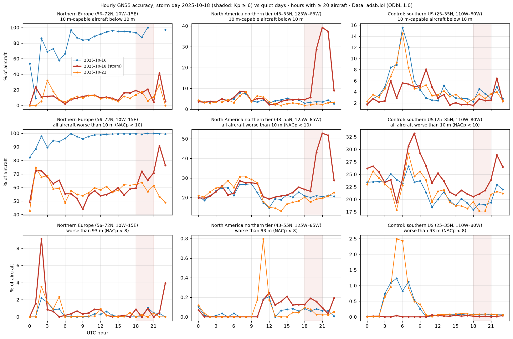
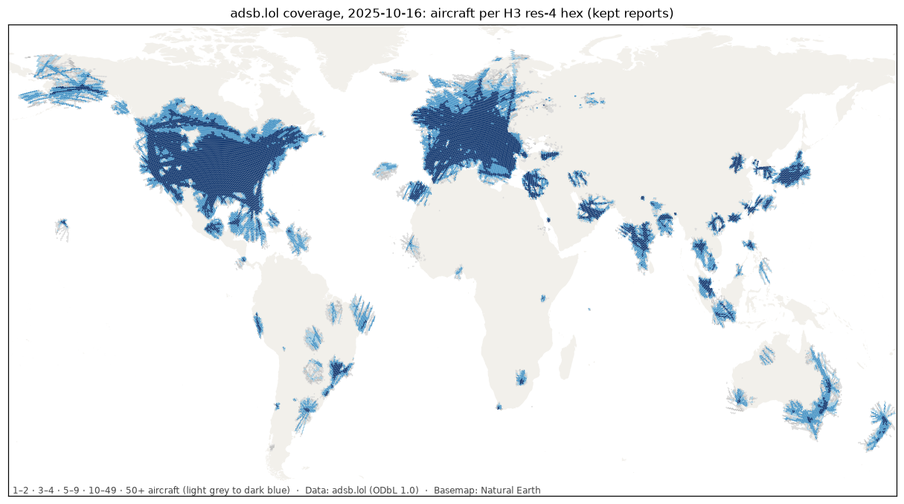

# Phase 1.1 validation: generated results

Generated by `tools/validate_phase1_1.py` for 2025-10-16, 2025-10-18, 2025-10-22. Narrative and verdicts: `phase1.md` (Phase 1.1 section).

## 1. v1 vs v1.1 on the hotspots (share of aircraft with NACp < 8)

| Sub-region | 2025-10-16 v1 → v1.1 | 2025-10-18 v1 → v1.1 | 2025-10-22 v1 → v1.1 |
|---|---|---|---|
| Kaliningrad and approaches | 19.8 → 19.8 | 34.5 → 34.9 | 35.0 → 35.2 |
| Gulf of Finland / Estonia–Russia border | 32.4 → 32.2 | 33.0 → 33.2 | 40.6 → 40.6 |
| Southern Black Sea offshore Turkey | 45.6 → 45.9 | 58.9 → 58.8 | 56.8 → 57.0 |
| Western Black Sea coast | 8.3 → 7.9 | 6.4 → 6.3 | 6.8 → 6.8 |
| Caucasus | 15.7 → 15.5 | 15.4 → 15.3 | 38.6 → 39.1 |
| Cyprus–Levant | 0.7 → 0.7 | 0.5 → 0.5 | 0.7 → 0.7 |
| High latitude excl. Baltic/Russia | 0.3 → 0.3 | 0.1 → 0.1 | 1.4 → 1.1 |

| Day | Suspects v1 | Suspects v1.1 | v1.1 suspects centred in a hotspot sub-region |
|---|---|---|---|
| 2025-10-16 | 93 | 164 | 2 |
| 2025-10-18 | 252 | 421 | 1 |
| 2025-10-22 | 82 | 133 | 0 |

## 2. Storm test: 2025-10-18, Kp ≥ 6 window 18–21Z, against the same hours on the quiet days

Share of aircraft (aircraft-hex-hour weighted) by threshold, mean over the window.

| Region | Threshold | 2025-10-16 | 2025-10-18 | 2025-10-22 |
|---|---|---|---|---|
| Northern Europe (56–72N, 10W–15E) | 10 m-capable aircraft below 10 m | 94.37 | 18.80 | 12.90 |
| Northern Europe (56–72N, 10W–15E) | all aircraft worse than 10 m (NACp < 10) | 99.64 | 65.68 | 61.35 |
| Northern Europe (56–72N, 10W–15E) | worse than 93 m (NACp < 8) | 0.28 | 0.60 | 0.07 |
| North America northern tier (43–55N, 125W–65W) | 10 m-capable aircraft below 10 m | 3.24 | 12.44 | 2.13 |
| North America northern tier (43–55N, 125W–65W) | all aircraft worse than 10 m (NACp < 10) | 20.66 | 29.78 | 19.08 |
| North America northern tier (43–55N, 125W–65W) | worse than 93 m (NACp < 8) | 0.08 | 0.16 | 0.07 |
| Control: southern US (25–35N, 110W–80W) | 10 m-capable aircraft below 10 m | 3.50 | 2.22 | 3.01 |
| Control: southern US (25–35N, 110W–80W) | all aircraft worse than 10 m (NACp < 10) | 18.64 | 21.11 | 18.28 |
| Control: southern US (25–35N, 110W–80W) | worse than 93 m (NACp < 8) | 0.08 | 0.02 | 0.08 |

## 3. Coverage, 2025-10-16

| Aircraft per hex | Hexes | Share |
|---|---|---|
| 1–2 | 3,904 | 14.3% |
| 3–4 | 2,002 | 7.4% |
| 5–9 | 2,936 | 10.8% |
| 10–49 | 7,956 | 29.2% |
| 50–+ | 10,415 | 38.3% |

