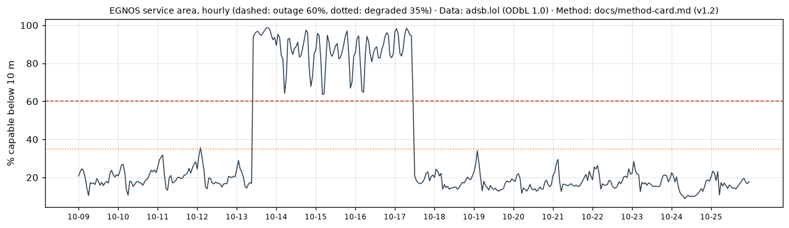
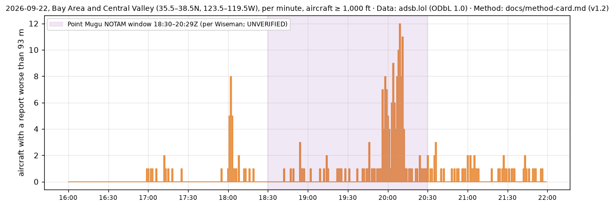

# Phase 1.2 validation: generated results

Generated by `tools/validate_phase1_2.py`. Narrative and verdicts: `phase1.md` (Phase 1.2 section).

## 1. SBAS service flag (area-wide share of 10 m-capable aircraft below 10 m)

Outage ≥ 60%, degraded ≥ 35%, over ≥ 200 capable aircraft-hex-hours in the hour. Kp ≥ 5 labels the hour as storm.

| Day | EGNOS (Europe) | WAAS (CONUS) | WAAS (Canada) | MSAS (Japan) | KASS (Korea) | GAGAN (India) | SouthPAN (Australia/NZ) |
|---|---|---|---|---|---|---|---|
| 2025-10-09 | – | – | – | 1 h: degraded 1 (07–07Z) | – | 12 h: degraded 1, outage 11 (06–17Z) | 2 h: outage 1, degraded 1 (00–19Z) |
| 2025-10-10 | – | – | – | 3 h: outage 2, degraded 1 (03–05Z) | 4 h: degraded 1, outage 3 (03–06Z) | 8 h: outage 6, degraded 2 (06–14Z) | 7 h: outage 2, degraded 5 (00–23Z) |
| 2025-10-11 | – | – | – | 11 h: degraded 3, outage 8 (04–22Z) | 12 h: degraded 1, outage 11 (02–13Z) | 7 h: outage 6, degraded 1 (05–11Z) | 6 h: degraded 4, outage 2 (00–23Z) |
| 2025-10-12 | 1 h: degraded 1 (02–02Z) | – | – | 1 h: degraded storm 1 (15–15Z) | – | 10 h: outage 8, degraded 1, degraded storm 1 (06–15Z) | 8 h: outage 2, degraded 2, degraded storm 3, outage storm 1 (00–23Z) |
| 2025-10-13 | 14 h: outage 14 (10–23Z) | – | – | 5 h: degraded 5 (13–22Z) | – | 10 h: outage 9, degraded 1 (06–15Z) | 7 h: degraded 5, outage 2 (00–23Z) |
| 2025-10-14 | 24 h: outage 24 (00–23Z) | – | – | 1 h: degraded 1 (21–21Z) | – | 2 h: outage 2 (16–17Z) | 2 h: degraded 2 (20–21Z) |
| 2025-10-15 | 24 h: outage 24 (00–23Z) | – | – | – | – | 2 h: outage 2 (16–17Z) | 1 h: degraded 1 (01–01Z) |
| 2025-10-16 | 24 h: outage 24 (00–23Z) | – | – | – | – | 2 h: outage 1, degraded 1 (16–17Z) | 6 h: degraded 5, outage 1 (02–18Z) |
| 2025-10-17 | 12 h: outage 12 (00–11Z) | – | – | 1 h: degraded 1 (16–16Z) | – | 3 h: outage 3 (04–16Z) | 4 h: degraded 4 (03–18Z) |
| 2025-10-18 | – | – | 3 h: degraded storm 1, outage storm 2 (20–22Z) | – | – | – | 4 h: degraded 2, outage 1, degraded storm 1 (04–23Z) |
| 2025-10-19 | – | – | – | – | – | 2 h: outage 2 (16–17Z) | – |
| 2025-10-20 | – | – | – | – | – | 3 h: outage 3 (16–18Z) | 1 h: degraded 1 (11–11Z) |
| 2025-10-21 | – | – | – | 1 h: degraded 1 (16–16Z) | – | 3 h: outage 2, degraded 1 (16–18Z) | 2 h: degraded 2 (04–18Z) |
| 2025-10-22 | – | – | – | 2 h: degraded 2 (04–05Z) | 2 h: degraded 2 (04–05Z) | 2 h: outage 2 (16–17Z) | 1 h: outage 1 (04–04Z) |
| 2025-10-23 | – | – | – | – | – | 1 h: outage 1 (16–16Z) | 1 h: outage 1 (09–09Z) |
| 2025-10-24 | – | – | – | – | – | 2 h: outage 1, degraded 1 (16–17Z) | 4 h: degraded 4 (11–22Z) |
| 2025-10-25 | – | – | – | – | – | 1 h: degraded 1 (16–16Z) | 2 h: outage 1, degraded 1 (09–22Z) |

## 2. Minute bursts: Bay Area, 2026-09-22

Median per minute 16–22Z in the box: 0 aircraft; peak minutes: 18:02Z (8), 20:04Z (9), 20:08Z (10), 20:09Z (12), 20:11Z (11)

Burst events detected by `pnt_analysis.py` near the area (res-2 cells and res-2 neighbourhoods, merged):

| Start | End | Peak aircraft | Centre | Detections | Threshold basis |
|---|---|---|---|---|---|
| 18:00Z | 18:08Z | 13 | 35.44, -118.47 | 9 | within day |
| 19:52Z | 20:12Z | 36 | 35.42, -118.74 | 19 | within day |

## 3. Same-hour baseline anomaly events (H3 res-2 regions, previous 14 days)

Adjacent anomalous region-hours on one measure form an event. Tiers by peak excess over the baseline median: major ≥ 25 points, notable ≥ 10, minor below.

### 2025-10-23: 144 events (major 18, notable 65, minor 61) from 313 region-hours; baseline 2025-10-09 to 2025-10-22

| Tier | Measure | Hours (UTC) | Region-hours | Peak share % | Excess (pts) | Centre | Country |
|---|---|---|---|---|---|---|---|
| major | gross | 04–19 | 62 | 51.3 | +36.8 | 55.56, 17.92 | sea / unknown |
| major | capable_10m | 03–08 | 16 | 54.2 | +49.3 | 34.91, -104.74 | United States of America |
| major | capable_10m | 17–17 | 7 | 42.3 | +40.2 | 17.28, 76.63 | India |
| major | capable_10m | 13–14 | 4 | 45.1 | +29.4 | 54.89, 17.1 | sea / unknown |
| major | capable_10m | 18–19 | 3 | 63.4 | +35.5 | 56.04, 17.07 | sea / unknown |
| major | capable_10m | 10–11 | 3 | 61.5 | +32.0 | 54.69, 16.15 | sea / unknown |
| major | gross | 03–03 | 2 | 53.7 | +27.2 | 55.09, 15.98 | sea / unknown |
| major | capable_10m | 17–17 | 2 | 29.3 | +25.9 | 21.55, -80.38 | sea / unknown |
| major | gross | 02–02 | 1 | 74.6 | +38.8 | 41.26, 41.05 | sea / unknown |
| major | capable_10m | 10–10 | 1 | 48.2 | +36.9 | 32.67, 135.22 | sea / unknown |
| major | capable_10m | 20–20 | 1 | 53.8 | +33.3 | 53.89, 16.49 | Poland |
| major | capable_10m | 21–21 | 1 | 37.5 | +31.9 | 59.76, -158.06 | United States of America |

### 2025-10-24: 137 events (major 9, notable 65, minor 63) from 285 region-hours; baseline 2025-10-10 to 2025-10-23

| Tier | Measure | Hours (UTC) | Region-hours | Peak share % | Excess (pts) | Centre | Country |
|---|---|---|---|---|---|---|---|
| major | capable_10m | 03–06 | 11 | 55.0 | +51.0 | 34.54, -105.74 | United States of America |
| major | capable_10m | 04–07 | 6 | 80.7 | +69.6 | 36.27, 126.59 | South Korea |
| major | capable_10m | 09–09 | 2 | 36.5 | +35.7 | 48.2, -91.12 | Canada |
| major | capable_10m | 00–00 | 2 | 62.4 | +30.2 | 50.27, 7.79 | Germany |
| major | capable_10m | 04–04 | 1 | 81.7 | +46.9 | 37.28, 123.43 | sea / unknown |
| major | capable_10m | 02–02 | 1 | 78.2 | +42.3 | 40.32, 20.59 | Albania |
| major | capable_10m | 06–06 | 1 | 41.1 | +28.5 | 42.73, -70.79 | United States of America |
| major | capable_10m | 18–18 | 1 | 46.6 | +26.9 | 38.34, 17.59 | sea / unknown |
| major | capable_10m | 22–22 | 1 | 38.8 | +25.2 | 51.71, -2.55 | United Kingdom |

### 2025-10-25: 174 events (major 22, notable 90, minor 62) from 291 region-hours; baseline 2025-10-11 to 2025-10-24

| Tier | Measure | Hours (UTC) | Region-hours | Peak share % | Excess (pts) | Centre | Country |
|---|---|---|---|---|---|---|---|
| major | capable_10m | 21–22 | 5 | 75.9 | +69.8 | 20.09, -97.07 | Mexico |
| major | capable_10m | 19–19 | 3 | 93.2 | +58.5 | 19.27, -96.05 | sea / unknown |
| major | gross | 02–05 | 4 | 72.1 | +35.3 | 59.64, 21.98 | sea / unknown |
| major | capable_10m | 17–18 | 5 | 28.7 | +25.6 | 52.84, -4.07 | United Kingdom |
| major | capable_10m | 17–17 | 3 | 40.1 | +31.0 | 45.28, -64.01 | sea / unknown |
| major | capable_10m | 08–09 | 3 | 26.0 | +26.0 | 29.56, -83.43 | sea / unknown |
| major | capable_10m | 04–04 | 3 | 39.2 | +25.2 | 48.45, 2.94 | France |
| major | gross | 02–03 | 2 | 80.0 | +36.8 | 40.58, 39.42 | Turkey |
| major | capable_10m | 12–12 | 2 | 45.5 | +33.0 | 44.88, -8.02 | sea / unknown |
| major | capable_10m | 06–06 | 2 | 39.7 | +28.0 | 49.86, -7.37 | sea / unknown |
| major | gross | 03–03 | 1 | 76.0 | +45.6 | 53.89, 16.49 | Poland |
| major | capable_10m | 03–03 | 1 | 46.0 | +43.6 | 54.28, -116.05 | Canada |

## 4. Minute-burst events by day (largest three)

| Day | Events | Largest (start–end, peak aircraft, centre, country, basis) |
|---|---|---|
| 2025-10-09 | 59 | 01:28Z–05:07Z, 18, 47.81,21.15 (Hungary); 13:02Z–13:04Z, 15, 47.86,22.44 (Hungary); 16:56Z–17:06Z, 14, 35.07,-117.51 (United States of America) · within day |
| 2025-10-10 | 55 | 01:49Z–05:34Z, 27, 48.87,18.46 (Slovakia); 14:25Z–16:17Z, 17, 40.71,-79.17 (United States of America); 16:42Z–17:34Z, 16, 33.76,-109.87 (United States of America) · within day |
| 2025-10-11 | 66 | 15:54Z–15:58Z, 22, 43.27,20.67 (Serbia); 02:12Z–05:30Z, 21, 47.81,17.35 (Hungary); 19:53Z–19:58Z, 17, 43.18,19.88 (Serbia) · within day |
| 2025-10-12 | 53 | 01:37Z–05:21Z, 19, 49.48,17.28 (Czechia); 15:34Z–16:11Z, 14, 40.91,-87.65 (United States of America); 18:58Z–19:12Z, 13, 35.29,-118.11 (United States of America) · within day |
| 2025-10-13 | 54 | 01:27Z–05:53Z, 21, 48.61,19.28 (Slovakia); 01:16Z–01:57Z, 16, 37.63,37.55 (Turkey); 13:38Z–14:31Z, 14, 41.64,39.02 (sea / unknown) · within day |
| 2025-10-14 | 17 | 08:34Z–08:52Z, 14, 46.45,20.35 (Hungary); 14:14Z–14:24Z, 11, 44.21,36.91 (sea / unknown); 08:58Z–09:03Z, 11, 46.21,25.31 (Romania) · prior 5 days, same 15-min slot |
| 2025-10-15 | 11 | 23:08Z–23:10Z, 12, 31.71,-114.87 (Mexico); 02:55Z–02:57Z, 8, 59.46,23.22 (sea / unknown); 19:19Z–19:24Z, 8, 19.69,87.98 (sea / unknown) · prior 6 days, same 15-min slot |
| 2025-10-16 | 45 | 03:12Z–03:14Z, 22, 47.55,19.95 (Hungary); 02:44Z–02:48Z, 18, 43.92,26.99 (Bulgaria); 03:01Z–03:05Z, 17, 35.45,-106.21 (United States of America) · prior 7 days, same 15-min slot |
| 2025-10-17 | 57 | 03:40Z–03:43Z, 25, 35.5,-105.68 (United States of America); 17:01Z–17:26Z, 19, 30.15,-111.12 (Mexico); 17:58Z–18:12Z, 17, 31.53,-111.99 (Mexico) · prior 8 days, same 15-min slot |
| 2025-10-18 | 47 | 18:13Z–18:19Z, 17, 38.02,-118.92 (United States of America); 15:32Z–15:42Z, 17, 43.96,-72.32 (United States of America); 14:22Z–14:55Z, 15, 50.49,8.53 (Germany) · prior 9 days, same 15-min slot |
| 2025-10-19 | 14 | 19:38Z–19:51Z, 14, 37.29,-120.31 (United States of America); 04:16Z–04:18Z, 12, 47.86,22.44 (Hungary); 13:36Z–13:50Z, 12, 49.27,9.6 (Germany) · prior 10 days, same 15-min slot |
| 2025-10-20 | 17 | 09:20Z–09:53Z, 23, 46.33,21.64 (Romania); 13:49Z–14:03Z, 14, 58.03,25.1 (Latvia); 13:28Z–13:31Z, 10, 57.95,19.23 (Sweden) · prior 11 days, same 15-min slot |
| 2025-10-21 | 33 | 04:00Z–05:57Z, 21, 49.01,14.7 (Czechia); 03:45Z–03:48Z, 19, 44.51,25.08 (Romania); 03:54Z–03:58Z, 18, 52.04,13.08 (Germany) · prior 12 days, same 15-min slot |
| 2025-10-22 | 26 | 04:28Z–04:36Z, 21, 46.32,21.56 (Romania); 04:15Z–04:18Z, 18, 46.95,20.78 (Hungary); 05:26Z–05:59Z, 14, 45.93,21.55 (Romania) · prior 13 days, same 15-min slot |
| 2025-10-23 | 30 | 03:45Z–04:21Z, 25, 49.28,14.74 (Czechia); 04:29Z–04:52Z, 19, 50.51,10.63 (Germany); 05:15Z–05:26Z, 17, 51.58,6.13 (Germany) · prior 14 days, same 15-min slot |
| 2025-10-24 | 31 | 04:23Z–04:26Z, 19, 50.27,7.79 (Germany); 17:52Z–18:48Z, 17, 42.72,-71.62 (United States of America); 20:20Z–20:22Z, 17, 36.14,-119.69 (United States of America) · prior 14 days, same 15-min slot |
| 2025-10-25 | 33 | 04:01Z–04:45Z, 19, 44.75,21.5 (Serbia); 04:52Z–05:34Z, 16, 47.35,13.35 (Austria); 14:22Z–14:24Z, 14, 41.66,-86.58 (United States of America) · prior 14 days, same 15-min slot |
