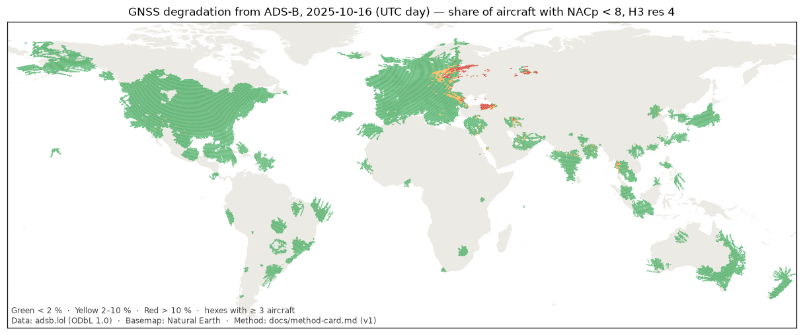
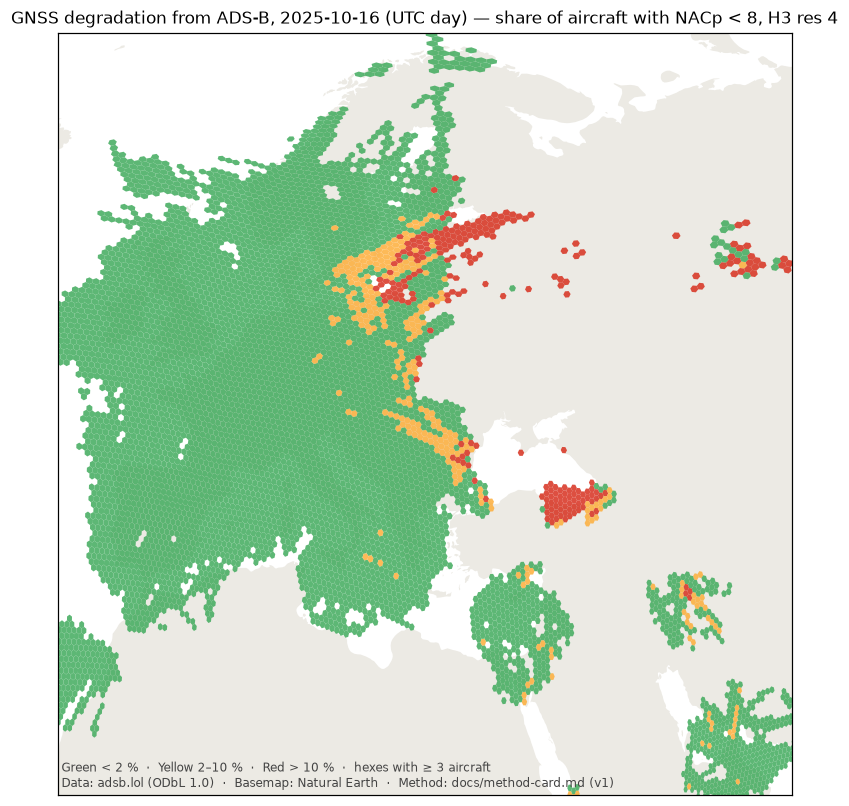
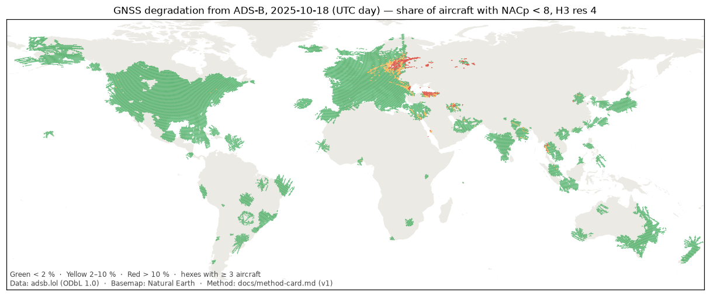
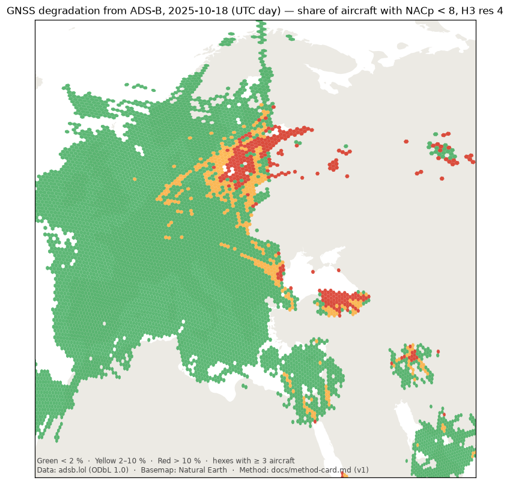
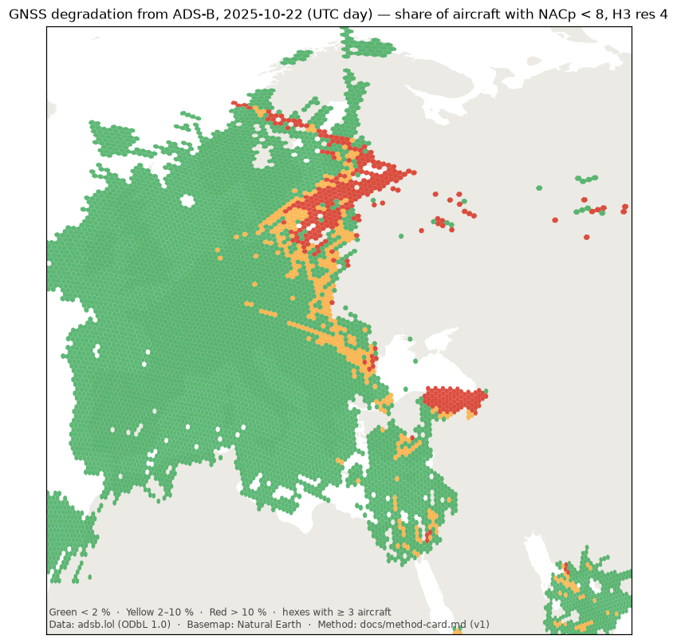

# Phase 1 validation: generated results

Generated by `tools/validate_phase1.py` for 2025-10-16, 2025-10-18, 2025-10-22. Narrative and verdicts: `phase1.md`.

## Runs

| Day | Seconds | Trace files | Aircraft | Avionics suspects | Hexes | Reports used |
|---|---|---|---|---|---|---|
| 2025-10-16 | 70.3 | 77,386 | 55,596 | 93 | 27,220 | 16,442,912 |
| 2025-10-18 | 68.3 | 72,152 | 50,544 | 252 | 27,523 | 14,930,802 |
| 2025-10-22 | 66.5 | 73,154 | 51,627 | 82 | 27,021 | 15,357,400 |

## Regions (aircraft-hex weighted share with NACp < 8; red = hexes with ≥ 10 aircraft and score > 10)

| Region | 2025-10-16 share % (red / hexes ≥10) | 2025-10-18 share % (red / hexes ≥10) | 2025-10-22 share % (red / hexes ≥10) |
|---|---|---|---|
| Baltic | 8.5 (70 / 289) | 12.9 (92 / 257) | 13.3 (105 / 251) |
| Black Sea | 13.3 (51 / 98) | 12.8 (50 / 111) | 15.3 (59 / 108) |
| Eastern Mediterranean | 0.8 (0 / 161) | 0.7 (0 / 160) | 1.3 (0 / 183) |
| Persian Gulf | 0.9 (0 / 146) | 0.9 (0 / 149) | 1.8 (2 / 145) |
| Control: central Europe | 0.7 (0 / 246) | 1.0 (0 / 246) | 0.7 (0 / 246) |
| Control: US Midwest | 0.0 (0 / 626) | 0.0 (0 / 626) | 0.0 (0 / 626) |
| Control: western Norway (high latitude) | 0.4 (0 / 149) | 0.0 (0 / 107) | 1.7 (1 / 143) |

## Sub-regions (same metrics)

| Sub-region (lat, lon box) | 2025-10-16 share % (red / hexes ≥10) | 2025-10-18 share % (red / hexes ≥10) | 2025-10-22 share % (red / hexes ≥10) |
|---|---|---|---|
| Kaliningrad and approaches (54.0–55.6N, 19.0–23.0E) | 19.8 (13 / 21) | 34.5 (11 / 16) | 35.0 (11 / 14) |
| Gulf of Finland / Estonia–Russia border (58.5–60.5N, 24.0–32.0E) | 32.4 (28 / 38) | 33.0 (18 / 26) | 40.6 (27 / 33) |
| Southern Black Sea offshore Turkey (41.3–42.5N, 34.0–41.0E) | 45.6 (20 / 20) | 58.9 (23 / 23) | 56.8 (22 / 22) |
| Western Black Sea coast (42.0–45.5N, 27.0–30.0E) | 8.3 (7 / 26) | 6.4 (7 / 27) | 6.8 (6 / 26) |
| Caucasus (40.0–43.5N, 41.0–49.0E) | 15.7 (8 / 19) | 15.4 (10 / 19) | 38.6 (12 / 13) |
| Cyprus–Levant (32.0–36.0N, 32.0–36.5E) | 0.7 (0 / 74) | 0.5 (0 / 72) | 0.7 (0 / 75) |
| High latitude excl. Baltic/Russia (60.0–72.0N, -30.0–20.0E) | 0.3 (0 / 269) | 0.1 (0 / 233) | 1.4 (1 / 295) |

## Latitude bands (all hexes; both hemispheres)

| |abs lat| band | 2025-10-16 share % | 2025-10-18 share % | 2025-10-22 share % |
|---|---|---|---|
| 0–30° | 0.34 | 0.34 | 0.56 |
| 30–50° | 0.32 | 0.32 | 0.35 |
| 50–60° | 1.14 | 1.56 | 1.29 |
| 60–90° | 0.52 | 0.65 | 1.73 |

## Top 20 hexes, 2025-10-16 (≥ 10 aircraft)

| Score | Aircraft | Bad (NACp) | Bad (NIC) | Lat | Lon | Country | Region |
|---|---|---|---|---|---|---|---|
| 94.12 | 17 | 17 | 17 | 58.98 | 28.76 | Russia | Baltic |
| 93.75 | 16 | 16 | 16 | 59.55 | 31.62 | Russia |  |
| 93.75 | 16 | 16 | 16 | 59.40 | 30.43 | Russia |  |
| 93.75 | 16 | 16 | 16 | 59.36 | 28.62 | Russia | Baltic |
| 93.75 | 16 | 16 | 16 | 59.63 | 29.13 | Russia | Baltic |
| 93.33 | 15 | 15 | 15 | 59.19 | 27.48 | Estonia | Baltic |
| 93.33 | 15 | 15 | 15 | 59.47 | 27.98 | sea / unknown | Baltic |
| 93.33 | 15 | 15 | 15 | 59.02 | 26.37 | Estonia | Baltic |
| 93.33 | 15 | 15 | 15 | 59.29 | 26.84 | Estonia | Baltic |
| 92.86 | 14 | 14 | 14 | 59.67 | 30.97 | Russia |  |
| 92.86 | 14 | 14 | 14 | 59.90 | 29.65 | Russia | Baltic |
| 92.86 | 14 | 14 | 14 | 58.82 | 27.63 | Russia | Baltic |
| 92.31 | 13 | 13 | 13 | 59.09 | 28.12 | Russia | Baltic |
| 92.31 | 13 | 13 | 13 | 59.25 | 29.26 | Russia | Baltic |
| 91.3 | 23 | 22 | 22 | 41.99 | 36.76 | sea / unknown | Black Sea |
| 90.48 | 21 | 20 | 21 | 60.06 | 30.85 | Russia |  |
| 87.5 | 24 | 22 | 23 | 41.95 | 38.68 | sea / unknown | Black Sea |
| 86.96 | 23 | 21 | 22 | 41.97 | 37.72 | sea / unknown | Black Sea |
| 85.71 | 14 | 13 | 13 | 59.52 | 29.78 | Russia | Baltic |
| 82.86 | 35 | 30 | 30 | 41.77 | 37.25 | sea / unknown | Black Sea |

Compare by eye: [GPSJam 2025-10-16](https://gpsjam.org/?lat=45&lon=25&z=3.5&date=2025-10-16)

## Top 20 hexes, 2025-10-18 (≥ 10 aircraft)

| Score | Aircraft | Bad (NACp) | Bad (NIC) | Lat | Lon | Country | Region |
|---|---|---|---|---|---|---|---|
| 97.5 | 40 | 40 | 40 | 41.77 | 37.25 | sea / unknown | Black Sea |
| 97.06 | 34 | 34 | 34 | 41.99 | 36.76 | sea / unknown | Black Sea |
| 96.55 | 29 | 29 | 29 | 41.97 | 37.72 | sea / unknown | Black Sea |
| 96.43 | 28 | 28 | 28 | 41.95 | 38.68 | sea / unknown | Black Sea |
| 95.83 | 24 | 24 | 24 | 42.20 | 36.26 | sea / unknown | Black Sea |
| 94.44 | 18 | 18 | 18 | 59.63 | 29.13 | Russia | Baltic |
| 94.44 | 18 | 18 | 18 | 59.47 | 27.98 | sea / unknown | Baltic |
| 94.44 | 18 | 18 | 18 | 41.78 | 36.28 | sea / unknown | Black Sea |
| 94.12 | 17 | 17 | 17 | 59.94 | 31.51 | Russia |  |
| 94.12 | 17 | 17 | 17 | 59.19 | 27.48 | Estonia | Baltic |
| 94.12 | 17 | 17 | 17 | 59.36 | 28.62 | Russia | Baltic |
| 93.75 | 16 | 16 | 16 | 59.29 | 26.84 | Estonia | Baltic |
| 93.33 | 15 | 15 | 15 | 59.02 | 26.37 | Estonia | Baltic |
| 92.86 | 14 | 14 | 14 | 59.11 | 25.74 | Estonia | Baltic |
| 90.91 | 22 | 21 | 22 | 59.90 | 29.65 | Russia | Baltic |
| 87.5 | 32 | 29 | 30 | 41.56 | 37.74 | sea / unknown | Black Sea |
| 86.96 | 46 | 41 | 42 | 41.76 | 38.21 | sea / unknown | Black Sea |
| 86.67 | 15 | 14 | 13 | 41.57 | 36.78 | sea / unknown | Black Sea |
| 86.36 | 22 | 20 | 22 | 59.79 | 30.31 | Russia |  |
| 85.71 | 21 | 19 | 20 | 60.06 | 30.85 | Russia |  |

Compare by eye: [GPSJam 2025-10-18](https://gpsjam.org/?lat=45&lon=25&z=3.5&date=2025-10-18)

## Top 20 hexes, 2025-10-22 (≥ 10 aircraft)

| Score | Aircraft | Bad (NACp) | Bad (NIC) | Lat | Lon | Country | Region |
|---|---|---|---|---|---|---|---|
| 93.33 | 15 | 15 | 15 | 60.06 | 30.85 | Russia |  |
| 92.86 | 14 | 14 | 14 | 58.98 | 28.76 | Russia | Baltic |
| 92.31 | 13 | 13 | 13 | 59.90 | 29.65 | Russia | Baltic |
| 92.31 | 13 | 13 | 13 | 59.63 | 29.13 | Russia | Baltic |
| 91.67 | 12 | 12 | 12 | 59.47 | 27.98 | sea / unknown | Baltic |
| 90.91 | 11 | 11 | 11 | 59.67 | 30.97 | Russia |  |
| 90.91 | 11 | 11 | 11 | 58.82 | 27.63 | Russia | Baltic |
| 90.91 | 11 | 11 | 11 | 59.19 | 27.48 | Estonia | Baltic |
| 90.91 | 11 | 11 | 11 | 58.54 | 27.15 | Estonia | Baltic |
| 90.91 | 11 | 11 | 11 | 59.25 | 29.26 | Russia | Baltic |
| 90.0 | 10 | 10 | 10 | 59.09 | 28.12 | Russia | Baltic |
| 90.0 | 10 | 10 | 10 | 59.02 | 26.37 | Estonia | Baltic |
| 90.0 | 10 | 10 | 10 | 59.11 | 25.74 | Estonia | Baltic |
| 90.0 | 10 | 10 | 10 | 59.29 | 26.84 | Estonia | Baltic |
| 90.0 | 10 | 10 | 10 | 41.95 | 38.68 | sea / unknown | Black Sea |
| 90.0 | 10 | 10 | 10 | 41.97 | 37.72 | sea / unknown | Black Sea |
| 87.5 | 32 | 29 | 29 | 41.77 | 37.25 | sea / unknown | Black Sea |
| 86.67 | 15 | 14 | 15 | 59.40 | 30.43 | Russia |  |
| 85.71 | 14 | 13 | 14 | 59.55 | 31.62 | Russia |  |
| 85.71 | 14 | 13 | 13 | 58.64 | 26.52 | Estonia | Baltic |

Compare by eye: [GPSJam 2025-10-22](https://gpsjam.org/?lat=45&lon=25&z=3.5&date=2025-10-22)
