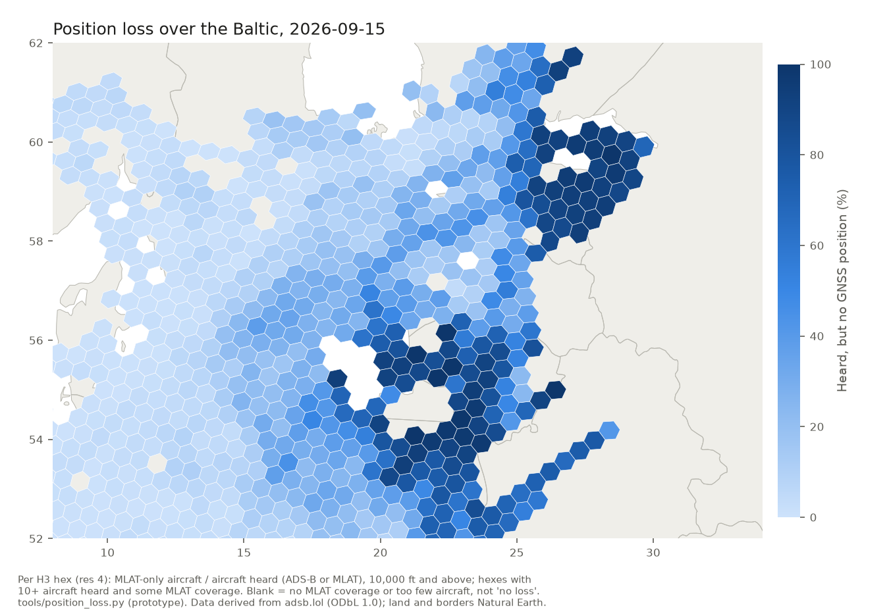

# Position loss: aircraft heard but sending no GNSS position (prototype, 25 Oct 2026)

**Code:** `tools/position_loss.py` (outputs in `data/position_loss/`, aggregates only, ODbL 1.0). **Status:** prototype and a pipeline option (off by
default), not on the map. Written by Claude overnight; not yet reviewed by Tom.

## Why

Every Noise Floor GNSS measure so far counts aircraft that broadcast an ADS-B position. Under strong jamming most
aircraft stop sending a position at all. They drop out of both the numerator and the denominator, and a hex where nearly
everyone lost GNSS can show a modest degraded share from the few that kept a fix. Verdict 45 (`phase1.md`) found exactly
that east of Kaliningrad: 1–3% of crossings had ADS-B positions on summer days in 2026, while the per-hex share read
14–55%.

Where enough ground receivers hear an aircraft, readsb places it by multilateration (MLAT) and marks those positions as
such. An aircraft with MLAT positions in a hex and no ADS-B position there is being heard but is sending no GNSS position.

## Method

Per H3 hex (resolution 4) and UTC hour, aircraft at or above 10,000 ft, ICAO addresses only, from the raw adsb.lol
traces:

- **heard:** aircraft with any ADS-B or MLAT position there;
- **MLAT-only:** aircraft with MLAT positions there and no ADS-B position;
- **position loss** = MLAT-only / heard.

It's a lower bound: an aircraft with neither ADS-B nor MLAT positions can't be placed at all. It depends on MLAT
coverage, so a rise can also mean receivers were added (aircraft that used to be dark become MLAT-only). A background of
aircraft that never send ADS-B positions (older transponders, some state aircraft) shows in the controls: about 1–2%
across central Europe and 4–18% in central Poland.

## Results on eight days with raw traces on disk

Position loss in bold; in brackets, the daily tables' degraded share for the same box and day (aircraft-hexes, live).

| Box | 17 Jan | 1 Feb | 16 May | 20 Jun | 15 Jul | 15 Aug | 15 Sep | 15 Oct |
|---|---|---|---|---|---|---|---|---|
| Gulf of Finland (58.5–60.5N 24–32E) | **30%** (39%) | **20%** (26%) | **46%** (33%) | **36%** (31%) | **43%** (26%) | **65%** (30%) | **63%** (14%) | **64%** (18%) |
| Eastern Gulf of Finland (59.3–60.5N 27–30.5E) | **36%** (91%) | **33%** (87%) | **56%** (98%) | **42%** (93%) | **48%** (78%) | **76%** (86%) | **89%** (87%) | **85%** (87%) |
| Kaliningrad (54.0–55.6N 19–23E) | **13%** (18%) | **18%** (21%) | **50%** (46%) | **84%** (57%) | **79%** (62%) | **86%** (40%) | **86%** (50%) | **82%** (36%) |
| Suwałki–Ełk (53.5–54.35N 21.6–23E) | **26%** (9%) | **39%** (9%) | **66%** (18%) | **93%** (29%) | **95%** (25%) | **91%** (24%) | **90%** (14%) | **94%** (0%) |
| Grodno area (53.5–54.35N 23–24.4E) | **14%** (2%) | **21%** (4%) | **32%** (11%) | **86%** (34%) | **95%** (55%) | **79%** (33%) | **94%** (39%) | **84%** (29%) |
| Kaunas (54.6–55.45N 23.5–24.9E) | **3%** (4%) | **2%** (6%) | **23%** (5%) | **57%** (9%) | **49%** (12%) | **51%** (6%) | **73%** (10%) | **52%** (13%) |
| Central Poland, control (52–52.85N 19.5–20.9E) | **4%** (1%) | **10%** (3%) | **5%** (1%) | **17%** (2%) | **15%** (2%) | **16%** (1%) | **16%** (1%) | **18%** (1%) |
| Central Europe, control (48–52N 5–15E) | **1%** (0%) | **2%** (0%) | **2%** (0%) | **1%** (0%) | **2%** (0%) | **2%** (0%) | **1%** (0%) | **2%** (0%) |

Aircraft heard in the Gulf of Finland box: 17 Jan 1,354, 1 Feb 1,217, 16 May 2,065, 20 Jun 1,756, 15 Jul 1,799, 15 Aug 2,505, 15 Sep 2,343, 15 Oct 2,451.

- **East of Kaliningrad the two measures agree on the season:** position loss rose from 13–39% in Jan–Feb to 79–95% from
  June in the Kaliningrad, Suwałki–Ełk and Grodno boxes, as the crossing test found (verdict 45).
- **The degraded share misses it:** in the Suwałki–Ełk box on 15 Oct, 94% of aircraft heard sent no position and the
  daily tables read 0% degraded, because the few aircraft left with a fix were fine.
- **The controls stay low** (central Europe 1–2%); central Poland's 4–18% is the background of aircraft that never send
  ADS-B positions there, and it rose in summer, which may be traffic mix or a little spill-over.

*15 Sep 2026: share of aircraft heard that sent no GNSS position, per hex. A band of heavy loss runs from the eastern
Gulf of Finland through Estonia, Latvia and Lithuania to the Polish–Belarusian border. Blank hexes have no MLAT
coverage or too few aircraft; they aren't "no loss" (Kaliningrad itself is blank).*

## Does the Gulf of Finland's falling share mean less interference?

**No. It's aircraft dropping out of the count.** The year analysis found the Gulf of Finland box's degraded share
roughly halving from late July 2026 with traffic steady. The crossing test (verdicts 34–35; aircraft at 10,000 ft or
more, region widened to 52–61.5N 8–34E for these days, extracts in `data/trace_box_wide/`) shows aircraft losing their
positions entirely from August, above all in the east:

| Day | Eastern Gulf, seen (59.3–60.4N 26.5–29.5E) | Western Gulf, seen (59.3–60.0N 24.5–26.5E) | Sweden control, seen (58.4–59.2N 14–16E) | Eastern Gulf, ADS-B aircraft-hexes in the daily table |
|---|---|---|---|---|
| 17 Jan | 33% | 41% | 99% | 52 |
| 1 Feb | 25% | 40% | 98% | 34 |
| 16 May | 25% | 34% | 100% | 60 |
| 20 Jun | 37% | 38% | 100% | 73 |
| 15 Jul | 26% | 29% | 96% | 53 |
| 15 Aug | 11% | 20% | 97% | 60 |
| 15 Sep | 6% | 27% | 98% | 12 |
| 15 Oct | 6% | 26% | 97% | 25 |

- The eastern Gulf's few positioned aircraft were nearly all degraded (75–100%) on every day. When most of them stopped
  sending positions in September and October, the box lost its most degraded aircraft-hexes, and the whole Gulf's
  average fell. The western Gulf's degraded share stayed at 5–13% all year.
- Position loss in the Gulf of Finland was already high in winter (59–75% of crossings without positions for most of
  the way); the change from August is in the east.
- Part of the rise in MLAT-only aircraft is MLAT coverage growing: in the western Gulf, dark crossings fell from 11–14%
  (Jan–Feb) to 3–12% while MLAT-only crossings rose from 29–31% to 43–65%. The crossing test's "seen" share isn't
  affected by that, which is why it's the measure used here.

## MLAT coverage changed in late 2025

The measure needs MLAT, and MLAT coverage east of Kaliningrad grew a lot in late 2025 (`mlat_any`, hexes with at least one
MLAT-placed aircraft, from `tools/position_loss.py` on 2025 days on disk):

| Day | Kaliningrad box: hexes with MLAT (of 30) | Suwałki–Ełk box: hexes with MLAT (of 5) | Suwałki–Ełk: aircraft heard, MLAT-only |
|---|---|---|---|
| 20 Jun 2025 | 2 | 0 | 26 heard, 0 MLAT-only |
| 20 Oct 2025 | 4 | 5 | 180 heard, 16 MLAT-only |
| 15 Dec 2025 | 20 | 5 | 206 heard, 54 MLAT-only |
| 17 Jan 2026 | 19 | 5 | 238 heard, 62 MLAT-only |
| 20 Jun 2026 | 27 | 5 | 305 heard, 283 MLAT-only |

On 20 Jun 2025 the crossing test found only 2–5% of crossings with positions in the Suwałki–Ełk box (verdict 45), yet this
measure read 0% there, because no aircraft could be placed by MLAT. **So position loss can't be compared across a change
in MLAT coverage; the crossing test's "seen" share can.** For trends, report MLAT coverage beside the share. The jump in
coverage falls between 20 Oct and 15 Dec 2025, the same window as a wider change in the archives found by the roll-turn
check (`roll-turn.md`, second test), so it may be a change in adsb.lol's processing rather than new receivers (unverified).

## Time of day and other regions

**Summer loss runs around the clock.** Pooled over two winter days (17 Jan, 1 Feb) and four summer–autumn days (15 Jul,
15 Aug, 15 Sep, 15 Oct), share of aircraft heard that sent no position, by six-hour block (UTC):

| Box | Season | 00–05 | 06–11 | 12–17 | 18–23 |
|---|---|---|---|---|---|
| Kaliningrad | Jan–Feb | 29% | 18% | 9% | 18% |
| Kaliningrad | Jul–Oct | 89% | 86% | 86% | 88% |
| Suwałki–Ełk | Jan–Feb | 80% | 22% | 24% | 29% |
| Suwałki–Ełk | Jul–Oct | 100% | 90% | 94% | 97% |
| Eastern Gulf of Finland | Jan–Feb | 15% | 71% | 41% | 2% |
| Eastern Gulf of Finland | Jul–Oct | 52% | 91% | 85% | 63% |

The eastern Gulf's winter blocks rest on 43–187 aircraft heard and swing widely; the summer blocks on 177–1,023.

**Elsewhere (res-2 regions with 300+ aircraft heard and some MLAT coverage).** On 15 Sep and 15 Jul the top regions are
all in the band above: north-east Estonia and the Russian border (62–91%), Lithuania (78–84%), the Kaliningrad coast
(37–59%), north-east Poland (50–52%) and western Belarus (59–62%). Next come south-east Finland near the Russian border
(54% on 15 Sep, 30% on 15 Jul) and Romania near Moldova (16–23%). The seas off Japan (6–13%) and north-east Bulgaria (8%)
are higher than the central-Europe background and unexplained; the Bulgarian region also holds one of the year's
persistent cells (`docs/assessment/year-trends.md`). Large parts of the world have no MLAT coverage, so this list says
nothing about them (the Middle East among them).

## In the daily pipeline (option, off by default; 25 Oct 2026)

`pipeline/pnt_daily.py --position-loss` counts the same thing from the same read of the archive: per hex and hour, aircraft
heard (ADS-B or MLAT position, 10,000 ft and above) and those heard only by MLAT. It writes `<day>.loss.parquet` (hex-hour)
and `<day>.loss_daily.parquet` (hex-day), and a `position_loss` block in the summary (version 0.1). The core tables don't
change. `pipeline/daily_job.py --position-loss` passes it on and uploads the two files with the day's release; the
workflow doesn't set it, so nothing published changes until it's switched on.

**Checked on the eight days used above** (raw archives on disk):

| Day | Per-hex table vs published v1.4 | Hourly table vs published v1.4 | Loss, hex-hour, vs prototype | Loss, hex-day, vs prototype | Run time with the option |
|---|---|---|---|---|---|
| 17 Jan | identical | identical | identical | identical | 134 s |
| 1 Feb | identical | identical | identical | identical | 148 s |
| 16 May | identical | identical | identical | identical | 144 s |
| 20 Jun | identical | identical | identical | identical | 159 s |
| 15 Jul | identical | identical | identical | identical | 177 s |
| 15 Aug | identical | identical | identical | identical | 200 s |
| 15 Sep | identical | identical | identical | identical | 191 s |
| 15 Oct | identical | identical | identical | identical | 193 s |

- The core tables match the published v1.4 tables on every day (all identical),
  on the columns both have (the published year tables predate the `heavy_live` column).
- With and without the option on the same day (2 days), the per-hex, hourly and minute tables are
  identical. Run time: 17 Jan: 113 s without, 134 s with; 15 Sep: 150 s without, 191 s with, so about 20–30% longer
  (not a controlled benchmark: other scheduled jobs shared the machine during some runs).
- The loss tables match `tools/position_loss.py` exactly (all identical),
  so the results above hold for the pipeline version too.
- Tests: `tests/test_pnt_daily.py` (`test_position_loss`): option off leaves the outputs and summary unchanged; option on
  counts ADS-B (any version), MLAT-only, and ignores ground, next-day, non-ICAO and sub-10,000 ft points.

Switching it on in the daily workflow is a deploy-setting change (Tom's call). Putting it on the map needs a layer design
that shows MLAT coverage, so that a blank hex isn't read as clean.

## What follows

1. **The per-hex degraded share can fall while interference spreads.** Wherever position loss is high, the share is
   measured on the few aircraft that keep a fix. Any trend in the share needs the position-loss measure beside it.
2. **A position-loss layer belongs on the map** next to the degraded share, with MLAT coverage shown so a blank isn't
   read as clean. The pipeline option is built (below); switching it on and drawing the layer are the next steps.
3. **Coverage drift has to be controlled for:** track the number of MLAT-capable hexes per day and keep control boxes
   (central Europe, central Poland) in every report.
