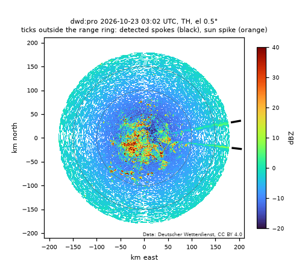
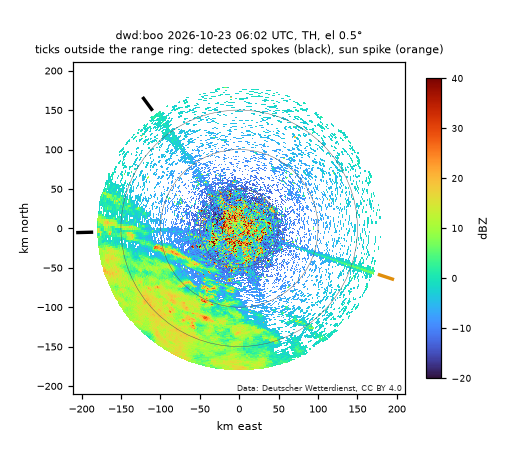
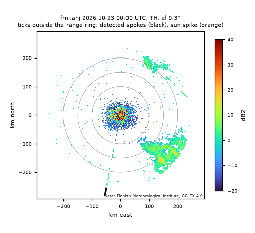
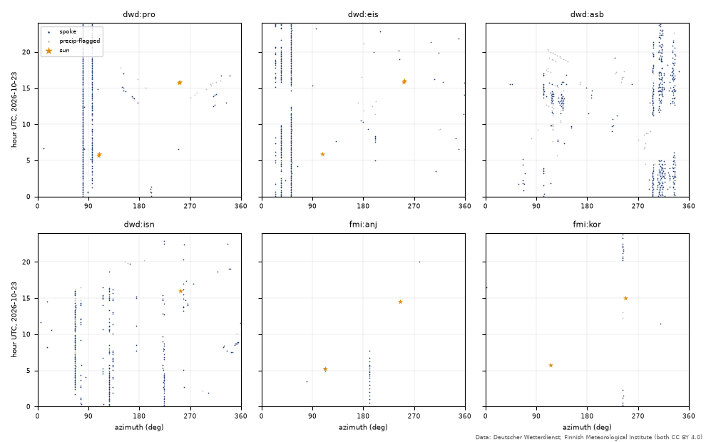
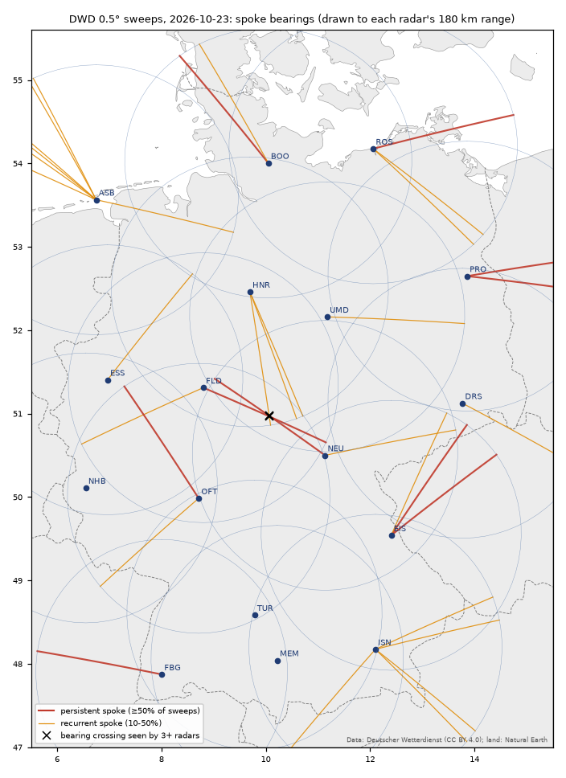
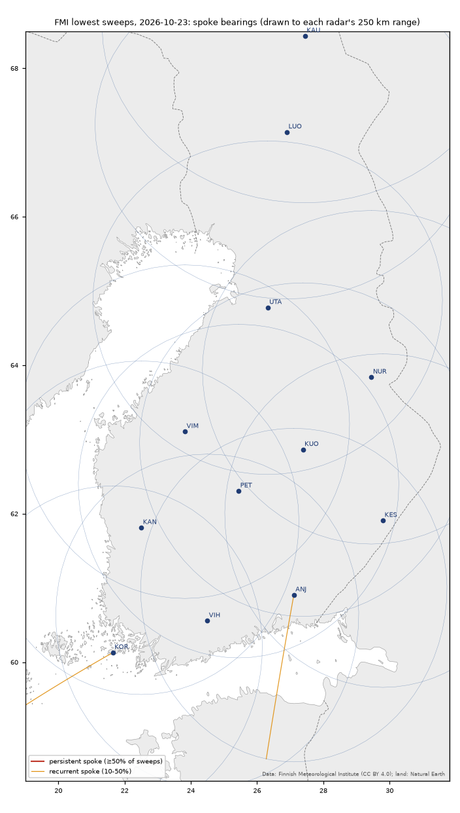

# Weather-radar spokes: first pass (24 Oct 2026)

**Lane:** `weather-radar` (Emitters group, Phase 5). **Code:** `tools/radar_spokes.py` (fetch, detector, aggregation,
figures), `tests/test_radar_spokes.py` (offline synthetic tests). **Data:** DWD single-site sweeps (registry id
`dwd-radar`) and FMI volumes (`fmi-radar`), both CC BY 4.0. Datenbasis: Deutscher Wetterdienst; Finnish Meteorological
Institute. Sample: one UTC day, **23 Oct 2026** (22 Oct 19:00 to 23 Oct 19:00 CDT), 29 radars, 3,593 sweeps.

**This is one day of data. Nothing here locates or identifies a transmitter.** The bearings are good to a fraction of a
degree; distance along each bearing is unknown unless several radars agree, and on this day no multi-radar agreement
rose above chance.

## Bottom line

- **Spokes are everywhere in the German data and rare in the Finnish data.** The detector found 2,822 spokes in
  3,593 sweeps: 57 sun spikes, 303 flagged as possibly rain, and **2,462 others (2,411 DWD, 51 FMI)**. A German radar
  showed a median of 0.8 such spokes per 0.5° sweep (range 0.06 at Neuheilenbach to 2.9 at Borkum). Ten of the twelve
  Finnish radars showed at most 3 all day. The six eastern and northern Finnish radars facing Russia (Kesälahti, Nurmes,
  Kuopio, Utajärvi, Luosto, Kaunispää) showed **no recurring spoke** on this day.
- **They behave like interference, not weather.** Their reflectivity rises with range at a median of 20.1 dB per decade
  (DWD; FMI 23.1), as constant received power must (20 dB/decade). Most are one ray wide (56% DWD, 88% FMI) and weak:
  median 6.9 dB above the sweep's noise floor (DWD) and roughly −112 dBm received.
- **The azimuths are right.** The sun is a known emitter: in 54 sweeps with the sun inside the main beam, the detector
  found it 43 times, with a mean azimuth error of 0.00° and a standard deviation of 0.23° (largest 0.52°). Eight of the
  eleven misses were in rain.
- **101 sources** (spokes repeating at one azimuth): 10 persistent (in at least half the sweeps; Prötzel 80° was in 95%),
  27 recurrent, 64 occasional. Most are what the literature says interference usually is: steady, narrow, weak and seen
  by one radar only, which fits fixed outdoor RLAN (5 GHz Wi-Fi) links. That is a pattern, not an identification.
- **Crossings:** 20 crossings between persistent or recurrent bearings from radar pairs, 2 supported by a third radar
  (one triple). Rotating every radar's bearings at random gives 2.7 such triples on average (p = 0.50): **the triple is
  consistent with chance**, so no emitter is located.
- **Precision:** in a random sample of 36 detections (not sun, not rain-flagged), 31 were clear spokes on visual review,
  4 ambiguous and 1 a rain band. The rain flag works: 18 of 24 flagged detections were rain.
- Some spokes are **night-only** (Anjalankoski 191°: 00–07 UTC; Korppoo (Korpo) 243°: 00–02 and 20–23 UTC; Flechtdorf 246°:
  00–04 UTC). Nocturnal ducting would do that; so would an emitter's own schedule. Untested.
- Nothing in this day's data points to military emitters or jamming. The method can see strong or wide C-band
  emitters (none showed up), but it cannot tell an RLAN from another kind of emitter by itself.

## 1. Why weather radars see emitters

European C-band weather radars receive in 5600–5650 MHz, a band shared with 5 GHz RLAN, which must detect radars and
move away. Interference from RLAN was first reported by the Hungarian and Polish services in 2005 and has since been
seen in at least 12 European countries (OPERA 2008, via search summary). Saltikoff et al. (2016) review the problem
worldwide; Schaper et al. (2022) report that Wi-Fi devices are the most common source in Germany.

Any transmitter in the band adds power at every range gate while the antenna points at it, because the radar maps
receive time to range. The processor converts power to reflectivity with the radar equation, dBZ = P + C + 20·log10(r),
so a transmitter of constant power appears as a radial **spoke** whose dBZ rises by 20 dB per decade of range, also in
clear air. The sun does the same at sunrise and sunset; weather services use those sun spikes to check antenna pointing
(Huuskonen and Holleman 2007). Here they check the detector.

Operational detectors exist. DWD flags disturbed rays from the signal quality index (SQI below 0.6) and the normalised
power variance (STD above 0.6) on four low scans every 5 minutes, and has done since July 2017; it found 11,889 sources
from July 2017 to May 2022, 61.6% of them lasting less than a day (Schaper et al. 2022). SQI and STD are not in the open
data, so this lane works from reflectivity alone. Poland's RADVOL-QC detects spikes from low variance along the beam
and high variance across it, in five variants (Ośródka and Szturc 2022; Specht et al. 2025). FMI's Rack software
(M. Peura, MIT licence) has an emitter detector based on "subtracting horizontal window medians by vertical
ones" (`EmitterOp.h`), and FMI ships its output in the open volumes as the `EMITTER.LINE` quality class.

## 2. Data

| | DWD (Germany) | FMI (Finland) |
|---|---|---|
| Radars | 17: ASB, BOO, DRS, EIS, ESS, FBG, FLD, HNR, ISN, MEM, NEU, NHB, OFT, PRO, ROS, TUR, UMD | 12: ANJ, KAN, KAU, KES, KOR, KUO, LUO, NUR, PET, UTA, VIH, VIM |
| Source | opendata.dwd.de `weather/radar/sites/sweep_vol_z/<site>/unfiltered/` | AWS bucket `fmi-opendata-radar-volume-hdf5` (public, no account) |
| Field | TH: uncorrected, unfiltered reflectivity | TH (plus DBZH and FMI's quality class, for comparison) |
| Sweep | 0.5° (volume index 05), 1° × 250 m, 180 km | lowest sweep: 0.3° (KOR 0.5°, LUO 0.1°), 1° × 500 m, 250 km |
| Cadence used | every 10 min (data every 5 min) | every 15 min (data every 5 min) |
| Sweeps, 23 Oct 2026 | 2,447 (NHB 143) | 1,146 (KAN 90) |
| Volume | 1.17 GB stored (whole files, 0.3–0.5 MB each) | 0.62 GB transferred, 0.17 GB stored |
| Retention | about 48 hours, so it must be collected daily | bucket has year folders back to 2007 |

FMI volumes are 15–20 MB, so the tool reads only the first sweep's datasets by HTTP range requests (about 9 requests and
0.5 MB per file). Dataset 1 was the lowest sweep in every file checked (36 files, all 12 radars). All downloads were
sequential, with a User-Agent naming the project. Total transfer about 1.9 GB, including 61 MB of 5-minute DWD files
set aside to keep the cadence uniform.

The day was showery in Germany: 43% of DWD sweeps had at least 10% of the 40–150 km gates at 15 dBZ or more, outside
static clutter (FMI 13%).

## 3. Method

The detector runs per sweep on TH. Rule version `radar-spokes-0.1 (2026-10-24)`; parameters are `PARAMS` in the tool.

| Step | Rule |
|---|---|
| Range normalisation | zc = Z − 20·log10(r) over 40–250 km. zc is received power plus a constant, so it is flat along an interfered ray. Inside 40 km ground clutter dominates. |
| Level | Per ray, the median zc of gates with echo (at least 15 gates). Coverage = share of window gates within ±3 dB of that level. |
| Contrast | Coverage ≥ 0.30, and at least 0.25 above the median coverage of the neighbouring rays (2 to 8 rays away on both sides) at the same level. |
| Along range | The level must hold (15% of gates) in at least 3 of 4 range segments. |
| Background-subtracted check | Ray power minus the gate-wise median power of those neighbours must also hold a constant level. This suppresses precipitation texture. |
| Blanked sectors | Rays within 3 rays of a sector that was not scanned are dropped (they pass the contrast test trivially). |
| Spoke | Adjacent candidate rays form one spoke. Azimuth is the contrast-weighted mean. |
| Sun flag | Within 2.5° of the sun's azimuth, with the sun's apparent elevation within 2° of the beam (Meeus position from `tools/sun_transit.py`, optical refraction). |
| Rain flag | More than 10% of the neighbour gates at the spoke's own ranges at 15 dBZ or more. Static clutter (gates at 15 dBZ in 75% of 24 sweeps sampled over the day) does not count. Flagged spokes stay in `spokes.csv` but are left out of the sources. |

Each spoke carries its level as dBZ at 100 km, an approximate received power (level minus the file's `radconstH`),
the excess over the sweep's noise floor (2nd percentile of zc beyond 60 km, excluding candidate rays) and the slope of Z
against log10 r.

**Aggregation.** Per radar, the non-sun, non-rain spokes are clustered by azimuth (±1.5°) into sources: persistent if
seen in at least 50% of that radar's sweeps, recurrent 10–50%, occasional 3 sweeps up to 10%. Strength classes use the
median excess: weak under 6 dB, moderate 6–15 dB, strong above. Bearings of persistent and recurrent sources from radar
pairs within 500 km are intersected (forward, within 300 km of both, crossing angle at least 15°). A third radar supports
a crossing when one of its sources points within 1.5° of it. As a **null test**, every radar's bearings are rotated by
an independent random angle and the 3+ radar crossings are counted again (300 trials).

**Long exposure.** As a second view, echo occurrence is stacked per gate over the day for each radar; rays whose
occurrence stays at least 5 percentage points above their neighbours' median along the range are listed (`stack.csv`).

## 4. Results

### Examples



Prötzel (PRO), 03:02 UTC, dry. The two spokes at 80° and 97° were present in 95% and 72% of the day's sweeps.



Boostedt (BOO), 06:02 UTC, with rain to the southwest: the sun spike at 108° (orange tick; computed sun azimuth 108.5°,
elevation −0.2° apparent), the persistent spoke at 323° and a single spoke at 268°.



Anjalankoski (ANJ), 00:00 UTC. A dotted spoke at 191° from 50 to 250 km, about at the noise level (received about
−113 dBm). It runs across the Gulf of Finland towards Estonia; where along it the emitter sits is unknown.



Every detection by azimuth and time. Vertical lines are steady sources. Orange stars are sun spikes, grey dots
rain-flagged detections.

### Per radar

| Radar | Spokes (not sun, not rain) per sweep | Sources: persistent / recurrent / occasional |
|---|---|---|
| ASB Borkum | 2.87 | 0 / 7 / 17 |
| PRO Prötzel | 1.88 | 2 / 0 / 3 |
| EIS Eisberg | 1.84 | 2 / 1 / 2 |
| ISN Isen | 1.83 | 0 / 5 / 4 |
| NEU Neuhaus | 1.11 | 1 / 1 / 6 |
| ROS Rostock | 1.07 | 1 / 2 / 3 |
| FLD Flechtdorf | 1.01 | 1 / 1 / 2 |
| OFT Offenthal | 1.01 | 1 / 1 / 1 |
| DRS Dresden | 0.79 | 0 / 1 / 5 |
| HNR Hannover | 0.75 | 0 / 3 / 4 |
| FBG Feldberg | 0.74 | 1 / 0 / 3 |
| BOO Boostedt | 0.71 | 1 / 1 / 1 |
| UMD Ummendorf | 0.57 | 0 / 1 / 7 |
| ESS Essen | 0.31 | 0 / 1 / 3 |
| MEM Memmingen | 0.11 | 0 / 0 / 1 |
| TUR Türkheim | 0.10 | 0 / 0 / 1 |
| NHB Neuheilenbach | 0.06 | 0 / 0 / 1 |
| ANJ Anjalankoski | 0.24 | 0 / 1 / 0 |
| KOR Korppoo | 0.19 | 0 / 1 / 0 |
| other 10 FMI radars | 0.00–0.03 | none |

The difference between the networks is large, but this day cannot say why. Candidates are fewer emitters, differences
in signal processing (FMI's thresholding leaves almost no clear-air speckle in TH) and the lower FMI sensitivity: the
noise floor found from the data is −111 to −115 dBm at FMI (Petäjävesi −109) against −117 to −120 dBm at DWD.

### Persistent sources (in at least 50% of sweeps)

| Radar | Azimuth | Share of sweeps | Hours seen | Median received power | Median excess | Width (rays) |
|---|---|---|---|---|---|---|
| PRO | 80.1° | 95% | 24 | −110 dBm | 9.8 dB | 2 |
| EIS | 52.5° | 87% | 23 | −114 dBm | 4.1 dB | 3 |
| PRO | 96.5° | 72% | 23 | −110 dBm | 9.9 dB | 1 |
| OFT | 326.6° | 67% | 22 | −109 dBm | 9.2 dB | 1 |
| NEU | 305.4° | 65% | 21 | −108 dBm | 10.8 dB | 1 |
| FLD | 113.0° | 64% | 21 | −113 dBm | 5.9 dB | 2 |
| ROS | 74.4° | 62% | 18 | −116 dBm | 3.3 dB | 2 |
| EIS | 34.5° | 57% | 18 | −115 dBm | 2.8 dB | 1 |
| FBG | 280.8° | 56% | 20 | −108 dBm | 10.0 dB | 2 |
| BOO | 323.3° | 50% | 14 | −115 dBm | 3.8 dB | 3 |

The strongest recurring source was **ISN 66.4°** (48% of sweeps, 01–16 UTC): median 15.6 dB above the noise floor,
up to 31 dB (about −87 dBm received), three rays wide. Strong, wide sources are the ones worth a closer look; this one
is still seen by one radar only. All sources are in `data/radar/out/2026-10-23/sources.csv` (not published).

### Maps and crossings





The 20 pair crossings are all in Germany. The one triple (FLD 113.0°, HNR 171.1°, NEU 305.4°) crosses at about
50.97° N, 10.07° E, near the Hesse–Thuringia border, with OFT and UMD in range and seeing nothing at that bearing. The
null test gives 2.7 triples by chance (95th percentile 10, p = 0.50). **It is not evidence of a common emitter.**

### Long exposure

The stacked echo occurrence gives 49 spokes. 36 match a per-sweep source, including 9 of the 10 persistent ones (OFT
326.6° is missed because echo occurs at nearly every gate there all day, so occurrence saturates). It also shows the
Anjalankoski 191° spoke as a clean line all night, although single sweeps passed the test in only 20% of cases. Its
13 extra spokes (for example EIS 96.9° and 131.4°, DRS 49.9°, NEU 173.0°) look like weak lines in the stacked image.
They are candidates only.

## 5. Validation

**Sun.** Of the 54 sweeps with the sun's apparent elevation within 0.6° of the beam, 43 had a sun-flagged spoke
(DWD 21 of 31, FMI 22 of 23). Azimuth error: mean 0.00°, standard deviation 0.23°, largest 0.52°. Eight of the ten DWD
misses were sweeps with at least 10% rain; the other two had the sun at the horizon (−0.09° and −0.03°), where the
refraction model matters most. The sun spikes also give a scale check: median received sun power −107.4 dBm (DWD) and
−108.8 dBm (FMI), within 1.4 dB of each other on different radars. An exact check needs receiver bandwidths and antenna
gains and was not done.

**The 20·log r signature.** The slope of Z against log10 r on detected spokes is 20.1 dB/decade at the median for DWD
(interquartile 17.6–22.4) and 23.1 for FMI (21.7–24.0). The FMI value would fit a 0.016 dB/km gas-attenuation
correction (the value in FMI's file metadata) being applied to TH. That is unverified.

**Received-power scale.** The noise floor estimated from the data, converted with `radconstH`, matches FMI's stated
noise level (`NEZH` minus `radconstH`) within 1.3 dB on all 12 FMI radars. Powers here are approximate: the conversion
assumes the ODIM convention dBZ = P(dBm) + C + 20·log10(r/km), and receiver losses are not removed.

**Visual review** (one reviewer, not blind; azimuth-range images ±20 rays around each detection):

| Sample | Clear spoke | Ambiguous | False |
|---|---|---|---|
| 36 random detections, not sun, not rain-flagged | 31 | 4 (faint, partly in rain) | 1 (rain band) |
| 24 random rain-flagged detections | 4 | 2 | 18 (rain bands, rain edges) |

So the rain flag removes mostly false detections. The price is that real spokes passing through rain are lost: the
detector is reliable in clear air only. An earlier version flagged 200 of Isen's 281 detections because of ground
clutter from the Alpine foreland. The static-clutter mask fixed that (17 flagged).

**FMI's own emitter flags.** Rack's `EMITTER.LINE` class (on DBZH, at least 10 flagged gates per ray beyond 40 km)
marks 7,438 rays in the 1,146 FMI sweeps (2,921 in sweeps with less than 2% rain). 56 of this detector's 103 FMI spoke
rays (54%) have a Rack flag within one ray; only 1% of Rack's rays coincide with this detector's. Viewed as images,
most Rack flags are short line-like segments inside echo areas, a different target. Over the day, Rack's most
persistent azimuths include Anjalankoski 191° (flagged in 59% of sweeps within ±1°), but also Korppoo 359° (85%) and
Kuopio 160° (69%), where the stacked TH occurrence shows no spoke. Those two are unexplained. The Anjalankoski spoke is
plain in stacked TH but absent from stacked DBZH, so FMI's DBZH processing appears to remove it. TH is therefore the
field to use (one case).

**DWD's published statistics.** Schaper et al. (2022) give a network average of 52 disturbed rays per day, per
elevation, per site (0.051% of rays) for 2017–2022. This detector finds far more (about 0.8 spokes per 10-minute sweep
per site, mostly 1–2 rays). The criteria differ: this detector keeps weak sources a few dB above noise, and DWD's
SQI/STD test is aimed at sources that degrade products. The numbers cannot be compared directly. The picture agrees in
kind: most sources are weak and narrow, and a few are steady all day. Schaper et al. name Isen as having had two
persistent sources; Isen had five recurrent sources on 23 Oct 2026, but there is no way to match them across four years.

## 6. What can and can't be inferred

- **Can:** that a radar received in-band energy from a given bearing (±0.25°) at a given time; its approximate power at
  the radar; whether it repeats, and when. Several steady, narrow, weak sources per German radar, each seen by one radar,
  match the published picture of fixed outdoor RLAN links.
- **Can't, from one radar:** distance, EIRP or emitter type. A spoke at 191° from Anjalankoski could come from 5 km or
  from beyond the Gulf of Finland. Received power depends on distance, antenna pattern and pointing, and propagation.
  TH alone cannot tell Wi-Fi from another radar or any other C-band emitter. DWD's SQI/STD, or spectral data, would help.
- **Location** needs bearings from two or more radars that agree in time, and that agreement has to beat chance. On this
  day nothing did.
- **No attribution.** Nothing here supports a claim of military activity or jamming. A strong, wide, multi-radar or
  short-lived spoke would be the pattern to examine, and the lane can now flag one, but on this day the strongest such
  pattern (ISN 66.4°) is one radar's view only.

## 7. Limits

- One day, 10- and 15-minute sampling, the lowest sweep only. Short-lived emitters are undersampled, especially at FMI.
- Clear air only: real spokes in rain are lost or flagged. Weak dotted spokes are under-detected per sweep (Anjalankoski
  191°: 20% of sweeps, against all night in the stacked image).
- Parameters were tuned by eye on this day's data, then checked on fresh random samples. They are not tuned on an
  independent day.
- The visual review was small and done by one reviewer, not blind.
- The received-power conversion is approximate (see section 5).
- The "near towns" test for RLAN was not done: one radar cannot place an emitter along its bearing, and the local
  Natural Earth places file is too coarse.
- DWD keeps sweeps for about 48 hours, so any history must be collected as it happens.

## 8. Next steps

1. Collect DWD daily (the 0.5° sweep at 10 minutes is about 1.2 GB a day; the 1.5° sweep would help separate
   ground emitters) and backfill FMI case days from its archive (year folders back to 2007).
2. Use FMI's `SQIH` (in every PVOL) to reproduce DWD's SQI test, and DWD's RHOHV sweeps, to separate interference
   from weather without the rain flag.
3. Run several days, keep only sources that recur, and repeat the crossings with the null test. Add neighbouring
   networks through EUMETNET OPERA once the registry entry (`eumetnet-opera`, ingest-after-ok) is cleared.
4. Test the night-only spokes against soundings (ducting) over several days.
5. Ask FMI what Rack flags at Korppoo 359° and Kuopio 160°.

## 9. Running it

From the repository root, with the project venv (`h5py`, `numpy`, `requests`, `matplotlib`, `shapely`; no new packages):

```powershell
# DWD keeps about 48 h: fetch a full UTC day within two days (17 radars, 10-min cadence, ~1.2 GB, 25-40 min here)
.\.venv\Scripts\python.exe tools\radar_spokes.py fetch --day 2026-10-23 --source dwd --step-dwd 10
# FMI lowest sweeps by range request (12 radars, 15-min cadence, ~0.6 GB transferred, about 40 min here)
.\.venv\Scripts\python.exe tools\radar_spokes.py fetch --day 2026-10-23 --source fmi --step-fmi 15
.\.venv\Scripts\python.exe tools\radar_spokes.py detect --day 2026-10-23       # ~15 min, writes data/radar/out/<day>/
.\.venv\Scripts\python.exe tools\radar_spokes.py aggregate --day 2026-10-23    # sources, sun check, crossings, null test
.\.venv\Scripts\python.exe tools\radar_spokes.py stack --day 2026-10-23        # long-exposure check
.\.venv\Scripts\python.exe tools\radar_spokes.py plot --day 2026-10-23 --maps --timeaz dwd:pro,dwd:eis,dwd:asb,dwd:isn,fmi:anj,fmi:kor
.\.venv\Scripts\python.exe tests\test_radar_spokes.py
```

The maps need the Natural Earth files in `data/natural_earth/` (already used by other lanes).

## Sources

Retrieved 23–24 Oct 2026 unless noted.

- DWD open data, radar single sites: https://opendata.dwd.de/weather/radar/sites/ (directory listings and files read
  23–24 Oct 2026). Licence CC BY 4.0 per the registry entry `dwd-radar` (DWD legal notice, checked 22 Oct 2026).
- FMI radar volumes on AWS: https://fmi-opendata-radar-volume-hdf5.s3.amazonaws.com/ (bucket listing and files read
  23–24 Oct 2026). Licence CC BY 4.0 per the registry entry `fmi-radar`.
- Schaper, M., Frech, M., Michaelis, D., Hald, C. and Rohrdantz, B. (2022): Radio frequency interference detection and
  mitigation in the DWD C-band weather radar network. *Atmos. Meas. Tech.* 15, 6625–6642.
  https://doi.org/10.5194/amt-15-6625-2022
- Saltikoff, E., Cho, J. Y. N., Tristant, P., Huuskonen, A., Allmon, L., Cook, R., Becker, E. and Joe, P. (2016): The
  threat to weather radars by wireless technology. *Bull. Amer. Meteor. Soc.* 97(7), 1159–1167.
  https://doi.org/10.1175/BAMS-D-15-00048.1 (abstract and record only; full text not read)
- Huuskonen, A. and Holleman, I. (2007): Determining weather radar antenna pointing using signals detected from the
  sun at low antenna elevations. *J. Atmos. Oceanic Technol.* 24, 476–483. https://doi.org/10.1175/JTECH1978.1
  (abstract only)
- Ośródka, K. and Szturc, J. (2022): Improvement in algorithms for quality control of weather radar data (RADVOL-QC
  system). *Atmos. Meas. Tech.* 15, 261–277. https://doi.org/10.5194/amt-15-261-2022
- Specht, K., Ośródka, K., Szturc, J. and Freda, W. (2025): Removal of interfering RLAN signals from C-band weather
  radar data. EGU General Assembly 2025, EGU25-10165 (abstract). https://meetingorganizer.copernicus.org/EGU25/EGU25-10165.html
- Peura, M. (2002): Computer vision methods for anomaly removal. Proc. ERAD 2002, 312–317.
  https://www.copernicus.org/erad/online/erad-312.pdf (bibliographic details from a search result; the PDF link returned
  404 on 24 Oct 2026)
- FMI Rack, `src/andre/EmitterOp.h` (MIT licence, header read 24 Oct 2026): https://github.com/fmidev/rack
- OPERA (2008): Recommendation on C-band meteorological radars design to ensure global and long-term coexistence with
  5 GHz RLAN. https://www.eumetnet.eu/wp-content/uploads/2017/01/OPERA_2008_12_Recommendation_RLAN.pdf (content taken
  from a search summary; not opened)
- Natural Earth (public domain): land, borders and populated places for the maps.
